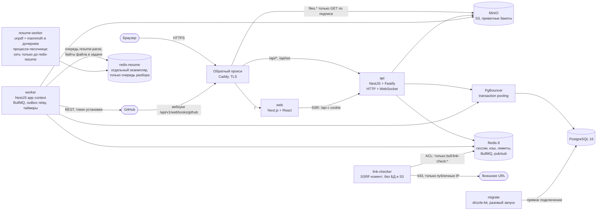
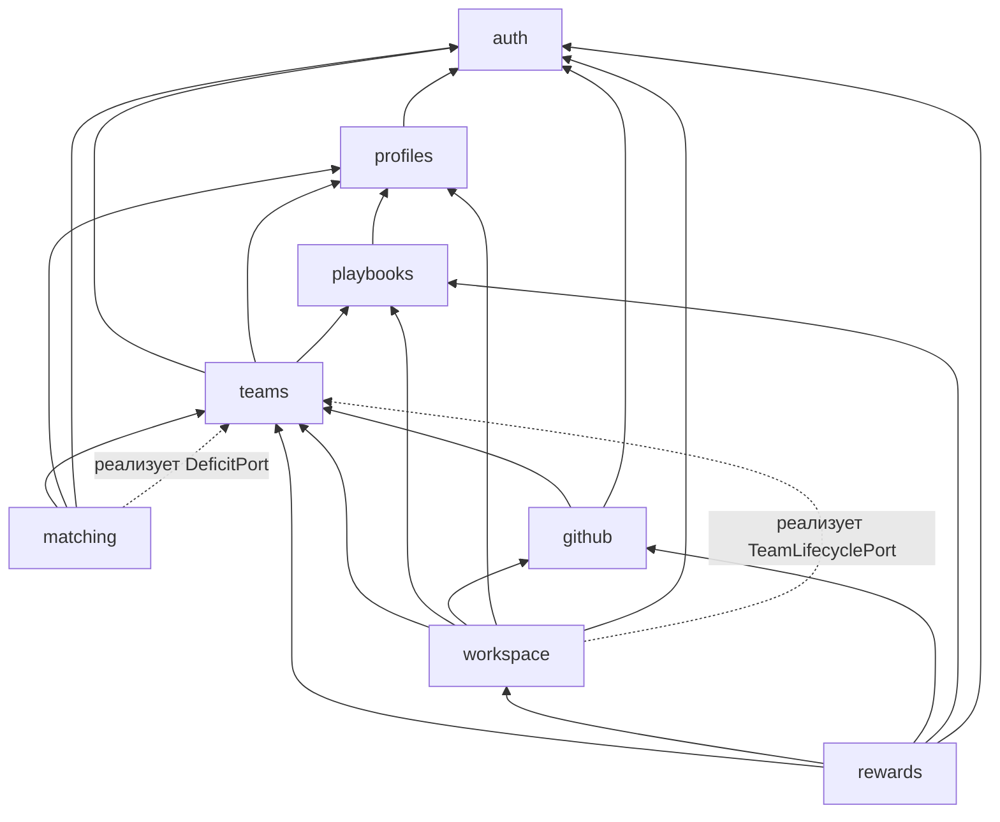
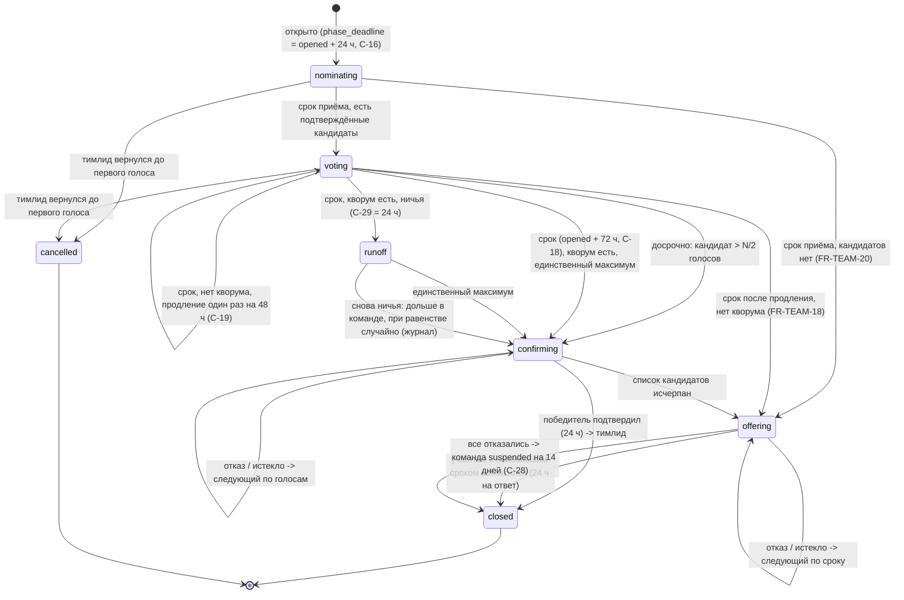
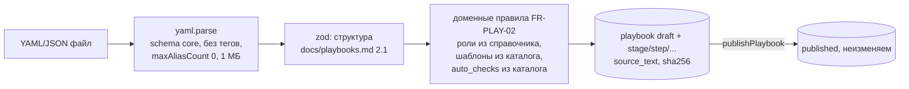

# Teamforge: архитектура и контракты

Версия: 1.1 (фаза 3, исправления по аудиту безопасности `docs/security-review-phase3.md` и ревью архитектуры). Дата: 2026-10-12. Источники: `docs/orchestrator.md`, `docs/decisions.md`, `docs/status.md`, `docs/spec.md` (главный), `docs/research/components.md`, `docs/playbooks.md` (раздел 2). Контракт API: `docs/api/openapi.yaml` (OpenAPI 3.1, 114 операций). Решения: `docs/adr/`. Спецификацию этот документ не меняет, кроме двух согласованных правок фазы 3 (FR-PROF-08 по SEC-04 и FR-TEAM-28..30 по Р-5, помечены в `docs/spec.md`); остальные противоречия собраны в разделе 16.

После фазы 3 контракт API и этот документ меняются только через оркестратора (spec 1.7, оркестратор, фаза 3).

Содержание:

1. Обзор и процессы
2. Модули и границы
3. Модули: ответственность, таблицы, публичные интерфейсы, события
4. Внутренняя шина событий и outbox
5. Схема базы данных
6. Подбор и очередь поиска
7. Интеграция с GitHub
8. Голосование за тимлида
9. События реального времени
10. Зачёт и награды
11. Маршрут как данные и переход этапа
12. Конкурентный доступ: сценарий -> механизм защиты
13. Сквозные вопросы
14. Контракт API и генерация типов
15. Трассировка FR -> эндпоинт / модуль
16. Расхождения со спецификацией
17. Открытые вопросы и риски
18. Реестр ADR

---

## 1. Обзор и процессы

Teamforge - модульный монолит на NestJS (Fastify) с одной базой PostgreSQL, Redis для сессий, кэша, очередей и pub/sub, S3-совместимым хранилищем (MinIO) и Next.js-фронтендом. Всё работает на одном VPS в РФ под Docker Compose (decisions.md, 3). API не хранит состояние в памяти процесса: любой экземпляр обслуживает любой запрос (spec 5.5).



Сети Docker Compose: `edge` (Caddy, web, api), `internal` (api, worker, PgBouncer, PostgreSQL, Redis, MinIO; `internal: true`), `resume-net` (worker, redis-resume, resume-worker; `internal: true`, без выхода в интернет), `checker-net` (link-checker, Redis основной - только через ACL-пользователя), `egress` (worker и link-checker: исходящий интернет). Порты на хост публикует только Caddy (80, 443); у остальных сервисов нет `ports:` (Docker публикует порты в обход ufw, поэтому правило проверяется скриптом в CI по `docker compose config`). resume-worker не видит ни PostgreSQL, ни основной Redis, ни MinIO (SEC-01).

| Процесс | Что делает | Масштабирование |
|---|---|---|
| `web` | Next.js (App Router): страницы, SSR, i18n-словари; ходит в API через `/api` с пробросом cookie | без состояния, N экземпляров |
| `api` | HTTP API `/api/v1/*`, маршруты Better Auth `/api/auth/*`, WebSocket `/api/ws`, приём вебхуков; только короткие транзакции; тяжёлое - в очереди | без состояния, N экземпляров за прокси |
| `worker` | процессоры BullMQ всех модулей, ретранслятор outbox, планировщик (повторяющиеся задачи и отложенные таймеры), вызовы GitHub API, постановка задач разбора резюме в `redis-resume` и запись результата; запросов по URL пользователей не делает | N экземпляров; задачи идемпотентны |
| `resume-worker` | разбор резюме (FR-PROF-03): родительский процесс берёт задачу из `redis-resume`, каждый файл разбирается в отдельном одноразовом дочернем процессе под другим uid без секретов; результат - только текст ограниченного формата. Без БД, основного Redis, MinIO и интернета; read-only ФС, non-root, лимиты CPU/памяти/времени (13.15, ADR-0010, ADR-0012) | 1+ |
| `link-checker` | проверки ссылок и релиза (очередь `link-check`; HTTP-проверки шагов `auto-checks` ставятся в неё же) SSRF-клиентом (13.12); тот же образ, что `worker`, другая точка входа; без БД и S3, к Redis - отдельным ACL-пользователем только на ключи `bull:link-check:*`; результат - коды, обрабатывает `worker` (SEC-05) | 1+ |
| `redis-resume` | отдельный экземпляр Redis 8 только для очереди `resume-parse`; без AOF (потеря задач лечит сканер `resume-stuck-scan`), ACL: `worker` (постановка), `resume` (обработка), `default` выключен | один |
| `migrate` | `drizzle-kit migrate` и посевы (справочники, сценарии, badge_def) напрямую в PostgreSQL, минуя PgBouncer | разовый контейнер перед выкаткой |
| PostgreSQL 16 | единственная БД; схема на каждый модуль (`auth`, `profiles`, ...), плюс `platform` | одна; резервные копии в РФ |
| PgBouncer | пул в режиме транзакций, пул API не более 20 на экземпляр (spec 5.2) | один |
| Redis 8 | сессии Better Auth (`secondaryStorage`), кэш витрины и токенов установки GitHub, счётчики лимитов, BullMQ, pub/sub реального времени, одноразовые `state` | один; AOF включён (BullMQ); ACL-пользователи на процесс, `default` выключен (13.16) |
| MinIO | бакеты `tf-resumes`, `tf-artifacts` (приватные) | один |

Код: `apps/api/src/modules/<module>/` для каждого из восьми модулей, `apps/api/src/platform/` для общего слоя (транзакции, outbox, идемпотентность, ошибки, лимиты, конфигурация, часы), точки входа `apps/api/src/main.api.ts` и `apps/api/src/main.worker.ts` (одна кодовая база, разные наборы провайдеров), `apps/api/src/resume-worker/` (отдельный образ без зависимостей на БД и S3; точка входа `main.resume-worker.ts` и `parse-child.ts`), `apps/api/src/main.link-checker.ts`.

---

## 2. Модули и границы

Решение: ADR-0001 (модульный монолит), ADR-0002 (межмодульные ссылки), ADR-0013 (транзакции через границу).

### 2.1 Правила

1. Каждый модуль - NestJS-модуль со своей PostgreSQL-схемой (`auth`, `profiles`, `playbooks`, `teams`, `matching`, `workspace`, `github`, `rewards`). Таблицы модуля читает и пишет только он.
2. Единственная поверхность импорта модуля - `modules/<m>/public.ts`: интерфейс фасада (`XxxApi`), DTO фасада, типы событий, токены портов. Импорт из `modules/<m>/internal/**` в другом модуле запрещён правилом `eslint-plugin-boundaries` и проверкой `dependency-cruiser` в CI (сборка падает).
3. Внешние ключи - только внутри модуля. Между модулями - идентификаторы без FK (ADR-0002).
4. Синхронные вызовы идут только "вниз" по графу 2.2. Обратное направление - через порт (интерфейс объявляет нижний модуль, реализует верхний; привязка в `AppModule`) или через событие outbox.
5. Межмодульная транзакция допустима только в перечисленных в 2.3 местах. Транзакция открывается на уровне сценария (контроллер или обработчик задачи) через `TransactionHost` (`@nestjs-cls/transactional`, адаптер Drizzle); фасады, помеченные `@requiresTx`, проверяют, что транзакция активна, и иначе бросают ошибку программиста.
6. Модуль не знает о HTTP другого модуля; фронтенд собирает страницы из нескольких эндпоинтов (например, профиль = `getPublicProfile` + `listUserAwards` + `getUserCounters` + `getRoleDemand`).

### 2.2 Граф зависимостей (синхронные вызовы)



Стрелка "A -> B": A вызывает фасад B. Пунктир: A реализует порт, объявленный в B (B вызывает A, не импортируя его). Циклов нет; проверка - `dependency-cruiser --validate` с правилом `no-circular` и списком разрешённых рёбер.

События (асинхронно, через outbox) идут в любом направлении: `github -> workspace` (вклад), `workspace -> rewards` (завершение), `rewards -> matching` (счётчики), `teams -> matching` (место открыто, исключение), `workspace -> profiles` (право на отзыв), `auth -> все` (удаление ПД).

### 2.3 Разрешённые межмодульные вызовы в одной транзакции

| # | Сценарий | Владелец транзакции | Вызовы внутри транзакции |
|---|---|---|---|
| T1 | Вступление на место (приглашение, предложение, заявка) | teams | `AuthApi.lockUserForJoin`, `DeficitPort.evaluate` (matching) |
| T2 | Автодобавление | matching | `AuthApi.lockUserForJoin`, `TeamsApi.joinSeat` (внутри него `DeficitPort.evaluate`) |
| T3 | Создание команды | teams | `AuthApi.lockUserForJoin`, `PlaybooksApi.getLatestPublished` (чтение неизменяемых данных) |
| T4 | Старт проекта | teams | `TeamLifecyclePort.onProjectStarted` (workspace) |
| T5 | Переход этапа | workspace | `TeamsApi.lockTeam` |
| T6 | Завершение проекта | workspace | `TeamsApi.lockTeam`, `TeamsApi.getCompletionRosterSnapshot`, `TeamsApi.markCompleted`, `GithubApi.markRepositoryCompleted` |
| T7 | Ссылка на релиз | workspace | `TeamsApi.setReleaseUrl` (под блокировкой команды) |

Внутри T1-T7 допустимы также чтения нижележащих фасадов без блокировок (например, `TeamsApi.getRoster` при назначении исполнителей в T4/T5). Любое другое обращение к чужому модулю под блокировкой запрещено: данные, нужные транзакции, читаются до `BEGIN` (так устроена транзакция зачёта, 10.2). Блокировать строки чужих таблиц модуль может только вызовом метода фасада-владельца с `@requiresTx` (`lockTeam`, `lockUserForJoin`), прямой `SELECT ... FOR ...` по чужой таблице - нарушение границы.

Во всех остальных местах модуль работает в своей транзакции, а согласование с другими модулями идёт через события. Если модуль когда-либо выносится в сервис, T1-T7 превращаются в саги; поэтому их список фиксирован и короток.

---

## 3. Модули: ответственность, таблицы, публичные интерфейсы, события

Общие типы (`platform/types.ts`):

```ts
type Brand<T, B extends string> = T & { readonly __brand: B };
export type UserId = Brand<string, 'UserId'>;        // UUID v7
export type TeamId = Brand<string, 'TeamId'>;
export type SeatId = Brand<string, 'SeatId'>;
export type PlaybookId = Brand<string, 'PlaybookId'>;
export type ApplicationId = Brand<string, 'ApplicationId'>;
export type RoleCode = Brand<string, 'RoleCode'>;     // 'backend', 'devops', ...
export type ProductTypeCode = Brand<string, 'ProductTypeCode'>;
export type Level = 'beginner' | 'junior' | 'middle';
export interface Page<T> { items: T[]; nextCursor: string | null }
export interface PageQuery { cursor?: string; limit?: number }   // limit 1..100, default 20 (C-40)
/** Domain failure returned (not thrown) where callers branch on it, e.g. auto-add. */
export type Rejection<C extends string> = { ok: false; code: C; data?: Record<string, unknown> };
```

Время: все фасады получают "сейчас" из `Clock` (`platform/clock.ts`), в SQL передаётся параметром, а не `now()`, чтобы тесты подменяли часы (spec 5.9).

### 3.1 auth

Ответственность: Better Auth (GitHub OAuth, magic link, привязка GitHub), сессии в Redis, согласие на ПД, нормализация email и одноразовые домены (FR-AUTH-06), администраторы справочников, удаление ПД (оркестратор саги), `ConsentGuard`, `AdminGuard`.

Таблицы: `auth.user`, `auth.account`, `auth.verification`, `auth.session` (не используется при `secondaryStorage`, создаётся для совместимости схемы Better Auth), `auth.consent`, `auth.deletion_request`, `auth.deletion_step`, `auth.deletion_log`, `auth.identity_signal`, `auth.identity_tombstone` (SEC-13).

```ts
export interface JoinEligibility {
  userId: UserId;
  status: 'active' | 'deleting' | 'deleted';
  githubUserId: number | null;
  consentValid: boolean;
}
export interface AuthApi {
  /** @requiresTx Lock #1: SELECT ... FROM auth.user WHERE id=$1 FOR NO KEY UPDATE. */
  lockUserForJoin(userId: UserId): Promise<JoinEligibility>;
  getIdentity(userId: UserId): Promise<{ githubUserId: number | null; githubLogin: string | null; status: string } | null>;
  findUserIdsByGithubIds(githubUserIds: number[]): Promise<Map<number, UserId>>;
  isAdmin(userId: UserId): Promise<boolean>;
  hasValidConsent(userId: UserId): Promise<boolean>;
  /** Called by modules when their deletion step is done (idempotent). */
  reportDeletionStep(requestId: string, module: ModuleName): Promise<void>;
  /** SEC-13: HMAC-ed device/network signals for antifraud (AF-17, AF-19, AF-21); no raw values. */
  getIdentitySignals(userIds: UserId[], since: Date): Promise<{ userId: UserId; kind: 'ip24' | 'ua' | 'device'; valueHmac: string }[]>;
  /** SEC-13: true if github_user_id / email of this user matches a tombstone of a deleted account (AF-15). */
  matchesTombstone(userId: UserId): Promise<boolean>;
}
```

Публикует: `auth.user_registered`, `auth.github_linked {userId, githubUserId}`, `auth.user_deletion_requested {requestId, userId, reason}`, `auth.user_deleted {userId}`, `auth.session_revoked {userId, sessionId?, reason}` (sign-out и revoke-all; realtime закрывает сокеты отозванных сессий с 4401). Слушает: `*.deletion_step_done` (через `reportDeletionStep`).

### 3.2 profiles

Ответственность: профиль, справочники ролей и тегов стека (FR-PROF-09), загрузка и разбор резюме, подтверждение полей, приватные отзывы, проекция права на отзыв.

Таблицы: `profiles.profile`, `profiles.profile_role_pref`, `profiles.profile_stack`, `profiles.profile_experience`, `profiles.resume_upload`, `profiles.peer_review`, `profiles.peer_review_authorship`, `profiles.review_eligibility`, `profiles.role`, `profiles.stack_tag`.

```ts
export interface MatchingProfile {
  userId: UserId; timezone: string; hoursPerWeek: number;
  stack: string[]; rolePrefs: { roleCode: RoleCode; level: Level }[];
}
export interface ProfilesApi {
  getMatchingProfiles(userIds: UserId[]): Promise<MatchingProfile[]>;           // batch, no N+1
  listMatchingProfilesByRole(role: RoleCode, q: PageQuery): Promise<Page<MatchingProfile>>;
  getDisplayNames(userIds: UserId[]): Promise<Map<UserId, string>>;             // deleted -> "Удалённый пользователь"
  listRoles(opts?: { includeInactive?: boolean }): Promise<{ code: RoleCode; name: string; active: boolean }[]>;
  /** Throws UnknownCatalogEntry with the list of unknown codes. */
  assertRolesExist(codes: RoleCode[], opts?: { activeOnly?: boolean }): Promise<void>;
  assertStackTagsExist(codes: string[]): Promise<void>;
}
```

Публикует: `profiles.profile_updated {userId}` (подбор пересчитывается), `profiles.resume_updated {userId, uploadId, status}` (реальное время). Слушает: `workspace.project_completed` (заполняет `review_eligibility`), `auth.user_deletion_requested` (удаление профиля, резюме, файлов, отзывов о пользователе; отзывы, написанные удаляемым, остаются у адресатов: автор и так не раскрывается, строки `peer_review_authorship` удаляемого удаляются - закрывает MEDIUM из backlog). Публикация отзывов пакетом - задача `review-publish` (5.3, SEC-04).

### 3.3 playbooks

Ответственность: типы продукта, сценарии (загрузка, проверка FR-PLAY-02, версии, публикация, неизменяемость), шаблоны платформы, выдача определения сценария другим модулям.

Таблицы: `playbooks.product_type`, `playbooks.playbook`, `playbooks.stage`, `playbooks.step`, `playbooks.step_review_item`, `playbooks.step_fallback`, `playbooks.platform_template`.

```ts
export interface StepDefinition {
  key: string; ordinal: number; title: string; kind: 'artifact' | 'ritual';
  submission: 'link' | 'file' | 'either' | null; ritualKind: 'call' | 'retro' | 'brainstorm' | 'code_review' | null;
  required: boolean; ownerRole: RoleCode | 'any'; altRoles: RoleCode[];
  fallback: { title: string; instruction: string; template: string; url: string | null } | null;
  reviewItems: string[]; autoChecks: string[];
}
export interface StageDefinition { key: string; ordinal: number; title: string; durationDays: number; steps: StepDefinition[] }
export interface PlaybookDefinition { id: PlaybookId; productType: ProductTypeCode; version: string; totalDays: number; stages: StageDefinition[] }
export interface PlaybooksApi {
  getLatestPublished(productType: ProductTypeCode): Promise<{ id: PlaybookId; version: string; totalDays: number } | null>;
  /** Published playbooks are immutable: result is cached in-process by id (safe across instances). */
  getDefinition(id: PlaybookId): Promise<PlaybookDefinition>;
  isActiveProductType(code: ProductTypeCode): Promise<boolean>;
}
```

Публикует: `playbooks.playbook_published {playbookId, productType, version}`. Слушает: ничего.

### 3.4 teams

Ответственность: команды и их статусы (FR-TEAM-27), места, желательность и журнал, членство, вступление (все пути), лимиты (C-02, C-03, C-04, C-10, C-13), приглашения, предложения и заявки на место, выход, исключение в испытательный срок, решения после выхода, голосование за тимлида, фиксация дефицитности при вступлении, каталог команд.

Таблицы: `teams.team`, `teams.seat`, `teams.membership`, `teams.seat_assignment`, `teams.invitation`, `teams.seat_offer`, `teams.departure`, `teams.leader_vote`, `teams.vote_eligible`, `teams.vote_candidate`, `teams.vote_ballot`, `teams.vote_offer`, `teams.vote_request`, `teams.team_event`.

```ts
export type JoinVia = 'invite' | 'offer' | 'request' | 'auto';
export type JoinRejectCode = 'SEAT_TAKEN' | 'SEAT_NOT_OPEN' | 'TEAM_FULL' | 'PROJECT_LIMIT' | 'ROLE_LIMIT'
  | 'ALREADY_MEMBER' | 'GITHUB_REQUIRED' | 'CONSENT_REQUIRED' | 'INVALID_STATE' | 'USER_INACTIVE';
/** userLocked (MEDIUM ревью): see the rule below the interface. It is not a trust flag and never skips checks. */
export interface JoinSeatInput { seatId: SeatId; userId: UserId; via: JoinVia; applicationId?: ApplicationId; userLocked: boolean }
export type JoinSeatResult =
  | { ok: true; teamId: TeamId; seatId: SeatId; roleCode: RoleCode; membershipId: string; trialUntil: Date | null; deficitAtJoin: boolean }
  | Rejection<JoinRejectCode>;

export interface TeamLockView { teamId: TeamId; status: TeamStatus; leadUserId: UserId | null; memberCount: number;
  startedAt: Date | null; plannedEndAt: Date | null; playbookId: PlaybookId; productType: ProductTypeCode }
export interface RosterMember { userId: UserId; joinedAt: Date; joinedVia: string; trialUntil: Date | null; isLead: boolean;
  roles: { roleCode: RoleCode; assignedAt: Date; deficitAtJoin: boolean }[] }
export interface OpenSeatView { seatId: SeatId; teamId: TeamId; roleCode: RoleCode; minLevel: Level; minHours: number;
  stack: string[]; openedAt: Date; teamTimezone: string; teamHoursPerWeek: number; leadUserId: UserId; memberUserIds: UserId[] }
export interface RosterSnapshot { members: RosterMember[]; seats: { seatId: SeatId; roleCode: RoleCode; desired: boolean;
  desiredChangedAt: Date | null; holderUserId: UserId | null }[]; departedUserIds: UserId[] }

export interface TeamsApi {
  getTeamView(teamId: TeamId): Promise<TeamLockView | null>;
  getRoster(teamId: TeamId): Promise<RosterMember[]>;                      // active members only
  assertMember(teamId: TeamId, userId: UserId): Promise<void>;             // throws NOT_TEAM_MEMBER
  assertLead(teamId: TeamId, userId: UserId): Promise<void>;               // throws NOT_TEAM_LEAD
  listOpenSeats(filter: { roleCodes?: RoleCode[]; seatIds?: SeatId[] }, q: PageQuery): Promise<Page<OpenSeatView>>;
  countOpenSeatsByRole(roles: RoleCode[]): Promise<Map<RoleCode, { openSeats: number; teamsSeeking: number }>>;
  /** @requiresTx. Lock order: [user, application held by caller], team, seat. Never throws domain errors. */
  joinSeat(input: JoinSeatInput): Promise<JoinSeatResult>;
  /** @requiresTx. Lock #4: SELECT ... FROM teams.team WHERE id=$1 FOR NO KEY UPDATE ('update', default)
   *  or FOR SHARE ('share': for operations that only need the status to stay unchanged, e.g. relabelContribution). */
  lockTeam(teamId: TeamId, mode?: 'update' | 'share'): Promise<TeamLockView>;
  /** @requiresTx, team must be locked by caller. */
  getCompletionRosterSnapshot(teamId: TeamId): Promise<RosterSnapshot>;
  markCompleted(teamId: TeamId, completedAt: Date): Promise<void>;         // @requiresTx
  setReleaseUrl(teamId: TeamId, url: string): Promise<void>;               // @requiresTx
}

// joinSeat semantics of userLocked:
//  false - joinSeat itself calls AuthApi.lockUserForJoin(userId) as its first statement; allowed only when the caller
//          holds no row locks of levels >= 2 in this transaction (otherwise the lock order 12.1 would be broken).
//  true  - the caller has already taken lock #1 for exactly this userId in the current transaction (T1 with an offer
//          ticket #3 taken after #1, T2 with search_application #2). joinSeat verifies this through the per-transaction
//          lock registry in CLS (TxLockRegistry: lockUserForJoin records userId and the JoinEligibility it read);
//          missing record -> ProgrammerError (500), never a silent pass.
//  In both cases eligibility (status, githubUserId, consentValid) is evaluated from the JoinEligibility read under
//  lock #1 in this transaction, and rejections USER_INACTIVE / GITHUB_REQUIRED / CONSENT_REQUIRED are returned the same way.

/** Ports declared by teams, implemented by upper modules (bound in AppModule). */
export interface DeficitPort {                       // implemented by matching (FR-MATCH-11)
  evaluate(input: { roleCode: RoleCode; openSeats: number; joiningUserId: UserId; via: JoinVia }):
    Promise<{ deficit: boolean; openSeats: number; queued: number }>;
}
export interface TeamLifecyclePort {                 // implemented by workspace (FR-WORK-01)
  onProjectStarted(input: { teamId: TeamId; playbookId: PlaybookId; startedAt: Date }): Promise<void>;
}
```

Публикует: `teams.team_created`, `teams.team_started`, `teams.team_status_changed {teamId, from, to, reason}`, `teams.seat_opened {seatId, teamId, roleCode, openedAt}`, `teams.seat_closed`, `teams.seat_desired_changed`, `teams.member_joined {teamId, userId, seatId, roleCode, via, trialUntil, deficitAtJoin}`, `teams.member_left {teamId, userId, reason, seatIds}`, `teams.member_excluded {teamId, userId, applicationId}`, `teams.lead_changed {teamId, from, to, via}`, `teams.vote_updated {teamId, voteId, status}`, `teams.offer_created`. Слушает: `auth.user_deletion_requested` (выход или запуск голосования, FR-AUTH-09 (г)); собственные `teams.seat_closed` и `teams.member_joined` (отмена ожидающих предложений и заявок закрытого или занятого места в отдельной транзакции, 12.3). Автодобавление приходит не событием, а синхронным вызовом `joinSeat` (T2).

### 3.5 matching

Ответственность: заявки в очередь (до 5 ролей с приоритетами), рекомендации (предрасчёт), автодобавление, возврат исключённого в очередь, витрина спроса, среднее ожидание, правило дефицитности (реализация `DeficitPort`).

Таблицы: `matching.search_application`, `matching.application_role`, `matching.application_exclusion`, `matching.match_candidate`, `matching.candidate_stats`, `matching.wait_sample`, `matching.auto_add_log`.

```ts
export interface RoleDemand { roleCode: RoleCode; teamsSeeking: number; openSeats: number; queuedCandidates: number;
  avgWaitSeconds: number | null; avgWaitStatus: 'ok' | 'insufficient_data'; deficit: boolean; computedAt: Date }
export interface MatchingApi {
  getDemand(roles: RoleCode[]): Promise<RoleDemand[]>;     // Redis cache 60 s (C-39)
  hasActiveApplication(userId: UserId): Promise<boolean>;
}
// + DeficitPort implementation (teams/public.ts) registered under token DEFICIT_PORT
```

Публикует: `matching.application_changed {userId, applicationId, status}`, `matching.auto_added {userId, teamId, seatId, roleCode}`. Слушает: `teams.seat_opened`, `teams.seat_closed`, `teams.member_joined`, `teams.member_left`, `teams.team_status_changed` (пересчёт и запуск автодобавления), `teams.member_excluded` (FR-MATCH-08), `profiles.profile_updated`, `rewards.credits_changed` (обновление `candidate_stats`), `auth.user_deletion_requested` (отмена заявки, удаление строк).

### 3.6 workspace

Ответственность: этапы проекта и сроки, чек-лист, исполнители и запасные шаги, артефакты (ссылки, файлы, ритуалы), ревью, переход этапа, подтверждение участия, вклад и его роль (FR-WORK-17), лента, проверка готовности, завершение проекта и снимок для зачёта, просрочка, уведомления.

Таблицы: `workspace.project_stage`, `workspace.checklist_item`, `workspace.artifact_file`, `workspace.project_storage_usage`, `workspace.review_answer`, `workspace.review_risk`, `workspace.contribution`, `workspace.participation_confirm`, `workspace.completion_check`, `workspace.release_check`, `workspace.project_completion`, `workspace.notification`.

```ts
export interface CompletionSnapshot {               // immutable, captured in the completion transaction
  teamId: TeamId; completedAt: Date; startedAt: Date; plannedEndAt: Date; overdueDays: number; productType: ProductTypeCode;
  roster: RosterSnapshot;
  stages: { ordinal: number; openedAt: Date; closedAt: Date }[];
  contributions: { userId: UserId; roleCode: RoleCode; stageOrdinal: number; source: 'issue' | 'pr' | 'artifact' | 'ritual'; receivedAt: Date }[];
  participationConfirms: { userId: UserId; stageOrdinal: number }[];
  releaseUrl: string; repositoryId: number;
}
export interface WorkspaceApi {
  getCompletion(teamId: TeamId): Promise<{ completedAt: Date; plannedEndAt: Date; overdueDays: number } | null>;
  getCompletionSnapshot(teamId: TeamId): Promise<CompletionSnapshot>;
  getAntifraudFacts(teamId: TeamId): Promise<AntifraudFacts>;       // per-day contribution counts, stage close times, artifact hashes
  findTeamsWithArtifactHashes(hashes: string[], excludeTeamId: TeamId): Promise<TeamId[]>;
  /** Safety net for lost events (credit-run-scan, review-eligibility-scan): completions since a moment, keyset by (completedAt, teamId). */
  listCompletedTeamsSince(since: Date, q: PageQuery): Promise<Page<{ teamId: TeamId; completedAt: Date }>>;
}
// + TeamLifecyclePort implementation (teams/public.ts) registered under token TEAM_LIFECYCLE_PORT
```

Публикует: `workspace.stage_opened`, `workspace.stage_closed`, `workspace.item_updated {teamId, itemId, version}`, `workspace.contribution_recorded`, `workspace.completion_check_done`, `workspace.project_completed {teamId, teamName, completedAt, memberUserIds}`, `workspace.notification_created {userId, notificationId}`. Слушает: `github.contribution_detected`, `github.contribution_revoked`, `github.repo_checked`, `teams.member_left` (снятие исполнителя, пересчёт `fallback_used`), `teams.member_joined`, `teams.team_status_changed` (заморозка таймеров при `suspended`), события-источники уведомлений (`matching.auto_added`, `teams.vote_updated`, `teams.offer_created`, `github.repo_unlinked`, ...), `auth.user_deletion_requested` (обезличивание: удаление файлов автора нет - файлы принадлежат проекту; `uploaded_by` и вклад остаются с user_id, имя показывается как "Удалённый пользователь").

### 3.7 github

Ответственность: GitHub App (установка, `state`, проверка доступа установщика), привязка репозитория (FR-GH-01, -02), приём и обработка вебхуков, хранение задач и PR, атрибуция авторов, суточная сверка, проверки репозитория и аккаунтов, кэш токенов установки.

Таблицы: `github.gh_installation`, `github.installation_grant` (SEC-02), `github.repo_link`, `github.webhook_delivery`, `github.gh_item`, `github.gh_pr_review`, `github.repo_sync_state`, `github.repo_check`, `github.account_check`.

```ts
export interface RepoLinkView { teamId: TeamId; repositoryId: number; installationId: number; fullName: string;
  status: 'active' | 'completed' | 'unlinked'; isPrivate: boolean; repoCreatedAt: Date }
export interface RepoFinalCheck { ok: boolean; checkedAt: Date; commits: number; distinctMemberAuthors: number;
  isPublic: boolean; archived: boolean; forkWithoutOwnCommits: boolean; reasons: string[] }
export interface GithubApi {
  getRepoLink(teamId: TeamId): Promise<RepoLinkView | null>;
  /** Enqueues a check; result arrives as github.repo_checked {teamId, kind, checkId}. */
  requestRepositoryCheck(teamId: TeamId, kind: 'exists' | 'final', correlationId: string): Promise<void>;
  getLatestRepositoryCheck(teamId: TeamId, kind: 'exists' | 'final'): Promise<RepoFinalCheck | null>;
  getAccountChecks(userIds: UserId[]): Promise<Map<UserId, { ok: boolean; checkedAt: Date }>>;   // FR-GH-09
  getPullRequestStats(teamId: TeamId): Promise<{ changedLines: number; maxPrShare: number; crossReviewed: number; ciGreen: boolean | null }>;
  /** @requiresTx. Called in the completion transaction (AF-01). */
  markRepositoryCompleted(teamId: TeamId): Promise<void>;
}
```

Публикует: `github.repo_linked`, `github.repo_unlinked`, `github.contribution_detected {teamId, repositoryId, source, ref, number, title, url, userIds, labels, receivedAt}`, `github.contribution_revoked {teamId, source, ref}` (issue переоткрыт), `github.repo_checked`. Слушает: `auth.github_linked` (повторная атрибуция сохранённых событий автора за время проекта), `teams.lead_changed` и `teams.member_left` (отзыв `installation_grant` прежнего тимлида или вышедшего, SEC-02), `auth.user_deletion_requested` (обнуление `github_user_id` автора в `gh_item`, удаление `account_check`, отзыв grant'ов).

### 3.8 rewards

Ответственность: период охлаждения, антифрод (раздел 8 spec), очередь ручной проверки, зачёт по ролям, счётчики, награды, отзыв, жалобы, журнал решений администратора.

Таблицы: `rewards.credit_run`, `rewards.project_credit`, `rewards.credit`, `rewards.counter`, `rewards.badge_def`, `rewards.award`, `rewards.fraud_signal`, `rewards.fraud_case`, `rewards.dispute`, `rewards.admin_audit`.

```ts
export interface RewardsApi {
  getUserAwards(userId: UserId): Promise<AwardView[]>;
  getCounters(userId: UserId): Promise<{ total: number; byRole: { roleCode: RoleCode; value: number }[]; productTypes: string[] }>;
  getCreditStatus(teamId: TeamId, userId: UserId): Promise<CreditStatusView | null>;
}
```

Публикует: `rewards.credits_changed {userId, roleCodes, counters}`, `rewards.award_granted {userId, badgeCode, teamId}`, `rewards.award_revoked`, `rewards.case_opened`. Слушает: `workspace.project_completed` (создание `credit_run`, антифрод фазы "завершение"), `auth.user_deletion_requested` (удаление наград, счётчиков, кредитов пользователя).

Модуль rewards не импортирует profiles и не получает событий об отзывах (FR-REW-13); правило `dependency-cruiser` `rewards-not-profiles` проверяет это в CI.

---

## 4. Внутренняя шина событий и outbox

Решение: ADR-0005.

- Событие пишется в `platform.outbox_event` в той же транзакции, что и изменение (атомарно: нет изменения без события и события без изменения).
- Ретранслятор в `worker` раз в 250 мс (и сразу по сигналу Redis `outbox:kick` после коммита) выбирает пачку `SELECT ... FROM platform.outbox_event WHERE published_at IS NULL ORDER BY id LIMIT 200 FOR UPDATE SKIP LOCKED` в короткой транзакции, для каждой подписки создаёт задачу BullMQ в очереди `events` с `jobId = <consumer>_<eventId>` (дедупликация повторной публикации; формат id - 13.12), публикует сигнал реального времени (раздел 9), ставит `published_at`.
- Потребитель выполняет обработку в своей транзакции и пишет `platform.inbox_event (consumer, event_id)` в той же транзакции; повторная доставка видит конфликт PK и пропускается (идемпотентность "не менее одного раза").
- Повторы: 5 попыток с экспоненциальной задержкой (1 с .. 1 мин), затем `failed` и запись уровня error в журнал; мёртвые события видны в метрике `outbox_consumer_failed_total` (spec 5.1 "Прочее").
- Мёртвые события (MEDIUM ревью): на последней неудачной попытке обработчик `failed` очереди `events` пишет строку `platform.event_dead_letter` (потребитель, `event_id`, тип, `aggregate_id`, полезная нагрузка - только id, текст ошибки без ПД). Хранится до разбора (не зависит от `removeOnFail` 7 дней и очистки outbox 7 дней). Инструмент повтора: CLI `pnpm --filter api run events:replay [--consumer <c>] [--type <t>] [--since <iso>] [--dry-run]` (и та же операция в задаче `maintenance`) ставит задачу заново с `jobId = <consumer>_<eventId>_r<n>`; идемпотентность обеспечивает `inbox_event`, а обработчик "перечитать и привести" работает и с давним событием. После успеха `replayed_at` проставляется; метрика `event_dead_letter_open` и предупреждение при значении > 0 больше часа.
- Порядок: доставка упорядоченной не обещается (группы BullMQ - функция платной BullMQ Pro, в стеке её нет; очередь `events` обрабатывается с конкурентностью 20, повтор может прийти после более нового события). Поэтому каждый обработчик не опирается на порядок и содержимое устаревшей нагрузки: по `aggregate_id` он читает текущее состояние через фасад владельца или проверяет его под блокировкой и приводит свою проекцию к нему ("перечитать и привести"), а событие служит только поводом. Обработчики, для которых порядок существенен (`teams.seat_opened/closed`, `member_joined/left`, `team_status_changed`, `lead_changed`), так и написаны; тест доставляет пару событий в обратном порядке и сверяет итоговое состояние с прямым (ADR-0005).
- Очистка: опубликованные строки удаляются через 7 дней, `inbox_event` - через 14 дней.

Контракт событий: `apps/api/src/modules/<m>/public.ts` экспортирует типы `XxxEvent` (discriminated union по `type`), версию схемы `v` в полезной нагрузке. Полезная нагрузка не содержит ПД сверх идентификаторов (никаких email, текстов, имён людей). Единственные допустимые не-идентификаторы - название команды в `workspace.project_completed` (не персональные данные; profiles не имеет права вызывать teams или workspace без цикла в графе 2.2, поэтому состав и название получает из события) и числовые признаки состояния.

| Событие | Полезная нагрузка (поля) | Подписчики |
|---|---|---|
| `auth.user_deletion_requested` | requestId, userId, reason | profiles, teams, matching, workspace, github, rewards |
| `auth.github_linked` | userId, githubUserId | github, matching |
| `profiles.profile_updated` | userId | matching |
| `profiles.resume_updated` | userId, uploadId, status | realtime |
| `teams.seat_opened` / `seat_closed` | seatId, teamId, roleCode, openedAt | matching |
| `teams.member_joined` | teamId, userId, seatId, roleCode, via, trialUntil | matching, workspace, realtime |
| `teams.member_left` | teamId, userId, reason, seatIds | matching, workspace, github, realtime |
| `teams.member_excluded` | teamId, userId, applicationId | matching, workspace |
| `teams.team_status_changed` | teamId, from, to, reason | matching, workspace, realtime |
| `teams.lead_changed` | teamId, fromUserId, toUserId, via | workspace, github, realtime |
| `teams.vote_updated` | teamId, voteId, status, round | workspace (уведомления), realtime |
| `teams.offer_created` | offerId, teamId, userId, direction | workspace (уведомления) |
| `matching.auto_added` | userId, teamId, seatId, roleCode | workspace (уведомления), realtime |
| `matching.application_changed` | userId, applicationId, status | realtime |
| `workspace.item_updated` | teamId, itemId, version | realtime |
| `workspace.stage_closed` / `stage_opened` | teamId, ordinal | realtime |
| `workspace.project_completed` | teamId, teamName, completedAt, memberUserIds (активные участники на момент завершения) | rewards, profiles, realtime |
| `workspace.notification_created` | userId, notificationId | realtime |
| `github.contribution_detected` | teamId, repositoryId, source, ref, userIds, labels, receivedAt | workspace |
| `github.contribution_revoked` | teamId, source, ref | workspace |
| `github.repo_checked` | teamId, kind, checkId, ok | workspace |
| `github.repo_unlinked` | teamId, repositoryId, reason | workspace (уведомление тимлиду) |
| `rewards.credits_changed` | userId, roleCodes | matching (`candidate_stats`), realtime |

Завершение шага удаления ПД модули сообщают не событием, а вызовом `AuthApi.reportDeletionStep` (все модули и так зависят от auth).

---

## 5. Схема базы данных

PostgreSQL 16. Схема реализуется только миграциями Drizzle (`apps/api/drizzle`); ниже - целевая структура в виде DDL для однозначности типов и ограничений. Соглашения:

- `id uuid` - UUID v7, генерируется приложением (монотонный, удобен для курсоров и индексов).
- Все метки времени `timestamptz` в UTC; `created_at`, `updated_at` есть у всех изменяемых таблиц (в DDL опущены, кроме значимых).
- Перечисления - `text` с `CHECK (... IN (...))`, а не `enum`-типы PostgreSQL: добавление значения не требует блокирующей `ALTER TYPE` и совместимо с выкаткой "расширение, затем сжатие" (spec 5.5).
- FK только внутри схемы модуля. Межмодульные ссылки помечены комментарием `-- ref <module>.<table>` и не имеют FK (ADR-0002). Целостность межмодульных ссылок поддерживают события удаления и ночная задача `orphan-scan` (отчёт в журнал, без автоудаления).
- `version int NOT NULL DEFAULT 1` - у редактируемых сущностей (оптимистическая блокировка, 409 `VERSION_CONFLICT`).
- Имена уникальных индексов значимы: обработчик ошибок отображает имя ограничения в код ошибки (раздел 13.1).

### 5.1 platform

```sql
CREATE TABLE platform.idempotency_key (
  user_id        uuid        NOT NULL,                 -- ref auth.user
  key            uuid        NOT NULL,
  operation_id   text        NOT NULL,                 -- operationId из OpenAPI
  request_hash   bytea       NOT NULL,                 -- sha256(method|route params|canonical JSON body)
  status         text        NOT NULL CHECK (status IN ('in_progress','completed')),
  locked_until   timestamptz NOT NULL,                 -- захват in_progress истекает: now + 120 s > худший случай запроса 70 s (12.4)
  lock_token     uuid        NOT NULL,                 -- токен захвата: финальный UPDATE в бизнес-транзакции проверяет его (12.4)
  response_status int,
  response_body  jsonb,
  response_provisional boolean NOT NULL DEFAULT false, -- true, пока в response_body сырой результат транзакции, а не итоговое HTTP-тело; повтор получает 409 IDEMPOTENCY_IN_PROGRESS (12.4)
  created_at     timestamptz NOT NULL,
  expires_at     timestamptz NOT NULL,                 -- created_at + 24 h (C-50)
  PRIMARY KEY (user_id, key)
);
CREATE INDEX idempotency_key_expires_idx ON platform.idempotency_key (expires_at);

CREATE TABLE platform.outbox_event (
  id            uuid PRIMARY KEY,
  module        text NOT NULL,
  type          text NOT NULL,
  aggregate_id  uuid NOT NULL,
  payload       jsonb NOT NULL,
  request_id    text,
  created_at    timestamptz NOT NULL,
  published_at  timestamptz
);
CREATE INDEX outbox_unpublished_idx ON platform.outbox_event (id) WHERE published_at IS NULL;
CREATE INDEX outbox_published_at_idx ON platform.outbox_event (published_at) WHERE published_at IS NOT NULL;

CREATE TABLE platform.inbox_event (
  consumer     text NOT NULL,
  event_id     uuid NOT NULL,
  processed_at timestamptz NOT NULL,
  PRIMARY KEY (consumer, event_id)
);

CREATE TABLE platform.event_dead_letter (                -- мёртвые события outbox (раздел 4)
  consumer     text NOT NULL,
  event_id     uuid NOT NULL,
  type         text NOT NULL,
  aggregate_id uuid NOT NULL,
  payload      jsonb NOT NULL,                           -- только идентификаторы (ПД в событиях запрещены)
  error        text NOT NULL,                            -- класс и сообщение без ПД
  attempts     smallint NOT NULL,
  failed_at    timestamptz NOT NULL,
  replayed_at  timestamptz,
  PRIMARY KEY (consumer, event_id)
);
CREATE INDEX event_dead_letter_open_idx ON platform.event_dead_letter (failed_at) WHERE replayed_at IS NULL;
```

В `idempotency_key.response_body` не сохраняются тела ответов, содержащие ПД, сверх необходимого клиенту: для `saveMyProfile`, `uploadResume`, `confirmResumeFields`, `getMyResume`-подобных ответов хранится только статус и id ресурса, тело при повторе перечитывается с текущей проверкой прав; строки пользователя удаляются в саге удаления (13.9, SEC-11).

### 5.2 auth

Таблицы Better Auth (`user`, `account`, `verification`, `session`) создаются нашей миграцией Drizzle по схеме Better Auth с дополнительными полями (`additionalFields`); `getMigrations` Better Auth не используется (components.md 1.2). Идентификаторы Better Auth генерируются как UUID v7 (`advanced.database.generateId`).

```sql
CREATE TABLE auth."user" (
  id               uuid PRIMARY KEY,
  name             text,
  email            text,                                 -- NULL после удаления ПД
  email_verified   boolean NOT NULL DEFAULT false,
  email_normalized text,                                 -- FR-AUTH-06
  image            text,
  github_user_id   bigint,
  github_login     text,
  status           text NOT NULL DEFAULT 'active' CHECK (status IN ('active','deleting','deleted')),
  is_admin         boolean NOT NULL DEFAULT false,       -- только посев/CLI (FR-AUTH-08)
  locale           text NOT NULL DEFAULT 'ru',
  last_seen_at     timestamptz,
  created_at timestamptz NOT NULL, updated_at timestamptz NOT NULL
);
CREATE UNIQUE INDEX user_email_normalized_uq ON auth."user" (email_normalized) WHERE email_normalized IS NOT NULL;
CREATE UNIQUE INDEX user_github_user_id_uq   ON auth."user" (github_user_id)   WHERE github_user_id IS NOT NULL;

CREATE TABLE auth.account (
  id uuid PRIMARY KEY,
  user_id uuid NOT NULL REFERENCES auth."user"(id) ON DELETE CASCADE,
  provider_id text NOT NULL, account_id text NOT NULL,
  access_token text, refresh_token text, id_token text,  -- зашифрованы (encryptOAuthTokens); обнуляются после привязки
  access_token_expires_at timestamptz, refresh_token_expires_at timestamptz, scope text,
  created_at timestamptz NOT NULL, updated_at timestamptz NOT NULL
);
CREATE UNIQUE INDEX account_provider_account_uq ON auth.account (provider_id, account_id);
CREATE INDEX account_user_idx ON auth.account (user_id);

CREATE TABLE auth.verification (
  id uuid PRIMARY KEY, identifier text NOT NULL,
  value text NOT NULL,                                   -- magic link: только хэш токена (magicLink storeToken: 'hashed', SEC-09)
  expires_at timestamptz NOT NULL,
  created_at timestamptz NOT NULL, updated_at timestamptz NOT NULL
);
CREATE INDEX verification_identifier_idx ON auth.verification (identifier);

CREATE TABLE auth.consent (
  id uuid PRIMARY KEY,
  user_id uuid NOT NULL REFERENCES auth."user"(id),
  version text NOT NULL, text_hash bytea NOT NULL,
  accepted_at timestamptz NOT NULL,
  ip_hash bytea,                                         -- HMAC(IP, IP_HASH_SALT); обнуляется через 90 дней (C-64)
  revoked_at timestamptz
);
CREATE INDEX consent_user_idx ON auth.consent (user_id, accepted_at DESC);

CREATE TABLE auth.deletion_request (
  id uuid PRIMARY KEY,
  user_id uuid NOT NULL,                                 -- остаётся после обезличивания
  reason text NOT NULL CHECK (reason IN ('user_request','consent_revoked')),
  status text NOT NULL CHECK (status IN ('requested','in_progress','completed','cancelled')),
  requested_at timestamptz NOT NULL,
  scheduled_at timestamptz NOT NULL,                     -- requested_at + 72 ч: до этого можно отменить (SEC-17)
  cancel_token_hash bytea,                               -- SHA-256 одноразового токена отмены из письма; NULL после старта саги
  deadline_at timestamptz NOT NULL, completed_at timestamptz, cancelled_at timestamptz
);
CREATE UNIQUE INDEX deletion_request_open_uq ON auth.deletion_request (user_id) WHERE status IN ('requested','in_progress');
CREATE UNIQUE INDEX deletion_request_cancel_uq ON auth.deletion_request (cancel_token_hash) WHERE cancel_token_hash IS NOT NULL;
CREATE INDEX deletion_request_scheduled_idx ON auth.deletion_request (scheduled_at) WHERE status = 'requested';

CREATE TABLE auth.deletion_step (
  request_id uuid NOT NULL REFERENCES auth.deletion_request(id),
  module text NOT NULL, done_at timestamptz NOT NULL,
  PRIMARY KEY (request_id, module)
);
CREATE TABLE auth.deletion_log (                         -- без ПД (FR-AUTH-09 (е))
  id uuid PRIMARY KEY, request_id uuid NOT NULL REFERENCES auth.deletion_request(id),
  module text NOT NULL, action text NOT NULL, counts jsonb NOT NULL, at timestamptz NOT NULL
);

CREATE TABLE auth.identity_signal (                      -- SEC-13: данные для AF-17, AF-19, AF-21
  user_id uuid NOT NULL REFERENCES auth."user"(id) ON DELETE CASCADE,
  kind text NOT NULL CHECK (kind IN ('ip24','ua','device')),   -- подсеть /24 (IPv6 /48), хэш User-Agent, cookie tf_device
  value_hmac bytea NOT NULL,                             -- HMAC-SHA-256(value, IP_HASH_SALT); сырых значений нет
  first_seen timestamptz NOT NULL, last_seen timestamptz NOT NULL,
  PRIMARY KEY (user_id, kind, value_hmac)
);
CREATE INDEX identity_signal_value_idx ON auth.identity_signal (kind, value_hmac, last_seen);
-- запись: при входе и при вступлении (acceptSeatOffer, acceptInvitation, createJoinRequest), upsert last_seen;
-- строки старше C-64 (90 дней) удаляет ip-hash-cleanup; удаляются в саге удаления.
-- cookie tf_device: случайные 16 байт, HttpOnly, Secure, SameSite=Lax, 1 год; сама по себе ПД не раскрывает.

CREATE TABLE auth.identity_tombstone (                   -- SEC-13: против обхода AF-15 удалением аккаунта
  kind text NOT NULL CHECK (kind IN ('github_user_id','email_normalized')),
  value_hmac bytea NOT NULL,                             -- HMAC(value, IP_HASH_SALT)
  deleted_at timestamptz NOT NULL,
  expires_at timestamptz NOT NULL,                       -- deleted_at + 180 дней, затем удаляется
  PRIMARY KEY (kind, value_hmac)
);
-- пишется на шаге 3 саги удаления; совпадение при новой регистрации - сигнал антифрода (не блок);
-- основание хранения ("предотвращение злоупотреблений") должно быть в политике ПД - открытый вопрос юристам (раздел 17).
```

### 5.3 profiles

```sql
CREATE TABLE profiles.role      (code text PRIMARY KEY, name text NOT NULL, active boolean NOT NULL DEFAULT true, ordinal int NOT NULL);
CREATE TABLE profiles.stack_tag (code text PRIMARY KEY, name text NOT NULL, active boolean NOT NULL DEFAULT true);

CREATE TABLE profiles.profile (
  user_id uuid PRIMARY KEY,                              -- ref auth.user
  display_name text NOT NULL CHECK (char_length(display_name) BETWEEN 2 AND 60),
  timezone text NOT NULL,                                -- IANA
  hours_per_week smallint NOT NULL CHECK (hours_per_week BETWEEN 3 AND 40),
  portfolio_url text,
  strengths jsonb NOT NULL DEFAULT '[]', weaknesses jsonb NOT NULL DEFAULT '[]',
  text_fingerprint bytea,                                -- нормализованный хэш для AF-18
  version int NOT NULL DEFAULT 1, updated_at timestamptz NOT NULL
);
CREATE INDEX profile_text_fp_idx ON profiles.profile (text_fingerprint);

CREATE TABLE profiles.profile_role_pref (
  user_id uuid NOT NULL REFERENCES profiles.profile(user_id) ON DELETE CASCADE,
  role_code text NOT NULL REFERENCES profiles.role(code),
  level text NOT NULL CHECK (level IN ('beginner','junior','middle')),
  ordinal smallint NOT NULL,
  PRIMARY KEY (user_id, role_code),
  CONSTRAINT profile_role_pref_ordinal_uq UNIQUE (user_id, ordinal) DEFERRABLE INITIALLY DEFERRED   -- перестановка порядка одним сохранением
);
CREATE INDEX profile_role_pref_role_idx ON profiles.profile_role_pref (role_code, level);

CREATE TABLE profiles.profile_stack (
  user_id uuid NOT NULL REFERENCES profiles.profile(user_id) ON DELETE CASCADE,
  stack_tag_code text NOT NULL REFERENCES profiles.stack_tag(code),
  PRIMARY KEY (user_id, stack_tag_code)
);
CREATE TABLE profiles.profile_experience (
  id uuid PRIMARY KEY, user_id uuid NOT NULL REFERENCES profiles.profile(user_id) ON DELETE CASCADE,
  title text NOT NULL, description text, period_from date NOT NULL, period_to date, ordinal smallint NOT NULL
);
CREATE INDEX profile_experience_user_idx ON profiles.profile_experience (user_id, ordinal);

CREATE TABLE profiles.resume_upload (
  id uuid PRIMARY KEY, user_id uuid NOT NULL,            -- ref auth.user
  storage_key text,                                      -- NULL после удаления файла
  mime text NOT NULL, size_bytes int NOT NULL, sha256 bytea NOT NULL,
  status text NOT NULL CHECK (status IN ('queued','processing','done','failed')),
  failure_reason text, extracted_text text, suggestions jsonb,
  keep_file boolean NOT NULL DEFAULT false,
  created_at timestamptz NOT NULL, processed_at timestamptz, confirmed_at timestamptz
);
CREATE INDEX resume_upload_user_idx ON profiles.resume_upload (user_id, created_at DESC);

CREATE TABLE profiles.review_eligibility (               -- проекция workspace.project_completed
  team_id uuid NOT NULL, user_id uuid NOT NULL,          -- ref teams.team, auth.user
  team_name text NOT NULL, window_until timestamptz NOT NULL,   -- completed_at + 14 d (C-27)
  PRIMARY KEY (team_id, user_id)
);
CREATE TABLE profiles.peer_review (                     -- выдача адресату; автора здесь нет (SEC-04)
  id uuid PRIMARY KEY,                                   -- UUID v4 (исключение из соглашения v7: без метки времени)
  team_id uuid NOT NULL,                                 -- ref teams.team
  subject_user_id uuid NOT NULL,                         -- ref auth.user
  text text NOT NULL CHECK (char_length(text) BETWEEN 1 AND 2000),
  status text NOT NULL DEFAULT 'pending' CHECK (status IN ('pending','published','withheld')),
  published_on date,                                     -- день закрытия окна C-27, один на весь пакет
  sort_key int NOT NULL,                                 -- случайное число (crypto.randomInt) для порядка внутри пакета
  purge_after date                                       -- для withheld: published window + 30 дней
);
CREATE INDEX peer_review_subject_idx ON profiles.peer_review (subject_user_id, published_on DESC, team_id, sort_key, id) WHERE status = 'published';
CREATE INDEX peer_review_team_subject_idx ON profiles.peer_review (team_id, subject_user_id);

CREATE TABLE profiles.peer_review_authorship (           -- только антиспам (одна пара) и удаление; в выдачу не попадает
  review_id uuid PRIMARY KEY REFERENCES profiles.peer_review(id) ON DELETE CASCADE,
  team_id uuid NOT NULL, author_user_id uuid NOT NULL, subject_user_id uuid NOT NULL,
  CHECK (author_user_id <> subject_user_id)
);
CREATE UNIQUE INDEX peer_review_pair_uq ON profiles.peer_review_authorship (team_id, author_user_id, subject_user_id);
CREATE INDEX peer_review_authorship_author_idx ON profiles.peer_review_authorship (author_user_id);
```

Отзывы (FR-PROF-08 в редакции SEC-04):

- Доступ к `peer_review_authorship` есть только у `ReviewAuthorshipRepository` (используется `createPeerReview`, `listSentReviews`, сагой удаления); правило `dependency-cruiser` запрещает импорт его в код выдачи (`ReceivedReviewsQuery`), а запрос выдачи не делает JOIN с этой таблицей (проверяется тестом на текст SQL). В журнал `createPeerReview` не пишутся тело и `subjectUserId`.
- Создание: одна транзакция `INSERT peer_review (status='pending', id = UUID v4, sort_key = randomInt)` + `INSERT peer_review_authorship` (конфликт `peer_review_pair_uq` -> 409 `REVIEW_EXISTS`). Ни уведомления, ни outbox-события, ни события реального времени.
- Публикация: задача `review-publish` (очередь `timers`, `jobId = review-publish_<teamId>`, задержка до `window_until`; страховочный сканер раз в час по `review_eligibility.window_until`). В одной транзакции по команде: для каждого адресата `count(*)` его `pending` отзывов; >= 2 - `status='published'`, `published_on = window_until::date`; иначе `status='withheld'`, `purge_after = window_until::date + 30`. Задача `review-purge` ежедневно удаляет `withheld` после `purge_after`. Только после публикации адресату создаётся одно уведомление "получены отзывы по проекту <команда>".
- Выдача `listReceivedReviews`: `WHERE subject_user_id = :me AND status = 'published'`, курсор по `(published_on, team_id, sort_key, id)`; поля - `id`, `teamId`, `teamName`, `text`, `publishedOn`. Администратор не имеет пути к чужим отзывам (13.14).
- Малые команды: правило ">= 2 разных авторов" действует всегда, в том числе когда возможных авторов (участников минус адресат) двое: единственный отзыв не публикуется, и адресат не может вычислить автора по факту публикации.

### 5.4 playbooks

```sql
CREATE TABLE playbooks.product_type (code text PRIMARY KEY, name text NOT NULL, active boolean NOT NULL DEFAULT false);

CREATE TABLE playbooks.playbook (
  id uuid PRIMARY KEY,
  product_type_code text NOT NULL REFERENCES playbooks.product_type(code),
  title text NOT NULL,
  version text NOT NULL, v_major int NOT NULL, v_minor int NOT NULL, v_patch int NOT NULL,
  status text NOT NULL CHECK (status IN ('draft','published')),
  total_days int NOT NULL CHECK (total_days > 0),
  source_text text NOT NULL, source_sha256 bytea NOT NULL,
  uploaded_by uuid NOT NULL,                             -- ref auth.user
  published_at timestamptz
);
CREATE UNIQUE INDEX playbook_type_version_uq ON playbooks.playbook (product_type_code, version);
CREATE INDEX playbook_latest_idx ON playbooks.playbook (product_type_code, v_major DESC, v_minor DESC, v_patch DESC) WHERE status = 'published';

CREATE TABLE playbooks.stage (
  id uuid PRIMARY KEY, playbook_id uuid NOT NULL REFERENCES playbooks.playbook(id),
  key text NOT NULL, ordinal smallint NOT NULL, title text NOT NULL, goal text NOT NULL,
  duration_days int NOT NULL CHECK (duration_days > 0), exit_criteria text NOT NULL,
  UNIQUE (playbook_id, ordinal), UNIQUE (playbook_id, key)
);
CREATE TABLE playbooks.step (
  id uuid PRIMARY KEY,
  playbook_id uuid NOT NULL REFERENCES playbooks.playbook(id),
  stage_id uuid NOT NULL REFERENCES playbooks.stage(id),
  key text NOT NULL, ordinal smallint NOT NULL, title text NOT NULL, description text NOT NULL,
  kind text NOT NULL CHECK (kind IN ('artifact','ritual')),
  submission text CHECK (submission IN ('link','file','either')),
  ritual_kind text CHECK (ritual_kind IN ('call','retro','brainstorm','code_review')),
  required boolean NOT NULL, owner_role text NOT NULL,   -- код роли или 'any'
  alt_roles text[] NOT NULL DEFAULT '{}', review_checklist boolean NOT NULL,
  auto_checks text[] NOT NULL DEFAULT '{}', sources text[] NOT NULL,
  CHECK ((kind = 'artifact') = (submission IS NOT NULL)),
  CHECK ((kind = 'ritual') = (ritual_kind IS NOT NULL)),
  UNIQUE (playbook_id, key), UNIQUE (stage_id, ordinal)
);
CREATE TABLE playbooks.step_review_item (
  step_id uuid NOT NULL REFERENCES playbooks.step(id), ordinal smallint NOT NULL, text text NOT NULL,
  PRIMARY KEY (step_id, ordinal)
);
CREATE TABLE playbooks.step_fallback (
  step_id uuid PRIMARY KEY REFERENCES playbooks.step(id),
  title text NOT NULL, instruction text NOT NULL, template_key text NOT NULL, url text
);
CREATE TABLE playbooks.platform_template (
  key text NOT NULL, version int NOT NULL, title text NOT NULL, body_md text NOT NULL,
  PRIMARY KEY (key, version)
);
```

Неизменяемость опубликованного сценария: сервис не выполняет UPDATE строк с `status='published'`; дополнительно триггер `BEFORE UPDATE OR DELETE` на `stage`, `step`, `step_review_item`, `step_fallback` отклоняет изменения, если родительский сценарий опубликован (защита от ошибки в коде).

### 5.5 teams

```sql
CREATE TABLE teams.team (
  id uuid PRIMARY KEY,
  name text NOT NULL, description text NOT NULL,
  product_type_code text NOT NULL,                       -- ref playbooks.product_type
  playbook_id uuid NOT NULL,                             -- ref playbooks.playbook (закреплённая версия)
  lead_user_id uuid,                                     -- ref auth.user; NULL во время голосования без лидера
  status text NOT NULL CHECK (status IN ('forming','active','voting','suspended','completed','archived')),
  status_reason text,                                    -- max_duration, no_lead, ...
  status_before_vote text,                               -- куда вернуться после голосования
  timezone text NOT NULL, hours_per_week smallint NOT NULL,
  member_count smallint NOT NULL DEFAULT 0 CHECK (member_count BETWEEN 0 AND 8),   -- C-02, меняется только под блокировкой
  seat_count smallint NOT NULL DEFAULT 0 CHECK (seat_count BETWEEN 0 AND 12),      -- C-04 (open+filled)
  started_at timestamptz, planned_end_at timestamptz, completed_at timestamptz,
  suspended_at timestamptz, suspended_total_seconds int NOT NULL DEFAULT 0,
  release_url text, lead_last_active_at timestamptz,
  version int NOT NULL DEFAULT 1, created_by uuid NOT NULL, created_at timestamptz NOT NULL, updated_at timestamptz NOT NULL
);
CREATE INDEX team_catalog_idx ON teams.team (status, product_type_code, created_at DESC, id DESC) WHERE status IN ('forming','active');
CREATE INDEX team_status_started_idx ON teams.team (status, started_at);           -- max_duration, неактивность

CREATE TABLE teams.seat (
  id uuid PRIMARY KEY,
  team_id uuid NOT NULL REFERENCES teams.team(id),
  role_code text NOT NULL,                               -- ref profiles.role
  ordinal smallint NOT NULL,
  desired boolean NOT NULL DEFAULT false, desired_changed_at timestamptz,
  min_level text NOT NULL CHECK (min_level IN ('beginner','junior','middle')),
  min_hours smallint NOT NULL, stack text[] NOT NULL DEFAULT '{}',
  status text NOT NULL CHECK (status IN ('open','filled','closed')),
  opened_at timestamptz,                                 -- последнее открытие (FR-MATCH-06)
  version int NOT NULL DEFAULT 1,
  UNIQUE (team_id, role_code, ordinal)
);
CREATE INDEX seat_team_status_role_idx ON teams.seat (team_id, status, role_code);  -- spec 5.2
CREATE INDEX seat_open_role_idx ON teams.seat (role_code, opened_at) WHERE status = 'open';

CREATE TABLE teams.membership (
  id uuid PRIMARY KEY,
  team_id uuid NOT NULL REFERENCES teams.team(id),
  user_id uuid NOT NULL,                                 -- ref auth.user
  status text NOT NULL CHECK (status IN ('active','left','removed')),
  joined_via text NOT NULL CHECK (joined_via IN ('creator','invite','offer','request','auto','vote')),
  joined_at timestamptz NOT NULL,
  trial_until timestamptz, trial_confirmed_at timestamptz,
  application_id uuid,                                   -- ref matching.search_application (для auto)
  left_at timestamptz, left_reason text CHECK (left_reason IN ('left','removed_in_trial','deleted_account','team_archived'))
);
CREATE UNIQUE INDEX membership_active_uq ON teams.membership (team_id, user_id) WHERE status = 'active';
CREATE INDEX membership_user_status_idx ON teams.membership (user_id, status);        -- spec 5.2
CREATE INDEX membership_trial_idx ON teams.membership (trial_until) WHERE status = 'active' AND trial_until IS NOT NULL AND trial_confirmed_at IS NULL;

CREATE TABLE teams.seat_assignment (                     -- "запись занятого места" (FR-TEAM-25)
  id uuid PRIMARY KEY,
  seat_id uuid NOT NULL REFERENCES teams.seat(id),
  team_id uuid NOT NULL REFERENCES teams.team(id),
  membership_id uuid NOT NULL REFERENCES teams.membership(id),
  user_id uuid NOT NULL, role_code text NOT NULL,
  joined_via text NOT NULL,
  started_at timestamptz NOT NULL, ended_at timestamptz,
  deficit_at_join boolean NOT NULL, deficit_open_seats int NOT NULL, deficit_queued int NOT NULL
);
CREATE UNIQUE INDEX seat_assignment_active_seat_uq ON teams.seat_assignment (seat_id) WHERE ended_at IS NULL;              -- CC-1
CREATE UNIQUE INDEX seat_assignment_active_role_uq ON teams.seat_assignment (team_id, user_id, role_code) WHERE ended_at IS NULL;  -- FR-TEAM-07
CREATE INDEX seat_assignment_membership_idx ON teams.seat_assignment (membership_id);

CREATE TABLE teams.invitation (
  id uuid PRIMARY KEY, team_id uuid NOT NULL REFERENCES teams.team(id), seat_id uuid NOT NULL REFERENCES teams.seat(id),
  token_hash bytea NOT NULL,                             -- sha256(token); токен 32 байта base64url
  invitee_github_user_id bigint,                         -- SEC-18: логин резолвится в id при создании (GET /users/{login}); принимается по id
  invitee_github_login text,                             -- только для отображения тимлиду
  invitee_email_hmac bytea,                              -- SEC-18: HMAC(email_normalized, IP_HASH_SALT); адрес не хранится
  status text NOT NULL CHECK (status IN ('active','used','revoked','expired')),
  expires_at timestamptz NOT NULL, used_by uuid, used_at timestamptz, created_by uuid NOT NULL, created_at timestamptz NOT NULL
);
CREATE UNIQUE INDEX invitation_token_uq ON teams.invitation (token_hash);
CREATE INDEX invitation_team_active_idx ON teams.invitation (team_id) WHERE status = 'active';
CREATE INDEX invitation_cleanup_idx ON teams.invitation (created_at) WHERE status <> 'active';   -- строки used/revoked/expired удаляются через 30 дней

CREATE TABLE teams.seat_offer (                          -- предложение тимлида или заявка кандидата
  id uuid PRIMARY KEY, team_id uuid NOT NULL REFERENCES teams.team(id), seat_id uuid NOT NULL REFERENCES teams.seat(id),
  user_id uuid NOT NULL, direction text NOT NULL CHECK (direction IN ('lead_to_user','user_to_lead')),
  status text NOT NULL CHECK (status IN ('pending','accepted','rejected','expired','cancelled')),
  message text, expires_at timestamptz NOT NULL, created_at timestamptz NOT NULL, decided_at timestamptz
);
CREATE UNIQUE INDEX seat_offer_pending_uq ON teams.seat_offer (seat_id, user_id) WHERE status = 'pending';
CREATE INDEX seat_offer_user_idx ON teams.seat_offer (user_id, created_at DESC);
CREATE INDEX seat_offer_team_idx ON teams.seat_offer (team_id, status, created_at DESC);

CREATE TABLE teams.departure (                           -- решение тимлида после выхода (FR-TEAM-12)
  id uuid PRIMARY KEY, team_id uuid NOT NULL REFERENCES teams.team(id), membership_id uuid NOT NULL REFERENCES teams.membership(id),
  user_id uuid NOT NULL, seat_ids uuid[] NOT NULL, reason text NOT NULL,
  decision text NOT NULL CHECK (decision IN ('pending','replace','continue')),
  due_at timestamptz NOT NULL, decided_at timestamptz, decided_by uuid
);
CREATE INDEX departure_pending_idx ON teams.departure (due_at) WHERE decision = 'pending';
CREATE INDEX departure_team_idx ON teams.departure (team_id, decision);

CREATE TABLE teams.leader_vote (
  id uuid PRIMARY KEY, team_id uuid NOT NULL REFERENCES teams.team(id),
  trigger text NOT NULL CHECK (trigger IN ('lead_left','lead_deleted','lead_inactive')),
  status text NOT NULL CHECK (status IN ('nominating','voting','runoff','confirming','offering','closed','cancelled')),
  round smallint NOT NULL DEFAULT 1 CHECK (round IN (1,2)),
  opened_at timestamptz NOT NULL, phase_deadline timestamptz, voting_deadline timestamptz NOT NULL,
  extended boolean NOT NULL DEFAULT false, eligible_count smallint NOT NULL,
  outcome text CHECK (outcome IN ('elected','appointed_senior','sole_member','suspended','archived','cancelled_lead_returned')),
  winner_user_id uuid, random_tie_break boolean NOT NULL DEFAULT false, closed_at timestamptz,
  version int NOT NULL DEFAULT 1
);
CREATE UNIQUE INDEX leader_vote_open_uq ON teams.leader_vote (team_id) WHERE status NOT IN ('closed','cancelled');   -- CC-4
CREATE INDEX leader_vote_deadline_idx ON teams.leader_vote (phase_deadline) WHERE status NOT IN ('closed','cancelled');

CREATE TABLE teams.vote_eligible  (vote_id uuid NOT NULL REFERENCES teams.leader_vote(id), user_id uuid NOT NULL, joined_at timestamptz NOT NULL, PRIMARY KEY (vote_id, user_id));
CREATE TABLE teams.vote_candidate (
  vote_id uuid NOT NULL REFERENCES teams.leader_vote(id), user_id uuid NOT NULL,
  nominated_by uuid NOT NULL, consent_at timestamptz, withdrawn_at timestamptz, in_runoff boolean NOT NULL DEFAULT false,
  PRIMARY KEY (vote_id, user_id)
);
CREATE TABLE teams.vote_ballot (
  vote_id uuid NOT NULL REFERENCES teams.leader_vote(id), round smallint NOT NULL, voter_user_id uuid NOT NULL,
  candidate_user_id uuid NOT NULL, cast_at timestamptz NOT NULL,
  PRIMARY KEY (vote_id, round, voter_user_id)                                                    -- CC-4
);
CREATE INDEX vote_ballot_tally_idx ON teams.vote_ballot (vote_id, round, candidate_user_id);
CREATE TABLE teams.vote_offer (                          -- подтверждение победителя / предложение старшему
  id uuid PRIMARY KEY, vote_id uuid NOT NULL REFERENCES teams.leader_vote(id), user_id uuid NOT NULL,
  kind text NOT NULL CHECK (kind IN ('winner_confirmation','senior_offer')), ordinal smallint NOT NULL,
  status text NOT NULL CHECK (status IN ('offered','accepted','declined','expired')),
  offered_at timestamptz NOT NULL, expires_at timestamptz NOT NULL, answered_at timestamptz,
  UNIQUE (vote_id, user_id, kind)
);
CREATE UNIQUE INDEX vote_offer_pending_uq ON teams.vote_offer (vote_id) WHERE status = 'offered';
CREATE TABLE teams.vote_request (                        -- запрос голосования из-за неактивности (C-15)
  team_id uuid NOT NULL REFERENCES teams.team(id), user_id uuid NOT NULL, created_at timestamptz NOT NULL,
  PRIMARY KEY (team_id, user_id)
);
CREATE TABLE teams.team_event (
  id uuid PRIMARY KEY, team_id uuid NOT NULL REFERENCES teams.team(id),
  type text NOT NULL, actor_user_id uuid, payload jsonb NOT NULL, at timestamptz NOT NULL
);
CREATE INDEX team_event_team_idx ON teams.team_event (team_id, at DESC, id DESC);
```

### 5.6 matching

```sql
CREATE TABLE matching.search_application (
  id uuid PRIMARY KEY, user_id uuid NOT NULL,            -- ref auth.user
  status text NOT NULL CHECK (status IN ('active','fulfilled','cancelled')),
  enqueued_at timestamptz NOT NULL,                      -- сохраняется при изменении и восстановлении
  paused_seconds int NOT NULL DEFAULT 0,                 -- время в команде до исключения (FR-MATCH-08)
  fulfilled_at timestamptz, fulfilled_seat_id uuid, fulfilled_role_code text, fulfilled_team_id uuid,
  cancelled_at timestamptz, restored_at timestamptz,
  version int NOT NULL DEFAULT 1
);
CREATE UNIQUE INDEX search_application_active_uq ON matching.search_application (user_id) WHERE status = 'active';   -- CC-10
CREATE INDEX search_application_queue_idx ON matching.search_application (enqueued_at, id) WHERE status = 'active';

CREATE TABLE matching.application_role (
  application_id uuid NOT NULL REFERENCES matching.search_application(id) ON DELETE CASCADE,
  role_code text NOT NULL, priority smallint NOT NULL CHECK (priority BETWEEN 1 AND 5),
  added_at timestamptz NOT NULL,
  is_active boolean NOT NULL,                            -- дубль статуса заявки для индекса подсчёта очереди
  PRIMARY KEY (application_id, role_code),
  CONSTRAINT application_role_priority_uq UNIQUE (application_id, priority) DEFERRABLE INITIALLY DEFERRED   -- обмен приоритетами в одном PUT
);
CREATE INDEX application_role_queue_idx ON matching.application_role (role_code, added_at) WHERE is_active;   -- spec 5.2 "заявки по (роль, enqueued_at)"

CREATE TABLE matching.application_exclusion (            -- команда, исключившая кандидата (FR-MATCH-08)
  application_id uuid NOT NULL REFERENCES matching.search_application(id) ON DELETE CASCADE,
  team_id uuid NOT NULL, PRIMARY KEY (application_id, team_id)
);

CREATE TABLE matching.match_candidate (                  -- предрасчёт FR-MATCH-01/02
  seat_id uuid NOT NULL, user_id uuid NOT NULL, team_id uuid NOT NULL, role_code text NOT NULL,
  score numeric(4,3) NOT NULL, reasons jsonb NOT NULL, in_queue boolean NOT NULL, computed_at timestamptz NOT NULL,
  PRIMARY KEY (seat_id, user_id)
);
CREATE INDEX match_candidate_seat_idx ON matching.match_candidate (seat_id, score DESC, user_id);
CREATE INDEX match_candidate_user_idx ON matching.match_candidate (user_id, score DESC, seat_id);

CREATE TABLE matching.candidate_stats (                  -- проекция rewards.credits_changed
  user_id uuid NOT NULL, role_code text NOT NULL, completed_count int NOT NULL,
  PRIMARY KEY (user_id, role_code)
);
CREATE TABLE matching.wait_sample (
  id uuid PRIMARY KEY, application_id uuid NOT NULL, role_code text NOT NULL,
  waited_seconds int NOT NULL, matched_at timestamptz NOT NULL
);
CREATE UNIQUE INDEX wait_sample_application_uq ON matching.wait_sample (application_id, matched_at);
CREATE INDEX wait_sample_role_idx ON matching.wait_sample (role_code, matched_at DESC);
CREATE TABLE matching.auto_add_log (
  id uuid PRIMARY KEY, run_id uuid NOT NULL, application_id uuid NOT NULL, seat_id uuid NOT NULL,
  outcome text NOT NULL, reason text, at timestamptz NOT NULL
);
CREATE INDEX auto_add_log_application_idx ON matching.auto_add_log (application_id, at DESC);
```

### 5.7 workspace

```sql
CREATE TABLE workspace.project_stage (
  id uuid PRIMARY KEY, team_id uuid NOT NULL,            -- ref teams.team
  stage_key text NOT NULL, ordinal smallint NOT NULL, title text NOT NULL, duration_days int NOT NULL,
  status text NOT NULL CHECK (status IN ('pending','open','closed')),
  opened_at timestamptz, due_at timestamptz, closed_at timestamptz, closed_by uuid,
  version int NOT NULL DEFAULT 1,
  UNIQUE (team_id, ordinal)
);
CREATE UNIQUE INDEX project_stage_one_open_uq ON workspace.project_stage (team_id) WHERE status = 'open';   -- CC-5
CREATE INDEX project_stage_due_idx ON workspace.project_stage (due_at) WHERE status = 'open';

CREATE TABLE workspace.checklist_item (
  id uuid PRIMARY KEY, team_id uuid NOT NULL,
  project_stage_id uuid NOT NULL REFERENCES workspace.project_stage(id),
  step_key text NOT NULL, kind text NOT NULL, submission text, ritual_kind text,
  required boolean NOT NULL, owner_role text NOT NULL, alt_roles text[] NOT NULL,
  status text NOT NULL CHECK (status IN ('open','done')),
  assignee_user_id uuid, role_code text, fallback_used boolean NOT NULL DEFAULT false,
  link_url text, link_status text NOT NULL DEFAULT 'none' CHECK (link_status IN ('none','unchecked','ok','broken','rejected')),
  link_checked_at timestamptz,
  held_on date, external_url text, outcome text,
  done_by uuid, done_at timestamptz,
  version int NOT NULL DEFAULT 1, updated_at timestamptz NOT NULL,
  UNIQUE (project_stage_id, step_key)
);
CREATE INDEX checklist_item_team_stage_idx ON workspace.checklist_item (team_id, project_stage_id);
CREATE INDEX checklist_item_assignee_idx ON workspace.checklist_item (assignee_user_id) WHERE status = 'open';

CREATE TABLE workspace.artifact_file (
  id uuid PRIMARY KEY, team_id uuid NOT NULL,
  checklist_item_id uuid NOT NULL REFERENCES workspace.checklist_item(id),
  storage_key text NOT NULL UNIQUE, sha256 bytea NOT NULL, size_bytes int NOT NULL CHECK (size_bytes >= 1024),
  mime text NOT NULL, original_name text NOT NULL, uploaded_by uuid NOT NULL, created_at timestamptz NOT NULL, deleted_at timestamptz
);
CREATE INDEX artifact_file_item_idx ON workspace.artifact_file (checklist_item_id) WHERE deleted_at IS NULL;
CREATE INDEX artifact_file_sha_idx ON workspace.artifact_file (sha256) WHERE deleted_at IS NULL;    -- AF-06

CREATE TABLE workspace.project_storage_usage (           -- квоты C-48, C-49 условным UPDATE
  team_id uuid PRIMARY KEY, files_count int NOT NULL DEFAULT 0 CHECK (files_count BETWEEN 0 AND 30),
  bytes_total bigint NOT NULL DEFAULT 0 CHECK (bytes_total BETWEEN 0 AND 52428800)
);

CREATE TABLE workspace.review_answer (
  checklist_item_id uuid NOT NULL REFERENCES workspace.checklist_item(id), ordinal smallint NOT NULL,
  reviewer_user_id uuid NOT NULL, answer boolean NOT NULL, answered_at timestamptz NOT NULL,
  PRIMARY KEY (checklist_item_id, ordinal)               -- последний ответ ревьюера по пункту
);
CREATE TABLE workspace.review_risk (
  checklist_item_id uuid NOT NULL REFERENCES workspace.checklist_item(id), ordinal smallint NOT NULL,
  reason text NOT NULL, accepted_by uuid NOT NULL, accepted_at timestamptz NOT NULL,
  PRIMARY KEY (checklist_item_id, ordinal)
);

CREATE TABLE workspace.contribution (
  id uuid PRIMARY KEY, team_id uuid NOT NULL, user_id uuid NOT NULL,
  source text NOT NULL CHECK (source IN ('issue','pr','artifact','ritual')),
  ref text NOT NULL,                                     -- issue:<repoId>#<n>, pr:<repoId>#<n>, item:<itemId>
  title text NOT NULL, url text,
  role_code text NOT NULL, role_locked boolean NOT NULL DEFAULT false,
  stage_ordinal smallint,                                -- открытый этап на received_at
  active boolean NOT NULL DEFAULT true,                  -- false: issue переоткрыт, пункт снова open
  occurred_at timestamptz NOT NULL, received_at timestamptz NOT NULL
);
CREATE UNIQUE INDEX contribution_uq ON workspace.contribution (team_id, source, ref, user_id);   -- CC-11
CREATE INDEX contribution_stage_user_idx ON workspace.contribution (team_id, stage_ordinal, user_id);   -- spec 5.2
CREATE INDEX contribution_feed_idx ON workspace.contribution (team_id, received_at DESC, id DESC);    -- spec 5.2

CREATE TABLE workspace.participation_confirm (
  team_id uuid NOT NULL, user_id uuid NOT NULL, stage_ordinal smallint NOT NULL,
  confirmed_by uuid NOT NULL, at timestamptz NOT NULL,
  PRIMARY KEY (team_id, user_id, stage_ordinal)
);
CREATE TABLE workspace.release_check (
  id uuid PRIMARY KEY, team_id uuid NOT NULL, url text NOT NULL, check_key text NOT NULL,
  ok boolean NOT NULL, http_status int,
  reason text CHECK (reason IN ('HTTP_STATUS','TOO_SMALL','PLACEHOLDER_TITLE','TIMEOUT','BLOCKED_ADDRESS','BLOCKED_PORT','TLS_ERROR','TOO_MANY_REDIRECTS','DNS_ERROR')),   -- SEC-05: только код, без текста ответа
  checked_at timestamptz NOT NULL
);
CREATE INDEX release_check_team_idx ON workspace.release_check (team_id, url, checked_at DESC);
CREATE TABLE workspace.completion_check (
  id uuid PRIMARY KEY, team_id uuid NOT NULL,
  status text NOT NULL CHECK (status IN ('queued','running','done','failed')),
  results jsonb NOT NULL DEFAULT '[]', requested_by uuid NOT NULL, requested_at timestamptz NOT NULL,
  finished_at timestamptz, valid_until timestamptz
);
CREATE INDEX completion_check_team_idx ON workspace.completion_check (team_id, requested_at DESC);
CREATE TABLE workspace.project_completion (
  team_id uuid PRIMARY KEY,                              -- CC-13: одна запись завершения
  completed_at timestamptz NOT NULL, planned_end_at timestamptz NOT NULL,
  overdue_days int NOT NULL CHECK (overdue_days >= 0),
  snapshot jsonb NOT NULL,                               -- CompletionSnapshot, неизменяем
  completed_by uuid NOT NULL
);
CREATE INDEX project_completion_completed_idx ON workspace.project_completion (completed_at, team_id);   -- сканеры credit-run-scan, review-eligibility-scan
CREATE TABLE workspace.notification (
  id uuid PRIMARY KEY, user_id uuid NOT NULL, type text NOT NULL,
  payload jsonb NOT NULL,                                -- только id и коды (SEC-11): имена людей подставляются при чтении
  dedupe_key text NOT NULL, created_at timestamptz NOT NULL, read_at timestamptz
);
CREATE UNIQUE INDEX notification_dedupe_uq ON workspace.notification (user_id, dedupe_key);
CREATE INDEX notification_user_idx ON workspace.notification (user_id, created_at DESC, id DESC);
```

### 5.8 github

```sql
CREATE TABLE github.gh_installation (
  installation_id bigint PRIMARY KEY, account_id bigint NOT NULL, account_login text NOT NULL, account_type text NOT NULL,
  status text NOT NULL CHECK (status IN ('active','suspended','deleted')), updated_at timestamptz NOT NULL
);
CREATE TABLE github.installation_grant (               -- SEC-02: кто и для какой команды подтвердил доступ к установке
  installation_id bigint NOT NULL REFERENCES github.gh_installation(installation_id),
  team_id uuid NOT NULL,                                 -- ref teams.team
  user_id uuid NOT NULL,                                 -- ref auth.user; тимлид, прошедший githubSetupCallback
  granted_at timestamptz NOT NULL, revoked_at timestamptz,
  PRIMARY KEY (installation_id, team_id, user_id)
);
CREATE INDEX installation_grant_team_user_idx ON github.installation_grant (team_id, user_id) WHERE revoked_at IS NULL;

CREATE TABLE github.repo_link (
  id uuid PRIMARY KEY, team_id uuid NOT NULL,            -- ref teams.team
  repository_id bigint NOT NULL, installation_id bigint NOT NULL REFERENCES github.gh_installation(installation_id),
  full_name text NOT NULL, is_private boolean NOT NULL, is_fork boolean NOT NULL, repo_created_at timestamptz NOT NULL,
  status text NOT NULL CHECK (status IN ('active','completed','unlinked')),
  linked_by uuid NOT NULL, linked_at timestamptz NOT NULL, unlinked_at timestamptz, unlink_reason text
);
CREATE UNIQUE INDEX repo_link_repository_uq ON github.repo_link (repository_id) WHERE status IN ('active','completed');   -- CC-9, AF-01
CREATE UNIQUE INDEX repo_link_team_active_uq ON github.repo_link (team_id) WHERE status = 'active';
CREATE INDEX repo_link_installation_idx ON github.repo_link (installation_id);

CREATE TABLE github.webhook_delivery (
  delivery_id text PRIMARY KEY,                          -- X-GitHub-Delivery (CC-11)
  event text NOT NULL, action text, installation_id bigint, repository_id bigint,
  payload jsonb,                                         -- обнуляется после обработки
  status text NOT NULL CHECK (status IN ('received','processed','ignored','failed')),
  attempts smallint NOT NULL DEFAULT 0, received_at timestamptz NOT NULL, processed_at timestamptz
);
CREATE INDEX webhook_delivery_pending_idx ON github.webhook_delivery (received_at) WHERE status = 'received';
CREATE INDEX webhook_delivery_received_idx ON github.webhook_delivery (received_at);   -- очистка через 7 дней (C-56)

CREATE TABLE github.gh_item (
  repository_id bigint NOT NULL, kind text NOT NULL CHECK (kind IN ('issue','pr')), number int NOT NULL,
  title text NOT NULL, html_url text NOT NULL,
  author_github_id bigint, assignee_github_ids bigint[] NOT NULL DEFAULT '{}', closer_pr_number int,
  state text NOT NULL, merged boolean NOT NULL DEFAULT false, labels text[] NOT NULL DEFAULT '{}',
  additions int, deletions int, closed_at timestamptz, merged_at timestamptz,
  first_received_at timestamptz NOT NULL, updated_at timestamptz NOT NULL,
  source_updated_at timestamptz NOT NULL,                -- SEC-06: issue.updated_at / pull_request.updated_at из GitHub
  PRIMARY KEY (repository_id, kind, number)
);
CREATE INDEX gh_item_repo_received_idx ON github.gh_item (repository_id, first_received_at DESC);
CREATE INDEX gh_item_author_idx ON github.gh_item (author_github_id);
CREATE TABLE github.gh_pr_review (
  repository_id bigint NOT NULL, pr_number int NOT NULL, reviewer_github_id bigint NOT NULL,
  state text NOT NULL, submitted_at timestamptz NOT NULL,
  PRIMARY KEY (repository_id, pr_number, reviewer_github_id)
);
CREATE TABLE github.repo_sync_state (
  repository_id bigint PRIMARY KEY, issues_etag text, pulls_etag text, last_synced_at timestamptz,
  ci_state text, ci_checked_at timestamptz
);
CREATE TABLE github.repo_check (
  id uuid PRIMARY KEY, team_id uuid NOT NULL, repository_id bigint NOT NULL,
  kind text NOT NULL CHECK (kind IN ('exists','final')), ok boolean NOT NULL, details jsonb NOT NULL, checked_at timestamptz NOT NULL
);
CREATE INDEX repo_check_team_idx ON github.repo_check (team_id, kind, checked_at DESC);
CREATE TABLE github.account_check (
  github_user_id bigint PRIMARY KEY, account_created_at timestamptz NOT NULL, public_repos int NOT NULL,
  has_public_activity boolean NOT NULL, checked_at timestamptz NOT NULL
);
```

### 5.9 rewards

```sql
CREATE TABLE rewards.credit_run (                        -- один на завершённый проект
  team_id uuid PRIMARY KEY,                              -- ref teams.team
  completed_at timestamptz NOT NULL, cooling_until timestamptz NOT NULL,   -- + 7 d (C-17b)
  status text NOT NULL CHECK (status IN ('cooling','frozen','credited','revoked')),
  roster_hash bytea NOT NULL,                            -- AF-13: состав команды
  fraud_score int NOT NULL DEFAULT 0, credited_at timestamptz, version int NOT NULL DEFAULT 1
);
CREATE INDEX credit_run_cooling_idx ON rewards.credit_run (cooling_until) WHERE status = 'cooling';

CREATE TABLE rewards.project_credit (                    -- зачёт человека по проекту (общий счётчик, типы, серии)
  team_id uuid NOT NULL REFERENCES rewards.credit_run(team_id), user_id uuid NOT NULL,
  status text NOT NULL CHECK (status IN ('credited','pending_account','denied','revoked')),
  reason text, product_type_code text NOT NULL, overdue_days int NOT NULL, completed_at timestamptz NOT NULL,
  roster_hash bytea NOT NULL, decided_at timestamptz NOT NULL,
  PRIMARY KEY (team_id, user_id)
);
CREATE INDEX project_credit_user_idx ON rewards.project_credit (user_id, completed_at DESC);
CREATE INDEX project_credit_pending_idx ON rewards.project_credit (user_id) WHERE status = 'pending_account';

CREATE TABLE rewards.credit (                            -- зачёт по роли (FR-REW-02)
  team_id uuid NOT NULL, user_id uuid NOT NULL, role_code text NOT NULL,
  status text NOT NULL CHECK (status IN ('credited','pending_account','denied','revoked')),
  deficit_at_join boolean NOT NULL, credited_at timestamptz,
  PRIMARY KEY (team_id, user_id, role_code),
  FOREIGN KEY (team_id, user_id) REFERENCES rewards.project_credit(team_id, user_id)
);
CREATE INDEX credit_user_idx ON rewards.credit (user_id);

CREATE TABLE rewards.counter (
  user_id uuid NOT NULL, role_code text,                 -- NULL = общий счётчик
  value int NOT NULL CHECK (value >= 0),
  CONSTRAINT counter_uq UNIQUE NULLS NOT DISTINCT (user_id, role_code)
);
CREATE TABLE rewards.badge_def (
  code text PRIMARY KEY, name text NOT NULL, series text CHECK (series IN ('projects','roles','product_types')),
  step smallint, scope text NOT NULL CHECK (scope IN ('individual','team')), available boolean NOT NULL
);
CREATE TABLE rewards.award (
  id uuid PRIMARY KEY, user_id uuid NOT NULL, badge_code text NOT NULL REFERENCES rewards.badge_def(code),
  scope text NOT NULL CHECK (scope IN ('individual','team')),
  team_id uuid,                                          -- проект, давший награду
  awarded_at timestamptz NOT NULL, revoked_at timestamptz, revoke_reason text
);
CREATE UNIQUE INDEX award_individual_uq ON rewards.award (user_id, badge_code) WHERE scope = 'individual' AND revoked_at IS NULL;
CREATE UNIQUE INDEX award_team_uq ON rewards.award (team_id, user_id, badge_code) WHERE scope = 'team';
CREATE INDEX award_user_idx ON rewards.award (user_id) WHERE revoked_at IS NULL;   -- spec 5.2

CREATE TABLE rewards.fraud_signal (
  id uuid PRIMARY KEY, team_id uuid NOT NULL, phase text NOT NULL CHECK (phase IN ('completion','cooling_end','step_check')),
  rule_code text NOT NULL, action text NOT NULL CHECK (action IN ('block','flag','signal','info')),
  score int NOT NULL, data jsonb NOT NULL, created_at timestamptz NOT NULL
);
CREATE UNIQUE INDEX fraud_signal_uq ON rewards.fraud_signal (team_id, phase, rule_code);
CREATE TABLE rewards.fraud_case (
  id uuid PRIMARY KEY, team_id uuid NOT NULL, status text NOT NULL CHECK (status IN ('open','ok','violation')),
  opened_at timestamptz NOT NULL, decided_by uuid, decided_at timestamptz, comment text
);
CREATE UNIQUE INDEX fraud_case_open_uq ON rewards.fraud_case (team_id) WHERE status = 'open';
CREATE INDEX fraud_case_status_idx ON rewards.fraud_case (status, opened_at, id);
CREATE TABLE rewards.dispute (
  id uuid PRIMARY KEY, team_id uuid NOT NULL, user_id uuid NOT NULL, text text NOT NULL, created_at timestamptz NOT NULL
);
CREATE INDEX dispute_team_idx ON rewards.dispute (team_id);
CREATE TABLE rewards.admin_audit (                       -- AF-25
  id uuid PRIMARY KEY, actor_user_id uuid NOT NULL, action text NOT NULL, target_type text NOT NULL, target_id text NOT NULL,
  reason text NOT NULL, data jsonb NOT NULL, at timestamptz NOT NULL
);
```

### 5.10 Индексы под частые запросы (сводка)

| Запрос | Индекс |
|---|---|
| Каталог команд по статусу и типу | `team_catalog_idx` + `seat_open_role_idx` |
| Места команды по (команда, статус, роль) | `seat_team_status_role_idx` |
| Активные проекты пользователя (лимит C-10) | `membership_user_status_idx` |
| Кандидаты в очереди на роль, подсчёт для дефицита и витрины | `application_role_queue_idx` |
| Рекомендации на место / для пользователя | `match_candidate_seat_idx`, `match_candidate_user_idx` |
| Вклад по (команда, этап, пользователь) | `contribution_stage_user_idx` |
| Лента команды | `contribution_feed_idx` |
| Вебхук по delivery id | PK `webhook_delivery` |
| Награды пользователя | `award_user_idx` |
| Истекающие таймеры (голосование, испытательный срок, охлаждение, решения после выхода) | `leader_vote_deadline_idx`, `membership_trial_idx`, `credit_run_cooling_idx`, `departure_pending_idx` |

Список команды с местами и участниками собирается тремя запросами (`team`, `seat` по `team_id`, `membership` + `seat_assignment` по `team_id`) и одним пакетным вызовом `ProfilesApi.getDisplayNames` - не более 5 запросов независимо от размера (spec 5.2); тест считает запросы через счётчик в драйвере.

---

## 6. Подбор и очередь поиска

Решение: ADR-0014. Подбор на правилах и весах, без обучаемых моделей (границы MVP).

### 6.1 Пары и жёсткие фильтры

Пара - (открытое место S, кандидат U). Источники кандидатов: активные заявки очереди (могут быть автодобавлены) и профили с желаемой ролью без заявки (только рекомендации, `in_queue=false`). Места: `TeamsApi.listOpenSeats` - статус места `open`, команда `forming`/`active`, `member_count < 8` (FR-TEAM-06).

Пара отбрасывается, если не выполнено хотя бы одно (FR-MATCH-12, FR-MATCH-07):

1. роль S есть среди ролей заявки U (для рекомендаций - среди `rolePrefs`);
2. уровень U по этой роли >= `min_level` S (beginner < junior < middle);
3. `hoursPerWeek` U >= `min_hours` S;
4. разница смещений часовых поясов на текущую дату (с учётом летнего времени) не более C-43 = 6 ч;
5. U не тимлид и не участник этой команды; команда не в `application_exclusion` заявки U (FR-MATCH-08).

Фильтры по лимиту проектов, GitHub и согласию на этапе рекомендаций не применяются (рекомендация не меняет состояние); они проверяются в транзакции вступления (раздел 12).

### 6.2 Оценка

Все веса в конфигурации (C-44), сумма 1.0:

```
score = 0.35*s_stack + 0.20*s_level + 0.20*s_tz + 0.15*s_avail + 0.10*s_done

s_stack = |stack(S) ∩ stack(U)| / |stack(S)|          ; 1.0, если у места стек не задан
s_level = 1.0 при уровне U = min_level(S); 0.75 на ступень выше; 0.5 на две ступени выше
s_tz    = 1 - |Δtz_hours| / 6                          ; Δtz по смещениям UTC на текущую дату
s_avail = min(1, hours(U) / max(min_hours(S), team.hours_per_week))
s_done  = min(completed_in_role(U, role(S)), 3) / 3    ; из matching.candidate_stats (проекция rewards)
```

Причины совпадения (`reasons`) сохраняются вместе с оценкой и отдаются в API как есть (`MatchReasons`). Округление score до 3 знаков; при равенстве порядок: `enqueued_at` раньше, затем `user_id`.

### 6.3 Предрасчёт рекомендаций

- Очередь `matching-recompute`, задачи с `jobId` `recompute_seat_<seatId>_<bucket>` и `recompute_user_<userId>_<bucket>`, где `bucket = floor(now / 5 с)`, задержка 5 с (дедупликация серии событий внутри окна; задача читает состояние на момент запуска, поэтому события окна не теряются, а событие, пришедшее во время выполнения, попадает в следующее окно и получает новый id). Очередь с `removeOnComplete: true`: BullMQ не принимает задачу с id, который ещё хранится в любом состоянии, в том числе завершённом, и постоянный id молча отбрасывал бы все пересчёты после первого. Источники: `teams.seat_opened/closed`, `teams.member_joined/left`, `teams.team_status_changed`, `matching.application_changed`, `profiles.profile_updated`, `rewards.credits_changed`.
- Задача для места пересчитывает все пары места (кандидаты пакетами по 500 через `listMatchingProfilesByRole` и активные заявки) и записывает `match_candidate` без окна пустого списка (MEDIUM ревью): каждая пачка - `INSERT ... ON CONFLICT (seat_id, user_id) DO UPDATE SET score, reasons, in_queue, computed_at = excluded.computed_at WHERE match_candidate.computed_at <= excluded.computed_at` (более старый параллельный пересчёт не перезаписывает новый); после последней пачки - `DELETE FROM match_candidate WHERE seat_id = :s AND computed_at < :runStartedAt` (пары, не прошедшие фильтры в этом прогоне). Читатель в любой момент видит либо старую, либо новую оценку пары, но не пустой список. Для пользователя - аналогично по всем открытым местам его ролей (удаление устаревших - `WHERE user_id = :u AND computed_at < :runStartedAt`). Место `closed`/`filled` - `DELETE` по `seat_id` в обработчике события.
- Полный пересчёт раз в сутки (часовые пояса меняются с летним временем).
- Эндпоинты `listSeatCandidates`, `listRecommendedTeams` читают только `match_candidate` (FR-MATCH-01: не считается в запросе).

### 6.4 Автодобавление

Запуск: повторяющаяся задача `matching-auto-add` раз в C-38 = 60 с (повторяющаяся задача регистрируется через `upsertJobScheduler` с фиксированным ключом, поэтому два экземпляра `worker` не создают два расписания; внеочередной запуск имеет `jobId = auto-add_<номер минутного окна>`, id не может быть числом; очередь с `removeOnComplete: true`) и внеочередной запуск через 5 с после `teams.seat_opened`, `matching.application_changed` (дедупликация по `jobId`). Корректность не зависит от единственности запуска: защита - блокировки и уникальные ограничения (CC-3).

Алгоритм одного запуска (`run_id`):

1. Собрать пары "активная заявка x открытое место" с ролью из заявки, прошедшие фильтры 6.1, со score >= C-45 = 0.5. Для каждой пары `match_possible_at = max(seat.opened_at, application_role.added_at)` (FR-MATCH-06).
2. Для каждой заявки упорядочить её пары по ключу `(bucket(match_possible_at), priority, -score, seat.opened_at, seat_id)`, где `bucket(t) = floor(t / C-38)` - номер окна запуска. Пары из одного окна считаются найденными "одновременно": между ними решает приоритет роли (1 выше). Пара из более раннего окна побеждает независимо от приоритета ("срабатывает роль, для которой проект нашёлся раньше").
3. Заявки обрабатываются по `enqueued_at` (кто дольше ждёт, первым получает спорное место), затем по `id`.
4. Для заявки перебираются её пары по порядку из шага 2; каждая попытка - отдельная транзакция T2:

```
BEGIN; SET LOCAL lock_timeout = '5s';
SELECT ... FROM auth."user" WHERE id = :userId FOR NO KEY UPDATE;                   -- lock #1 (AuthApi.lockUserForJoin)
SELECT ... FROM matching.search_application WHERE id = :appId FOR UPDATE;           -- lock #2
  -- status = 'active' и роль ещё в заявке, иначе выход (заявку уже обработал параллельный запуск)
TeamsApi.joinSeat({ seatId, userId, via: 'auto', applicationId, userLocked: true })  -- locks #4 team, #5 seat
  -- ok: UPDATE search_application SET status='fulfilled', fulfilled_* , version=version+1;
  --     UPDATE application_role SET is_active=false WHERE application_id=:appId;
  --     INSERT wait_sample (waited = matched_at - enqueued_at - paused_seconds);
  --     INSERT outbox matching.auto_added
  -- rejected PROJECT_LIMIT / GITHUB_REQUIRED / CONSENT_REQUIRED / USER_INACTIVE: заявку пропустить до следующего запуска
  -- rejected SEAT_TAKEN / TEAM_FULL / SEAT_NOT_OPEN / ALREADY_MEMBER / ROLE_LIMIT: следующая пара этой заявки
INSERT auto_add_log (run_id, application_id, seat_id, outcome);
COMMIT;
```

5. Вступивший получает `trial_until = now + C-11 (7 дней)`, `joined_via = 'auto'`; уведомление через `matching.auto_added`.

Идемпотентность: повтор задачи или параллельный запуск упирается в блокировку заявки (вторая транзакция видит `status='fulfilled'` и выходит) и в `seat_assignment_active_seat_uq`, `membership_active_uq`. Тест CC-3 (раздел 12).

### 6.5 Возврат исключённого (FR-MATCH-08)

Обработчик `teams.member_excluded` в своей транзакции: блокирует пользователя (lock #1) и заявку `applicationId` (lock #2); если активной заявки у пользователя нет - переводит её обратно в `active`, `paused_seconds += restored_at - fulfilled_at`, `enqueued_at` прежний, роли и приоритеты прежние, `application_role.is_active = true`, добавляет `application_exclusion(team_id)`. Если пользователь успел создать новую активную заявку - старая не восстанавливается, а `application_exclusion` и `enqueued_at = min(старый, новый)` переносятся в новую (решение архитектуры, ADR-0014).

### 6.6 Витрина спроса и дефицит

- `getDemand(roles)`: `teamsSeeking` и `openSeats` - `TeamsApi.countOpenSeatsByRole` (места `open`, команды `forming`/`active`, `member_count < 8`); `queuedCandidates` - `count(*) FROM application_role WHERE role_code = :r AND is_active`; `avgWaitSeconds` - среднее `waited_seconds` из `wait_sample` за C-41 = 90 дней, при числе наблюдений < C-42 = 5 - `insufficient_data`. Кэш Redis `demand:v1:<role>` на C-39 = 60 с. Отменённые заявки в `wait_sample` не попадают (FR-MATCH-10).
- `DeficitPort.evaluate` (FR-MATCH-11, FR-TEAM-25) вызывается teams внутри транзакции вступления до изменения места: `openSeats` считает teams (место ещё `open` - входит в подсчёт), matching считает `queued` без кэша; для `via='invite'|'offer'|'request'` вступающий вычитается из `queued`, если у него есть активная заявка с этой ролью, для `via='auto'` - учитывается (заявка ещё активна). `deficit = openSeats > queued`. Результат записывается в `seat_assignment.deficit_*` и больше не пересчитывается.

---

## 7. Интеграция с GitHub

Решение: ADR-0008.

### 7.1 Приложения и права

- Вход и привязка учётки: **решение - тот же GitHub App** (user-to-server OAuth, web application flow; документация GitHub: пользовательская авторизация App поддерживается, `scope` игнорируется, права определяются регистрацией App и пересечением с правами пользователя). Better Auth подключается как provider `github` с `GITHUB_APP_CLIENT_ID`/`GITHUB_APP_CLIENT_SECRET`. Требования к регистрации App: (1) Account permissions: **Email addresses: read** (без него `GET /user/emails` недоступен, а email нужен для FR-AUTH-06); (2) Callback URL №1 - `${APP_ORIGIN}/api/v1/github/setup` (первый в списке: именно на него GitHub возвращает `code` после установки), Callback URL №2 - `${BETTER_AUTH_URL}/api/auth/callback/github` (вход; Better Auth всегда передаёт `redirect_uri` явно); (3) включено "Request user authorization (OAuth) during installation" (поле Setup URL не используется); (4) "Expire user authorization tokens" включено (по умолчанию, 8 ч): токен всё равно отбрасывается сразу после получения `github_user_id`. Особенности: GitHub отвечает `unverified_user_email`, если у пользователя не подтверждён основной email - экран входа подсказывает подтвердить его на GitHub или войти по ссылке на email; вебхук `github_app_authorization` (отзыв пользователем) приходит всегда и помечается `ignored`. После привязки `account.access_token`/`refresh_token` обнуляются хуком `account.create.after` / `account.update.after` (FR-GH-10). Запасной вариант, если прототип в срезе авторизации провалится (не возвращается email, ошибка совместимости Better Auth): отдельное OAuth App только для входа; переменные `GITHUB_OAUTH_CLIENT_ID`/`GITHUB_OAUTH_CLIENT_SECRET` необязательны и по умолчанию равны переменным App, поэтому переход не меняет код.
- GitHub App (для данных репозитория): права Repository: Metadata read, Issues read, Pull requests read, **Actions read** (решение Р-9: сигнальная проверка `ci_workflow` читает `GET /repos/{id}/actions/runs`; право выдаётся при первой установке, потому что добавление права позже требует повторного одобрения от каждого владельца установки). **Contents не запрашивается**: число коммитов и авторов для `repo_final` берётся из `GET /repos/{id}/contributors` (по таблице прав GitHub для него достаточно Metadata read; поле `id` - числовой идентификатор GitHub, `contributions` - число коммитов в ветке по умолчанию). Если прототип покажет, что `contributors` неполон, право Contents: read добавляется отдельным решением оркестратора (spec 9, вопрос 4). Никаких прав на запись.
- Подписки: `issues`, `pull_request`, `pull_request_review`, `installation`, `installation_repositories`, `repository` (archived, privatized, deleted, transferred).

### 7.2 Установка и привязка репозитория

```mermaid
sequenceDiagram
  participant L as Тимлид (web)
  participant A as api
  participant R as Redis
  participant G as GitHub
  L->>A: POST /v1/teams/{teamId}/github/installation-sessions
  A->>R: SET gh_state:<random> {teamId,userId} EX 600
  A-->>L: installUrl = https://github.com/apps/<slug>/installations/new?state=...
  L->>G: установка App на выбранный репозиторий, затем авторизация пользователя (OAuth при установке)
  G->>A: GET /v1/github/setup?installation_id&setup_action&state&code (Callback URL №1 App)
  A->>R: GETDEL gh_state:<state> (одноразово, проверка userId сессии; state без `:`)
  A->>G: обмен code на пользовательский токен, GET /user/installations (доступ к installation_id)
  A->>A: токен отброшен, upsert gh_installation, INSERT installation_grant (installation, team, user)
  A-->>L: 302 /teams/{teamId}/settings/repository?installation=...
  L->>A: GET available-repositories?installationId (assertLead + grant, иначе 404; токен установки)
  L->>A: PUT /v1/teams/{teamId}/repository {installationId, repositoryId}
  A->>A: tx: assertLead, grant, проверка форка и доступа, INSERT repo_link (unique repository_id) -> 200 / 404 INSTALLATION_NOT_GRANTED / 409 REPO_TAKEN
```

Пространство `gh_state:` разрешено ACL-пользователю `api` целиком и делится с кэшем логинов GitHub (`gh_state:cache:login:<login>`, `GET /users/{login}` команды): значение `state` - случайная строка base64url и не содержит `:`; обработчик возврата отклоняет `state` с `:` до обращения к Redis, поэтому `state` не может назвать ключ кэша.

Маршрут `/v1/github/setup` - это Callback URL App, а не Setup URL: `code` приходит только при включённой опции "Request user authorization (OAuth) during installation" (7.1), и именно он доказывает, что установку выполнил этот пользователь (параметр `installation_id` можно подделать, GitHub предупреждает об этом). Если на прототипе окажется, что `state` не возвращается после такой цепочки, привязка к команде не теряется: установка в любом случае проверяется по `GET /user/installations`, а команда выбирается следующим шагом `PUT /v1/teams/{teamId}/repository`, который требует сессию тимлида и доступ установки к репозиторию; в этом случае `state` используется только как защита от CSRF на странице возврата и заменяется проверкой сессии.

Привязка установки к пользователю (SEC-02). `gh_installation` - справочник установок, сам по себе прав не даёт. Право пользоваться установкой - строка `github.installation_grant (installation_id, team_id, user_id)`, которая пишется только в `githubSetupCallback` после трёх проверок: `state` из Redis (GETDEL) принадлежит текущей сессии и указывает `teamId`, пользователь - текущий тимлид этой команды (`assertLead`), `installation_id` присутствует в `GET /user/installations` под user-to-server токеном этого пользователя. `listAvailableRepositories` и `linkRepository` требуют `assertLead(teamId)` и действующий grant `(installationId, teamId, текущий пользователь)`; иначе 404 `INSTALLATION_NOT_GRANTED` (перебор `installationId` не раскрывает ни существование установки, ни имена репозиториев). Привязка репозитория уникальна: `repo_link_repository_uq` (один репозиторий - одна команда, CC-9). Grant отзывается (`revoked_at`) при `installation.deleted`, при `teams.lead_changed` (для прежнего тимлида), при выходе пользователя из команды и в саге удаления. Действующая `repo_link` при смене тимлида остаётся, но новые привязки требуют, чтобы новый тимлид сам прошёл установку (если App уже установлен, GitHub показывает страницу настройки и возвращает `code` с `setup_action=update`).

Проверки при привязке: репозиторий входит в установку (запрос токеном установки); форк без собственных коммитов отклоняется (422 `REPO_REJECTED`); `repo_created_at` раньше старта проекта больше чем на C-55 = 30 дней - предупреждение в ответе и сигнал AF-03 при завершении. Смена тимлида (FR-TEAM-14) не трогает установку; новому тимлиду показывается уведомление, что установку можно переустановить (spec 9, вопрос 5).

### 7.3 Вебхуки и обработка

1. `POST /api/v1/webhooks/github`: маршрут Fastify с сырым телом (`rawBody`), вне `IdempotencyInterceptor`, `ConsentGuard`, CSRF. Проверка `X-Hub-Signature-256` через `@octokit/webhooks` `verify` (HMAC SHA-256, сравнение за постоянное время); неверная или отсутствующая подпись - 401 `SIGNATURE_INVALID`, тело не разбирается (FR-GH-03). Лимит размера тела 5 МБ. Маршрут исключён из общего лимита по IP (адреса GitHub общие); отдельный лимит - 600/мин на `installation_id` (SEC-06).
2. `INSERT INTO github.webhook_delivery (delivery_id, event, action, installation_id, repository_id, payload, status='received') ON CONFLICT (delivery_id) DO NOTHING`. Если `repository_id` не входит ни в одну `repo_link` со статусом `active` и событие не `installation*`/`repository*`, строка пишется сразу как `ignored` без `payload` и задача не ставится (чужие и непривязанные репозитории не раздувают таблицу, SEC-06). Вставлено `received` - задача `github-webhook` с `jobId = delivery_id`; не вставлено - повтор, ничего не делать. Ответ 202 во всех случаях (FR-GH-04, CC-11).
3. Страховка: задача `webhook-sweeper` раз в минуту ставит в очередь строки `received` старше 1 минуты (если процесс упал между вставкой и постановкой в очередь).
4. Воркер: payload проверяется zod-схемой события (только используемые поля). Порядок доставки GitHub не гарантирует, а `X-GitHub-Delivery` не входит в подпись (SEC-06): поэтому `gh_item` пишется условным upsert `INSERT ... ON CONFLICT (repository_id, kind, number) DO UPDATE ... WHERE excluded.source_updated_at > gh_item.source_updated_at` (`source_updated_at` = `issue.updated_at` / `pull_request.updated_at`), и события `github.contribution_detected` / `contribution_revoked` публикуются только если upsert реально изменил `state` (`RETURNING` старого и нового состояния). Поздний `issues.reopened` после более нового `closed` (или старая доставка при ручном повторе) ничего не меняет. Затем:
   - `issues.closed`: upsert `gh_item`; исполнители = `assignees`, иначе автор закрывающего PR (по `closer_pr_number` из события `pull_request` с `Closes #n` или из сверки); каждому исполнителю, сопоставленному с участником команды (`AuthApi.findUserIdsByGithubIds` + `TeamsApi.getRoster`), - событие `github.contribution_detected` (source `issue`, ref `issue:<repoId>#<n>`). `issues.reopened` - `github.contribution_revoked`.
   - `pull_request.closed` с `merged=true`: upsert `gh_item` (additions, deletions для AF-05), вклад автору PR (source `pr`). `pull_request_review.submitted`: `gh_pr_review` (для `pr_cross_review`).
   - `installation.deleted`, `installation_repositories.removed`, `repository.deleted/archived/privatized/transferred`: перед любым разрушительным действием состояние перепроверяется через GitHub API токеном установки (`GET /app/installations/{id}`, `GET /repositories/{id}`); если перепроверка не подтверждает событие - строка `ignored`, расхождение пишется в журнал (SEC-06). Подтверждено: `installation_grant.revoked_at` для удалённой установки, `repo_link.status = 'unlinked'` (для `archived`/`privatized` - пометка в `repo_sync_state`, отвязка не нужна: проверка при завершении всё равно не пройдёт), событие `github.repo_unlinked`, уведомление тимлиду; прежние вклады сохраняются (FR-GH-07).
   - Автор без привязанной учётки: событие сохраняется в `gh_item`, вклада нет; при `auth.github_linked` воркер повторно атрибутирует `gh_item` этого `github_user_id` для команд, где пользователь состоит (FR-GH-05).
   - `received_at` = время приёма сервером; даты коммитов не используются (AF-23).
5. После обработки `payload = NULL`, `status = 'processed'`; строки старше C-56 = 7 дней удаляются задачей `webhook-cleanup`.
6. При расхождении вебхука и сверки источником истины считается суточная сверка `github-reconcile` (7.4): она читает текущее состояние из API и проходит тот же условный upsert.

### 7.4 Суточная сверка, проверки, лимиты

- `github-reconcile` раз в сутки (C-57) на каждую активную `repo_link`, разнесённо по времени (`jobId` = `reconcile_<repoId>_<date>`): `GET /repos/{id}/issues?state=closed&since=<last_synced_at>` и `GET /repos/{id}/pulls?state=closed&sort=updated` с `If-None-Match` (ETag в `repo_sync_state`). 304 не расходует лимит. Найденные пропуски проходят тот же код, что и вебхук (идемпотентно через `gh_item` PK и `contribution_uq`) (FR-GH-06).
- Проверка `repo_exists` при сохранении пункта `*_repo*` и `repo_final` в задаче `completion-check` (FR-GH-08): существование по `repository_id`, `archived=false`, `private=false`, форк с собственными коммитами, не менее C-58 = 10 коммитов и авторы (числовые `id`) не менее чем от 2 привязанных участников - по `GET /repos/{id}/contributors` (Metadata read, Contents не нужен, 7.1). Результат в `repo_check`, событие `github.repo_checked`.
- `github-account-check` (FR-GH-09): `GET /user/{id}` (возраст >= C-59 = 30 дней, `public_repos > 0` или публичные события) для участников при завершении и ежедневно для `pending_account`.
- `ci_workflow` (сигнальная, балл 0): `GET /repos/{id}/actions/runs?per_page=10` (право Actions: read, 7.1); есть ли хотя бы один завершённый запуск с `conclusion=success` на ветке по умолчанию - пишется в `repo_sync_state.ci_state`, `ci_checked_at`; для установки без этого права ответ 403 даёт `ci_state = NULL` ("не проверено"), ошибкой это не считается.
- Octokit с `@octokit/plugin-throttling` и `plugin-retry`; при остатке лимита установки < 10% некритичные задачи (сверка, `ci_workflow`) откладываются. Конкурентность воркеров GitHub не более 10 одновременных запросов на установку.

### 7.5 Токены

- Токен установки: `@octokit/auth-app` с внешним кэшем в Redis `gh_inst_token:<installationId>` (TTL 55 мин, значение зашифровано AES-256-GCM ключом `DATA_ENCRYPTION_KEY`), в БД не хранится (FR-GH-01). Префикс `gh_inst_token:*` разрешён ACL-пользователям `api` (список репозиториев при установке) и `worker`; кэш пропускает токен, до конца которого меньше минуты, а отказ GitHub (401) заменяет токен один раз. В Redis `state` установки лежит под хэшем (`gh_state:<sha256 base64url>`), не под самим значением.
- Приватный ключ App, секрет вебхука, client secret - только в переменных окружения, проверяются при старте (13.11).

### 7.6 Атрибуция вклада к роли (FR-WORK-17)

Обработчик `github.contribution_detected` в workspace на каждого пользователя:

1. если среди `labels` есть `role:<code>` и пользователь держит `<code>` в этой команде (активное `seat_assignment`), роль = `<code>`;
2. иначе основная роль участника - самое раннее по `started_at` активное назначение;
3. `stage_ordinal` = открытый этап на `received_at` (или последний закрытый, если открытого нет);
4. `INSERT ... ON CONFLICT (team_id, source, ref, user_id) DO UPDATE SET active = true` (переоткрытая и снова закрытая задача не дублируется).

Участник меняет роль вклада через `relabelContribution` до завершения проекта; при завершении снимок фиксирует роли (`role_locked = true`).

---

## 8. Голосование за тимлида

Решение: ADR-0015. Владелец - модуль teams.

### 8.1 Запуск

| Триггер | Действие |
|---|---|
| Тимлид вышел (`leaveTeam`) | в той же транзакции: membership `left`, `team.lead_user_id = NULL`, создание голосования |
| Тимлид удалил аккаунт | обработчик `auth.user_deletion_requested` выполняет то же |
| Неактивность тимлида > C-15 = 14 дней (`lead_last_active_at`) и запросы `vote_request` не менее чем от ceil(N/2) активных участников | в транзакции последнего запроса создаётся голосование (`trigger='lead_inactive'`) |

Создание: блокировка команды (lock #4), проверка статуса (`forming`/`active`; у `suspended` команды вышедший тимлид тоже открывает голосование, а по его закрытию команда возвращается в `suspended` через `status_before_vote`; Р-27), `INSERT leader_vote` - частичный уникальный индекс `leader_vote_open_uq` гарантирует одно открытое голосование (CC-4); `team.status_before_vote = status`, `status = 'voting'`. Особые случаи сразу при создании: один активный участник - он тимлид (`outcome='sole_member'`, голосование закрыто); участников нет - `archived`.

Имеющие право (`vote_eligible`, снимок на момент открытия): активные участники без действующего испытательного срока; если таких нет - все активные. N = `eligible_count`, кворум = ⌊N/2⌋+1. Вышедший во время голосования теряет право; его поданный голос остаётся (решение архитектуры); снятый кандидат (`withdrawn_at`) из подсчёта исключается.

Если `trigger='lead_inactive'`, тимлид может отменить голосование до первого голоса операцией `returnAsLead` (`POST /v1/teams/{teamId}/leader-votes/{voteId}/lead-return`, `x-authz: team-lead`, блокировки #4 -> #7): `cancelled`, `outcome='cancelled_lead_returned'`, статус команды восстанавливается, `lead_last_active_at = now`, `team_event vote_cancelled`. После первого голоса, для голосования не из-за неактивности и для уже закрытого - 409 `INVALID_STATE`. Чтение (`listLeaderVotes`) ничего не отменяет; в вебе кнопка "Я вернулся, отменить голосование" на странице голосования.

### 8.2 Состояния



- Голосовать можно в фазах `voting` (раунд 1) и `runoff` (раунд 2, только за кандидатов `in_runoff`). Выдвижение - только в `nominating`, кандидат появляется в бюллетене после согласия (`consent_at`).
- Снятие кандидатуры (MEDIUM ревью): `withdrawCandidacy` (`POST .../leader-votes/{voteId}/candidates/me/withdrawal`), блокировки #4 команда -> #7 голосование, `UPDATE vote_candidate SET withdrawn_at = :now WHERE vote_id = :v AND user_id = :me AND withdrawn_at IS NULL` (0 строк - 404 или 409 `INVALID_STATE`). Допустимо в `nominating`, `voting`, `runoff`; в `confirming` снятие победителя равно его отказу (следующий по голосам, как при истечении срока). Голоса за снятого не переносятся и не учитываются при подсчёте максимума и досрочного закрытия; кворум считается по поданным бюллетеням (снятие не уменьшает явку). Если подтверждённых кандидатов не осталось, при наступлении срока фазы голосование переходит в `offering` (FR-TEAM-20). Выход кандидата из команды ставит `withdrawn_at` тем же кодом в транзакции выхода (`VoteLeaveService.afterLeave`) и пишет `team_event candidacy_withdrawn` (`reason='left_team'`); бюллетень за снятого или вышедшего - 409 `INVALID_STATE` (кандидата нет в голосовании - 404).
- Досрочное закрытие (FR-TEAM-17): после вставки голоса в той же транзакции считается `max(votes)`; если > N/2 - переход в `confirming`.
- Ничья во втором туре: побеждает больший `vote_eligible.joined_at` стаж (раньше вступил); при равенстве - `crypto.randomInt`, `random_tie_break = true`, запись в `team_event` с участниками жребия.
- Срок ответа на предложение старшему участнику не задан спецификацией; принято 24 ч, как у подтверждения победителя (раздел 16, Р-12).
- Если адресат предложения (победитель в `confirming` или старший в `offering`) выходит из команды, предложение сразу считается отклонённым и голосование идёт дальше. Если выход оставляет команду без участников, команда архивируется, открытое голосование закрывается с исходом `archived` (событие автомата `team_emptied`).
- Итог: `team.lead_user_id = winner`, `status = status_before_vote`, `team_event` (`lead_changed`), `teams.lead_changed`. Приостановка: `status='suspended'`, `suspended_at`, таймер `suspension-expire` (C-28 = 14 дней) - затем `archived` без зачёта (FR-TEAM-20). Таймеры этапов заморожены (FR-WORK-18).
- Журнал (FR-TEAM-21): после закрытия `LeaderVote.candidates[].votes` раскрывает число голосов; кто за кого голосовал, не отдаётся никогда.

### 8.3 Таймеры

- Каждая смена фазы ставит отложенную задачу BullMQ `vote-deadline` с `jobId = vote_<voteId>_<status>_<round>_<deadlineEpoch>` и задержкой до `phase_deadline` (`voting_deadline` для голосования). Повторная постановка с тем же `jobId` не создаёт дубля.
- Обработчик: транзакция, lock #4 команда, lock #7 `leader_vote FOR UPDATE`; если статус/раунд/дедлайн не совпадают с параметрами задачи или `phase_deadline > now` - выход без изменений (устаревший таймер). Иначе - переход по диаграмме.
- Страховка от потери отложенных задач в Redis: сканер `vote-deadline-scan` раз в минуту выбирает `leader_vote_deadline_idx` с истёкшим `phase_deadline` и сам переводит каждое такое голосование дальше тем же обработчиком, что и задача (задач не ставит: уже стоящая в Redis задача с тем же `jobId` блокировала бы новую). Повторный и параллельный запуск безопасны. Те же правила применяются на лету: `castBallot`, `nominateCandidate`, `consentCandidacy`, `withdrawCandidacy` сначала закрывают фазу, срок которой истёк; отказ после такого перехода коммитит переход (`CommittedDomainError`).
- "Последний голос" против "истечения срока" (CC-4): обе транзакции берут одни и те же блокировки в одном порядке; вторая видит уже изменённый статус и выходит. Ровно один тимлид и одна запись `lead_changed`.

---

## 9. События реального времени

Решение: ADR-0011. Чата реального времени в MVP нет; WebSocket нужен только для обновления экранов без перезагрузки (статус разбора резюме, голосование, чек-лист, лента, уведомления).

- Подключение: `GET /api/ws` (upgrade) на процессе `api` (`@fastify/websocket`). Аутентификация - cookie сессии Better Auth при рукопожатии (`auth.api.getSession`), проверка `Origin` из списка разрешённых; без сессии или согласия - закрытие с кодом 4401/4403. Пинг каждые 25 с, отключение неактивных через 60 с.
- Каналы:

| Канал | Кто может подписаться | События |
|---|---|---|
| `user:<userId>` | только сам пользователь (подписка автоматическая) | `notification.created`, `resume.updated`, `application.changed`, `credits.changed`, `session.revoked` |
| `team:<teamId>` | активный участник команды (проверка `TeamsApi.assertMember` при подписке) | `team.updated`, `member.joined`, `member.left`, `vote.updated`, `stage.opened`, `stage.closed`, `item.updated`, `contribution.recorded`, `project.completed` |

- Протокол (JSON): клиент `{"op":"subscribe","channel":"team:<id>"}` / `{"op":"unsubscribe",...}`; сервер `{"op":"event","channel":"team:<id>","type":"item.updated","data":{"teamId":"...","itemId":"...","version":5},"at":"..."}` или `{"op":"error","code":"FORBIDDEN"}`.
- Полезная нагрузка - только идентификаторы, версии и статусы (без ПД и текстов). Клиент по событию инвалидирует запросы TanStack Query и перечитывает данные через REST с обычной проверкой прав. Поэтому утечка события не раскрывает содержимого, а потерянное событие лечится повторным чтением при переподключении.
- Доставка между экземплярами: ретранслятор outbox публикует в Redis `PUBLISH rt:team:<id>` / `rt:user:<id>`; каждый экземпляр `api` держит одну подписку `PSUBSCRIBE rt:*` и раздаёт сообщения локальным сокетам по карте каналов. Состояния подписок в памяти процесса - это допустимо: оно эфемерно и восстанавливается клиентом при переподключении (API остаётся без состояния в смысле spec 5.5).
- Отзыв доступа: при `teams.member_left`/`member_excluded` экземпляры отписывают сокеты пользователя от `team:<id>`; при удалении аккаунта или выходе (`session.revoked`) соединения пользователя закрываются. Повторная проверка членства раз в 5 минут для долгих соединений.
- Лимиты: не более 5 соединений на пользователя, 50 подписок на соединение, 20 сообщений клиента в 10 с.

---

## 10. Зачёт и награды

Решение: ADR-0016. Владелец - rewards; данные проекта берутся из неизменяемого снимка завершения (workspace).

### 10.1 Когда что вычисляется

| Момент | Что происходит | Где |
|---|---|---|
| Вступление на место | фиксация `deficit_at_join`, `deficit_open_seats`, `deficit_queued` в `seat_assignment` (FR-TEAM-25); больше не пересчитывается | teams, T1/T2 |
| Изменение пометки "желательная" | `desired_changed_at`, `team_event` | teams |
| Завершение проекта (T6) | `project_completion` со снимком: состав, места с `desired` и `desired_changed_at`, назначения с `deficit_at_join`, вклад с ролями (метки фиксируются), подтверждения участия, этапы; `overdue_days`; команда `completed`; `repo_link.status='completed'` | workspace |
| Событие `workspace.project_completed` (страховка - сканер `credit-run-scan`, ниже) | `credit_run(status='cooling', cooling_until = completed_at + 7 дней)`, антифрод фазы `completion` (блок-правила уже проверены в T6; флаги и сигналы считаются здесь), при флаге или сумме >= C-61 - `fraud_case`, `status='frozen'` | rewards |
| Охлаждение истекло (`rewards-cooling-end`) | антифрод фазы `cooling_end`, затем зачёт и награды в одной транзакции (10.2) | rewards |
| Ежедневно (`pending-account-recheck`) | `pending_account` -> `credited`, если FR-GH-09 выполнен; затем счётчики и награды | rewards |
| Решение администратора | `ok` - зачёт (как в 10.2); `violation` - отзыв (10.4) | rewards |

Сканер `credit-run-scan` (MEDIUM ревью): раз в 10 минут в очереди `maintenance` сравнивает `WorkspaceApi.listCompletedTeamsSince(:since)` (по индексу `project_completion (completed_at)`) с `rewards.credit_run` и для завершений старше 10 минут без строки `credit_run` вызывает тот же обработчик, что и событие (`INSERT credit_run ... ON CONFLICT (team_id) DO NOTHING`), плюс ставит `rewards-cooling-end`. Так потерянное или мёртвое событие `workspace.project_completed` не оставляет проект без зачёта; метрика `credit_run_missing_total`. Аналогичный сканер `review-eligibility-scan` у profiles.

### 10.2 Транзакция зачёта (CC-6)

```
-- до BEGIN, без блокировок (данные неизменяемы или допускают небольшую давность):
snapshot := WorkspaceApi.getCompletionSnapshot(:t)                        -- неизменяемый снимок завершения
accounts := GithubApi.getAccountChecks(members)                           -- последние результаты проверок, без сетевых вызовов
BEGIN; SET LOCAL lock_timeout = '5s';
SELECT * FROM rewards.credit_run WHERE team_id = :t FOR UPDATE;          -- lock #11
  -- status <> 'cooling' (или 'frozen' без решения ok) -> выход: уже обработано
FOR каждого участника на момент завершения:
  eligible := активен на момент завершения (FR-REW-01 (1))
           AND есть вклад (2)
           AND участвовал >= ceil(0.6 * stages) этапов: был в команде в окне этапа и (вклад на этапе или подтверждение) (3)
           AND проект не заморожен (4)
  status := eligible ? (accountOk ? 'credited' : 'pending_account') : 'denied'
  INSERT project_credit ... ON CONFLICT DO NOTHING
  FOR каждой роли R участника с хотя бы одним вкладом, помеченным R (FR-REW-02, FR-REW-03):
     INSERT credit (team, user, R, status, deficit_at_join из назначения R) ON CONFLICT DO NOTHING RETURNING
  если status = 'credited' и строки реально вставлены (RETURNING): обновить счётчики и награды (10.3)
UPDATE credit_run SET status = 'credited', credited_at = :now
INSERT outbox rewards.credits_changed (на каждого пользователя)
COMMIT;
```

Вызовы фасадов workspace и github выполняются до `BEGIN` и не входят в список T1-T7 (2.3): под блокировкой `credit_run` модуль rewards обращается только к своим таблицам, поэтому при выносе модуля сетевых вызовов внутри транзакции не будет. Давность `accounts` (результат проверки аккаунта GitHub) безопасна: участник с неподтверждённым аккаунтом получает `pending_account`, и ежедневная задача пересмотрит его по свежей проверке.

Счётчики меняются только по факту вставки строки (`RETURNING`), поэтому повторный или параллельный запуск не даёт +2. Командный бонус и индивидуальные награды вставляются с `ON CONFLICT DO NOTHING` на уникальные индексы `award_*`.

### 10.3 Правила наград (FR-REW-04..10)

| Награда | Правило в транзакции зачёта |
|---|---|
| Серия "Проекты" (1, 3, 5, 10) | `count(DISTINCT roster_hash)` по `project_credit` пользователя со статусом `credited` (AF-13: проекты с идентичным составом считаются как 1); выдаются все достигнутые ступени, которых ещё нет |
| Серия "Роли" (3, 5) | число различных `role_code` в `credit` со статусом `credited` |
| Серия "Типы продукта" (2, 4) | число различных `product_type_code` в `project_credit`; ступень 4 недоступна в MVP (`badge_def.available = false`) |
| В срок | `overdue_days = 0` у этого проекта и пользователь зачтён |
| Три в срок подряд | последние 3 `project_credit` пользователя со статусом `credited` по `completed_at` имеют `overdue_days = 0` (проекты без зачёта цепочку не прерывают: учитываются только `credited`) |
| Закрыл дефицит | существует `credit` пользователя в этом проекте со статусом `credited` и `deficit_at_join = true` |
| Закрытая вакансия (командная) | в снимке существует место с `desired = true` на момент завершения, его держатель имеет `credit` по роли места со статусом `credited` и `deficit_at_join = true` - награда каждому участнику снимка, активному на момент завершения (кроме вышедших досрочно), независимо от собственного зачёта; `desired_changed_at` позже `completed_at - 7 дней` даёт сигнал AF-14, бонус не отменяет |

Для участника в статусе `pending_account` индивидуальные награды и счётчики откладываются до перехода в `credited`; командный бонус от собственного зачёта не зависит и выдаётся сразу (FR-REW-10).

### 10.4 Отзыв (FR-REW-12)

Транзакция с lock #11: `credit_run.status = 'revoked'`; `credit` и `project_credit` со статусом `credited` -> `revoked` (`RETURNING`), счётчики уменьшаются на число реально изменённых строк; `award` проекта -> `revoked_at`, `revoke_reason`; запись `admin_audit`; событие `rewards.award_revoked`. Повторное решение невозможно: `fraud_case` уже не `open`.

### 10.5 Антифрод (spec 8)

Данные для правил мультиаккаунтов (SEC-13): AF-17, AF-19, AF-21 сравнивают `AuthApi.getIdentitySignals(members, since)` (HMAC подсети /24, User-Agent, cookie устройства из `auth.identity_signal`) между участниками команды и с участниками других команд; AF-15 использует `AuthApi.matchesTombstone` (совпадение GitHub id или email с удалённой учёткой - сигнал). Сырые IP и User-Agent нигде не хранятся.

AF-22 (не более 1 зачтённого проекта за 14 дней при сумме сигналов >= 2) реализуется как флаг фазы `cooling_end`: проект уходит в ручную проверку, а не получает автоматический отказ (раздел 16, Р-13).

Правила реализованы как чистые функции `(facts) -> Signal[]` в `rewards/internal/fraud/rules/AF-xx.ts`, каждое с тестом на фикстуре. Блок-правила (AF-01, AF-02 уникальность, AF-04, AF-09, AF-10) дублируются как условия завершения в workspace T6 (через `completion-check` и проверки внутри транзакции), поэтому заблокированный проект не завершается вовсе. Сигнальные проверки шагов (`STEP_<key>`, FR-PLAY-08) пишутся с баллом 0 в фазе `step_check`; исключение - `sha_dedup`, который является сигналом AF-06 по каталогу playbooks (терминологическое расхождение spec "флаг" / playbooks "сигнал" - раздел 16, Р-8).

---

## 11. Маршрут как данные и переход этапа

### 11.1 Загрузка сценария



- Точки входа: `POST /v1/admin/playbooks` (тело - текст файла, `application/yaml` или `application/json`) и CLI `pnpm --filter api run playbooks:load <file> [--publish]` (тот же сервис). Начальные `web_service` и `ml_product` 1.0.0 загружаются CLI в контейнере `migrate` из файлов `apps/api/seeds/playbooks/*.yaml`, которые извлекаются из `docs/playbooks.md` (YAML-блоки 3.2 и 4.3) скриптом и сверяются по SHA-256 в CI.
- Ошибки - 422 `PLAYBOOK_INVALID` с полным списком `errors[]` (JSON Pointer на поле файла, код правила), не только первая ошибка. Предупреждения (суммарная длительность вне 10-16 недель, FR-PLAY-07) возвращаются в `warnings[]`.
- Версия: semver строго больше последней версии этого типа (409 `PLAYBOOK_VERSION_NOT_GREATER`). Новый тип продукта создаётся тем же файлом (запись `product_type` с `active=false`; включение - `PATCH` справочника администратором в рамках FR-PLAY-04 после публикации).
- Закрепление: `team.playbook_id` выставляется при создании команды на последнюю опубликованную версию (FR-PLAY-03); дальше команда читает только её (`PlaybooksApi.getDefinition` кэшируется по id, так как опубликованное неизменно).

### 11.2 Открытие этапа и чек-лист

`TeamLifecyclePort.onProjectStarted` (T4) создаёт `project_stage` для всех этапов сценария (первый `open`, остальные `pending`) и пункты чек-листа первого этапа. Пункты следующего этапа создаются при его открытии в транзакции перехода (FR-WORK-01). Для каждого шага определяется исполнитель (FR-WORK-02):

| Случай | `assignee_user_id` | `fallback_used` |
|---|---|---|
| `owner_role = any` | NULL (закрывает любой участник) | false |
| есть ровно один держатель `owner_role` | он | false |
| несколько держателей `owner_role` или нет держателя, но есть держатели `alt_roles` | NULL до назначения тимлидом; если держатель один - он | false |
| нет ни `owner_role`, ни `alt_roles` | NULL до назначения тимлидом | true |

При `teams.member_left` и `teams.member_joined` открытые пункты пересчитываются: у вышедшего пункты остаются без исполнителя (FR-TEAM-11); если пропала последняя роль - `fallback_used = true`; если роль появилась, `fallback_used` не снимается автоматически - тимлид может вернуть обычный шаг (`revertFallback`).

### 11.3 Переход этапа (FR-WORK-10, CC-5)

```
BEGIN; SET LOCAL lock_timeout = '5s';
TeamsApi.lockTeam(:teamId)                                 -- lock #4; статус 'active', иначе 409 TEAM_STATUS_BLOCKS_ACTION (voting/suspended)
SELECT * FROM workspace.project_stage WHERE team_id = :t AND ordinal = :from FOR UPDATE;   -- lock #8
  -- status <> 'open' -> 409 STAGE_NOT_OPEN
unmet := []
  обязательные пункты этапа со status <> 'done'                             -> REQUIRED_ITEMS_OPEN
  обязательные пункты fallback_used без исполнителя                          -> FALLBACK_ASSIGNEE_MISSING
  пункты с review_checklist, где не на все ordinal ответ true или принятый риск -> REVIEW_NOT_PASSED
  now - opened_at < 24 ч (C-08)                                              -> MIN_TIME_NOT_ELAPSED
  блокирующие авто-проверки пунктов не пройдены (file_ok, ritual_fields, link_https SSRF, repo_exists) -> AUTO_CHECKS_FAILED
unmet не пуст -> ROLLBACK, 409 STAGE_TRANSITION_BLOCKED {unmet}
UPDATE project_stage SET status='closed', closed_at=:now, closed_by=:lead WHERE id = :stage
UPDATE project_stage SET status='open', opened_at=:now, due_at=:now + duration (+0 при suspended) WHERE team_id=:t AND ordinal=:from+1
INSERT checklist_item ... для шагов следующего этапа
INSERT outbox workspace.stage_closed, workspace.stage_opened
COMMIT;
```

Порядок этапов строгий (берётся только `:from` в статусе `open`, а следующий - `:from+1`), а частичный уникальный индекс `project_stage_one_open_uq` не даёт двум этапам быть открытыми. Просрочка этапа переход не блокирует. Последний этап закрывается этим же действием; после этого доступно завершение (FR-WORK-13 (1)).

### 11.4 Завершение проекта (FR-WORK-13, CC-13)

1. Тимлид запускает `requestCompletionCheck` (202). Задача `completion-check`: `repo_final`, повторная проверка ссылок `link_https` и релиза (`release_alive_*`, вторая проверка не ранее C-53 = 24 ч после первой; если первой нет или она моложе 24 ч, проверка сообщает, когда можно повторить), антифрод-блоки по фактам GitHub. Результат в `completion_check` с `valid_until = finished_at + 1 ч`.
2. `completeProject` - транзакция T6: lock команды; статус `active`; актуальная успешная `completion_check` (не старше `valid_until`); все этапы `closed`; участников >= C-01 = 3; длительность >= C-06a = 14 дней от открытия первого этапа и >= C-09 = 3 календарных дня с вкладом; вклад >= C-52 = 10 (слитые PR + закрытые задачи, активные) от >= 2 разных GitHub-аккаунтов; этапы не закрывались быстрее 24 ч (AF-10). Иначе 409 `COMPLETION_BLOCKED` с `unmet[]`. Коды `unmet[].code` - перечисление `UnmetCode` в контракте (MEDIUM ревью): `STAGES_NOT_CLOSED`, `COMPLETION_CHECK_MISSING`, `COMPLETION_CHECK_EXPIRED`, `REPO_FINAL_FAILED`, `RELEASE_CHECK_FAILED`, `LINK_CHECK_FAILED`, `MEMBERS_BELOW_MIN`, `DURATION_TOO_SHORT`, `CONTRIBUTION_DAYS_TOO_FEW`, `CONTRIBUTION_TOO_LOW`, `CONTRIBUTORS_TOO_FEW`, `STAGE_CLOSED_TOO_FAST`, `FRAUD_BLOCK`; для перехода этапа (11.3) - `REQUIRED_ITEMS_OPEN`, `FALLBACK_ASSIGNEE_MISSING`, `REVIEW_NOT_PASSED`, `MIN_TIME_NOT_ELAPSED`, `AUTO_CHECKS_FAILED`. Новый код добавляется в контракт до использования в коде.
3. Успех: `INSERT project_completion (team_id PK)` со снимком, `overdue_days = max(0, ceil((completed_at - planned_end_at) / 1 день))`, `TeamsApi.markCompleted`, `GithubApi.markRepositoryCompleted`, `contribution.role_locked = true`, outbox `workspace.project_completed`.

Плановая дата (FR-WORK-12): `planned_end_at = started_at + total_days` при старте; при выходе из `suspended` увеличивается на длительность приостановки (`suspended_total_seconds`), сроки открытого этапа (`due_at`) сдвигаются так же.

---

## 12. Конкурентный доступ: сценарий -> механизм защиты

Решения: ADR-0003 (блокировки), ADR-0004 (идемпотентность), ADR-0013 (транзакции через границу модулей).

### 12.1 Общие правила

- Проверка "свободно ли" без блокировки или уникального ограничения запрещена (оркестратор). Каждое правило ниже - либо `SELECT ... FOR UPDATE / FOR NO KEY UPDATE` в той же транзакции, что и запись, либо уникальный индекс, либо условный `UPDATE ... WHERE <условие> RETURNING`.
- Глобальный порядок блокировок (расширяет spec 5.1 "пользователь, заявка, команда, место"):

| # | Строка | Режим |
|---|---|---|
| 1 | `auth.user` | `FOR NO KEY UPDATE` |
| 2 | `matching.search_application` | `FOR UPDATE` |
| 3 | "билет" запроса в teams: `invitation`, `seat_offer`, `departure` | `FOR UPDATE` |
| 4 | `teams.team` | `FOR NO KEY UPDATE` |
| 5 | `teams.seat` (несколько - по возрастанию `id`) | `FOR UPDATE` |
| 6 | `teams.membership`, `teams.seat_assignment` | `FOR UPDATE` |
| 7 | `teams.leader_vote` | `FOR UPDATE` |
| 8 | `workspace.project_stage` | `FOR UPDATE` / `FOR SHARE` |
| 9 | `workspace.checklist_item` | условный `UPDATE` по версии |
| 10 | `github.repo_link` | `FOR UPDATE` |
| 11 | `rewards.credit_run` | `FOR UPDATE` |

  Транзакция может пропускать уровни, но не брать их в обратном порядке. Если действие выполняет не вступающий (тимлид принимает заявку кандидата, `acceptSeatOffer` при `direction='user_to_lead'`), идентификатор вступающего берётся из строки предложения обычным чтением до `BEGIN`; в транзакции сначала блокируется #1 (вступающий), затем #3 (предложение), после чего строка предложения перечитывается и сверяется с прочитанным (не совпала - 409 `INVALID_STATE`). Для родительских строк используется `FOR NO KEY UPDATE`, чтобы не блокировать вставки дочерних строк с FK (они берут `FOR KEY SHARE`). Правило проверяется ревью и тестом-гонкой "все CC-сценарии одновременно на одной команде" (нет `40P01 deadlock_detected`).
- В каждой изменяющей транзакции первым оператором `SET LOCAL lock_timeout = '5s'` (C-62) и `SET LOCAL statement_timeout = '10s'`. `SET LOCAL` действует до конца транзакции и совместим с PgBouncer в режиме транзакций. Ошибка `55P03` -> 503 `LOCK_TIMEOUT` с `Retry-After: 1`; `40P01`/`40001` -> до 3 повторов транзакции целиком с джиттером (до 500 мс), затем 503. Каждая попытка ограничена сроком 15 с на уровне приложения: по истечении клиент получает 503, попытка помечается прерванной, и следующий оператор в ней (`TxRunner.tx`, блокировки, outbox) и проверка перед коммитом бросают ошибку, поэтому транзакция откатывается и никогда не коммитится после ответа 503 (после последней проверки срок уже не действует, ждётся реальный итог), запрос целиком - жёстким сроком 70 с (4 попытки x 15 с + джиттер + захват и запись ключа идемпотентности), после которого новые попытки не начинаются и возвращается 503. От этого срока считается `locked_until` ключа идемпотентности (12.4).
- Ограничения PgBouncer (transaction pooling): только транзакционное состояние - нет `SET` без `LOCAL`, нет сессионных advisory-блокировок (`pg_advisory_lock`); допустимы только `pg_advisory_xact_lock` (в текущем дизайне не нужны), нет `LISTEN/NOTIFY` (используется Redis), нет `PREPARE` и именованных подготовленных выражений: драйвер `postgres` с `prepare: false`; нет временных таблиц и курсоров `WITH HOLD` вне транзакции. Миграции и длинные административные операции идут через `DATABASE_DIRECT_URL` в обход PgBouncer.
- Уровень изоляции - `READ COMMITTED` (по умолчанию); корректность обеспечивают блокировки и ограничения, а не `SERIALIZABLE`.
- Время сравнивается с параметром `:now` из `Clock`, не с `now()` в SQL (тесты двигают часы).

### 12.2 Таблица сценариев

| Сценарий | Механизм защиты (что и в каком порядке) | Код ответа проигравшего | Тест с параллельными запросами (N >= 20, реальная БД через PgBouncer) |
|---|---|---|---|
| **CC-1** Занятие места (FR-TEAM-04) | T1: #1 `auth.user` (вступающий) -> #3 билет (offer/invitation) -> #4 `team` -> #5 `seat`; проверка `seat.status='open'` под блокировкой; `INSERT seat_assignment` с `seat_assignment_active_seat_uq` как вторая линия; `UPDATE seat SET status='filled'` | 409 `SEAT_TAKEN` | 20 пользователей с 20 разными предложениями на одно место: ровно 1 x 200, 19 x 409 `SEAT_TAKEN`; `SELECT count(*) FROM seat_assignment WHERE seat_id=:s AND ended_at IS NULL` = 1; `team.member_count` = 2 |
| **CC-2** Вступление и лимит проектов (FR-TEAM-05, -06) | #1 `auth.user` блокирует все вступления/создания команд одного пользователя; внутри - подсчёт `membership` (активные) x `team.status IN (forming, active, voting, suspended)`; #4 `team` сериализует вступления в одну команду, `member_count < 8` проверяется и увеличивается под блокировкой | 409 `PROJECT_LIMIT` / `TEAM_FULL` | (а) один пользователь принимает 5 предложений в 5 команд параллельно: успехов <= 2; (б) 10 разных пользователей на 10 разных мест команды с 7 участниками: ровно 1 успех, 9 x 409 `TEAM_FULL`; (в) создание команды + 2 вступления параллельно у пользователя с 1 проектом: успехов 1 |
| **CC-3** Автодобавление (FR-MATCH-05, -07) | T2 на каждую пару: #1 `auth.user` -> #2 `search_application` (`status='active'` под блокировкой) -> `joinSeat` (#4, #5); `search_application_active_uq`, `seat_assignment_active_seat_uq`, `membership_active_uq` | пара пропускается (`auto_add_log.outcome`) | (а) два `runAutoAdd()` одновременно, 1 заявка и 3 подходящих места: кандидат добавлен 1 раз, заявка `fulfilled` 1 раз, `wait_sample` 1 строка; (б) 20 заявок, 1 место, 2 параллельных запуска: ровно 1 `seat_assignment`, остальные заявки `active`; (в) автодобавление и ручное вступление того же пользователя в другую команду при 1 свободном слоте лимита: ровно одно успешно |
| **CC-4** Голосование (FR-TEAM-14, -16, -17) | Открытие: #4 `team` + частичный уникальный `leader_vote_open_uq`. Голос: #4 `team` -> #7 `leader_vote` (фаза и право под блокировкой) -> `INSERT vote_ballot` (PK `vote_id, round, voter_user_id`). Закрытие по сроку: задача с теми же #4 -> #7, проверка статуса и дедлайна. Ответ на предложение: #4 -> #7 -> `vote_offer` | 409 `ALREADY_VOTED`, `VOTE_ALREADY_OPEN` / `INVALID_STATE`, `VOTE_PHASE` | (а) 20 одинаковых голосов одного участника (разные ключи идемпотентности): 1 x 201, 19 x 409; (б) 20 параллельных "тимлид вышел" + "запрос неактивности": `count(*) leader_vote WHERE status NOT IN (closed, cancelled)` = 1; (в) последний голос, дающий > N/2, параллельно с обработчиком срока при подменённых часах: одна запись `team_event.type='lead_changed'`, `team.lead_user_id` один, `leader_vote.outcome` один |
| **CC-5** Переход этапа (FR-WORK-10) | T5: #4 `team` -> #8 `project_stage` (`ordinal=:from FOR UPDATE`, `status='open'`); условия проверяются внутри; `project_stage_one_open_uq` | 409 `STAGE_NOT_OPEN` (или повтор с тем же ключом - сохранённый 201) | 20 запросов "Перейти" с разными ключами: 1 x 201, 19 x 409; открытых этапов 1; пункты следующего этапа созданы 1 раз (`UNIQUE (project_stage_id, step_key)`) |
| **CC-6** Зачёт проекта (FR-REW-04, -06, -11) | Задача `rewards-cooling-end` с `jobId=credit_<teamId>`; транзакция: #11 `credit_run FOR UPDATE`, проверка `status='cooling'`; вставки `ON CONFLICT DO NOTHING RETURNING`; счётчики по `RETURNING`; уникальные `credit` PK, `counter_uq`, `award_*_uq` | повтор - без изменений | 10 параллельных вызовов `creditProject(teamId)`: `counter.value` +1 для каждого зачтённого, `award` без дублей, `credit_run.status='credited'` |
| **CC-7** Пункты чек-листа (FR-WORK-07) | `UPDATE checklist_item SET ..., version = version + 1 WHERE id=:id AND version=:v RETURNING *`; 0 строк -> чтение текущего -> 409 с `current`. Перед этим `SELECT ... FROM project_stage WHERE id=:stage FOR SHARE` (#8) - конфликтует с `FOR UPDATE` перехода, поэтому пункт нельзя переоткрыть посреди перехода | 409 `VERSION_CONFLICT` (+ `current`); без `version` - 400 `VERSION_MISSING` | 2 (и 20) параллельные записи с версией N: 1 успех (версия N+1), остальные 409; ни одной потерянной записи |
| **CC-8** Приглашение (FR-TEAM-09) | #1 `auth.user` -> #3 `invitation WHERE token_hash=:h FOR UPDATE` (`status='active'`, `expires_at > :now`, адресат) -> CC-1; `UPDATE invitation SET status='used'` в той же транзакции | 410 `INVITATION_GONE` | 10 разных пользователей принимают один токен: 1 x 200, 9 x 410; `invitation.used_by` один |
| **CC-9** Привязка репозитория (FR-GH-02) | `INSERT repo_link` с `repo_link_repository_uq` (частичный: `status IN (active, completed)`) и `repo_link_team_active_uq`; ошибка `23505` по имени индекса -> код | 409 `REPO_TAKEN` | 2 (и 20) команды одновременно привязывают один `repository_id`: 1 успех |
| **CC-10** Заявка в очередь (FR-MATCH-03, -04) | Создание: `search_application_active_uq`. Изменение/отмена: #1 -> #2 `FOR UPDATE` + `version` | 409 `APPLICATION_EXISTS` / `VERSION_CONFLICT` | 10 параллельных создания: 1 заявка; изменение параллельно с автодобавлением: либо изменение до добавления, либо 409/404 после `fulfilled` |
| **CC-11** Вебхуки (FR-GH-04) | `webhook_delivery` PK `delivery_id` (`ON CONFLICT DO NOTHING`), задача с `jobId=delivery_id`; вклад `contribution_uq (team_id, source, ref, user_id)`; `gh_item` PK | 202 без обработки | одна доставка 10 раз параллельно: 1 строка `webhook_delivery`, 1 `contribution`; вебхук + суточная сверка одного issue параллельно: 1 `contribution` |
| **CC-12** Выдача и отзыв наград | как CC-6; отзыв: #11 `credit_run FOR UPDATE` + `fraud_case` `status='open'` под блокировкой; уменьшение счётчиков по `RETURNING` | 409 `INVALID_STATE` (повторное решение) | 10 параллельных решений администратора по одному делу: 1 успех; отзыв параллельно с `pending-account-recheck`: счётчик не уходит ниже исходного |
| **CC-13** Старт и завершение (FR-TEAM-10, FR-WORK-13) | Старт T4: #4 `team`, `status='forming'`; `project_stage UNIQUE (team_id, ordinal)`. Завершение T6: #4 `team`, `status='active'`; `project_completion` PK `team_id`. Переход этапа и завершение оба берут #4 - сериализуются | 409 `INVALID_STATE` / `TEAM_STATUS_BLOCKS_ACTION` | 20 "Начать": 1 x 200, первый этап 1; 20 "Завершить": 1 x 201, `project_completion` 1 строка; "Завершить" против "Перейти" на последнем этапе: один исход, без закрытого проекта с открытым этапом |

### 12.3 Прочие сценарии гонок (из оркестратора и найденные при проектировании)

| Сценарий | Механизм |
|---|---|
| Совмещение второй роли (FR-TEAM-07) | как CC-1; `seat_assignment_active_role_uq`; число ролей участника (<= C-03) считается под #4 |
| Выход участника против вступления на его место | выход: #1 -> #4 -> #6; место открывается под #5 только после завершения выхода |
| Закрытие или изменение места против вступления (MEDIUM ревью) | `closeSeat` и `updateSeat`: #4 `team` -> #5 `seat FOR UPDATE`; закрыть можно только `open` (`filled` - 409 `INVALID_STATE`), `updateSeat` проверяет и увеличивает `seat.version` (409 `VERSION_CONFLICT`). Вступление (T1/T2) берёт тот же #5 и проверяет `status='open'` под блокировкой: если первым прошло закрытие - отказ `SEAT_NOT_OPEN`; если вступление - закрытие получает `INVALID_STATE`. Изменение требований места не отменяет ожидающие предложения и заявки (их отправили на прежних условиях сознательно), а вступление сверяет только статус места; подбор пересчитывается по событию. Ожидающие `seat_offer` закрытого или занятого места в транзакции закрытия/вступления не трогаются (это был бы уровень #3 после #5): проигравший при принятии получает `SEAT_NOT_OPEN`/`SEAT_TAKEN` и переводит своё предложение (#3 уже у него) в `cancelled`, а обработчик `teams.seat_closed` / `teams.member_joined` в отдельной транзакции (только #3) отменяет остальные ожидающие предложения этого места |
| Исключение в испытательный срок против истечения срока | оба: #4 -> #6 `membership FOR UPDATE`; исключение проверяет `trial_until > :now AND trial_confirmed_at IS NULL AND joined_via='auto'` под блокировкой (409 `TRIAL_EXPIRED` / `NOT_AUTO_ADDED`) |
| Решение тимлида после выхода против таймера по умолчанию (C-14) | #3 `departure FOR UPDATE`, `decision='pending'` |
| Лимит приглашений C-13, лимит мест C-04 | #4 `team`, подсчёт под блокировкой; `seat_count` в строке команды |
| Квота файлов проекта C-48/C-49 | условный `UPDATE project_storage_usage SET files_count = files_count + 1, bytes_total = bytes_total + :n WHERE team_id=:t AND files_count < 30 AND bytes_total + :n <= 52428800 RETURNING` (0 строк -> 409 `PROJECT_STORAGE_LIMIT`); при откате загрузки - обратный `UPDATE` |
| Пометка "желательная" против завершения | обе операции под #4; снимок завершения видит пометку до или после, но не промежуточное состояние |
| Смена роли вклада против завершения | `relabelContribution`: `TeamsApi.lockTeam(teamId, 'share')` (#4 в разделяемом режиме, `FOR SHARE` выполняет teams, а не workspace) и проверка `status='active'`; завершение держит `FOR NO KEY UPDATE` - конфликт сериализует |
| Файл артефакта против изменения пункта (загрузка, удаление, `status='done'`) | `uploadArtifactFile` / `deleteArtifactFile`: `SELECT ... FROM checklist_item WHERE id=:id FOR UPDATE` (#9) после `project_stage FOR SHARE` (#8); статус пункта `open` проверяется под блокировкой (иначе 409 `INVALID_STATE`), операция увеличивает `version` пункта. Параллельный `PATCH status='done'` с прежней версией получает 409 `VERSION_CONFLICT`, поэтому пункт не может стать `done` без файла, удалённого параллельным запросом |
| Предложения и заявки на место (лимиты `OFFER_LIMIT`, Р-5) | заявка кандидата: число его `pending` заявок (`direction='user_to_lead'`) <= 10 считается под #1 `auth.user` (до вставки); предложения тимлида: число `pending` предложений команды (`lead_to_user`) <= 30 считается под #4 `team`; превышение - 409 `OFFER_LIMIT`. Пара (место, пользователь) защищена `seat_offer_pending_uq` |
| Удаление аккаунта против вступления | сага удаления сначала ставит `auth.user.status='deleting'` под #1; вступление под #1 видит `deleting` -> отказ `USER_INACTIVE` |
| Повторная выдача отложенного зачёта (`pending_account`) | #11 `credit_run` + `UPDATE ... WHERE status='pending_account' RETURNING` |
| Ссылка на релиз (FR-WORK-14) | T7: #4 `team` -> условная запись пункта по версии -> `setReleaseUrl` |

### 12.4 Ключ идемпотентности (FR-WORK-08)

- Где: `IdempotencyInterceptor` на всех изменяющих операциях `/v1` (кроме исключений из раздела 14). Заголовок `Idempotency-Key` (UUID) обязателен: нет - 400 `IDEMPOTENCY_KEY_MISSING`.
- Область: пара (`user_id`, `key`); ключ одного пользователя не пересекается с ключами другого. Хранение: `platform.idempotency_key` в PostgreSQL (не Redis): захват делается уникальным ключом, а запись результата - в той же транзакции, что и бизнес-изменение, поэтому "эффект есть, а ответа нет" невозможно.
- Алгоритм:
  1. Захват отдельным оператором вне бизнес-транзакции: `INSERT ... (status='in_progress', request_hash, lock_token = <новый uuid>, locked_until = now + 120 s) ON CONFLICT (user_id, key) DO NOTHING RETURNING`. 120 с больше худшего случая запроса (жёсткий срок 70 с: 4 попытки транзакции по 15 с, джиттер, захват и запись ключа - 12.1) с запасом на паузы GC и расхождение часов экземпляров (MEDIUM ревью).
  2. Не вставлено -> чтение строки: `request_hash` или `operation_id` отличаются - 422 `IDEMPOTENCY_KEY_REUSED`; `completed` - сохранённые статус и тело с заголовком `Idempotent-Replayed: true`; `in_progress` и `locked_until > now` - 409 `IDEMPOTENCY_IN_PROGRESS` (`Retry-After: 1`); `in_progress` и захват истёк (процесс упал до коммита, значит эффекта нет) - перехват условным `UPDATE ... WHERE locked_until < now RETURNING`.
  3. Бизнес-транзакция; последним оператором в ней `UPDATE idempotency_key SET status='completed', response_status, response_body WHERE user_id=:u AND key=:k AND status='in_progress' AND lock_token=:t`. В этом UPDATE ставится `response_provisional=true` (в `response_body` сырой результат транзакции); после коммита интерцептор записывает итоговое HTTP-тело и снимает метку (до 3 попыток), повтор с тем же ключом между коммитом и перезаписью получает 409 `IDEMPOTENCY_IN_PROGRESS`, а сырой результат не отдаётся никогда. 0 строк означает, что захват истёк и перехвачен другим запросом: транзакция откатывается, ответ 409 `IDEMPOTENCY_IN_PROGRESS`. Поэтому двойной эффект невозможен, даже если оценка срока в п. 1 окажется нарушенной (токен захвата работает как fencing token). Перехват истёкшего захвата в п. 2 выдаёт новый `lock_token`.
  4. Ответ 4xx (доменный отказ) тоже сохраняется как `completed` отдельным оператором, чтобы повтор получил тот же ответ. Временные ответы не сохраняются: 408, 423, 425, 429, любой ответ с `Retry-After`, 5xx и 503 `LOCK_TIMEOUT` - строка удаляется, повтор выполнит операцию заново (это те же ответы, после которых клиент оставляет ключ).
  5. Одна изменяющая операция = одна бизнес-транзакция. Её результат записывается последним оператором (п. 3) как предварительный ответ; когда обработчик вернул итоговый ответ (например, контроллер превратил сущность в DTO), интерцептор заменяет сохранённое тело на него (`UPDATE` под тем же `lock_token`). Поэтому повтор отдаёт именно то, что получил первый клиент. Вторая верхнеуровневая `TxRunner.run` в запросе после коммита первой - `InvariantError` (500) во всех окружениях: ключ уже `completed`, и повтор не смог бы довести операцию до конца. Если транзакция закоммитилась, а позже что-то упало, строка не освобождается: эффект есть, повтор получит сохранённый ответ.
- `request_hash` = SHA-256 от `operationId`, параметров пути и канонического JSON тела (ключи отсортированы, после удаления лишних полей валидатором). Для multipart - SHA-256 содержимого файла и полей.
- TTL: C-50 = 24 ч (`expires_at`), очистка задачей `idempotency-cleanup` раз в час. 24 ч перекрывают все пути повтора клиентом (повторы браузера и пользователя - минуты); фоновые задачи используют не этот ключ, а собственные детерминированные `jobId` и уникальные ограничения (раздел 13.12), поэтому срок хранения ключа не зависит от мёртвой очереди.
- Клиент генерирует ключ один раз на попытку действия и переиспользует его только при повторе той же попытки после сетевой ошибки, тайм-аута, 429, 503 или 5xx (ответа нет или он не сохранён). Любой итоговый ответ (2xx и сохранённый 4xx) завершает попытку: следующее нажатие пользователя получает новый ключ. Иначе сохранённый отказ состояния (например, 409 `GITHUB_REQUIRED` или `TEAM_STATUS_BLOCKS_ACTION`) воспроизводился бы на повторное нажатие после того, как пользователь устранил причину, до 24 часов (раздел 14).

### 12.5 Как пишется тест с параллельными запросами

```ts
// apps/api/test/concurrency/cc-01-seat.test.ts (Vitest, real PostgreSQL via PgBouncer + Redis in docker compose -p test)
it('CC-1: 20 parallel joins on one seat -> exactly one wins', async () => {
  const { team, seat, users, offers } = await fixtures.teamWithOpenSeat({ candidates: 20 });
  const gate = barrier(20);                                   // all requests released at once
  const results = await Promise.allSettled(users.map((u, i) => gate.then(() =>
    api.as(u).post(`/api/v1/seat-offers/${offers[i].id}/acceptance`, undefined, { idempotencyKey: randomUUID() }))));
  expect(statuses(results)).toEqual({ 200: 1, 409: 19 });
  expect(codes(results, 409)).toEqual(['SEAT_TAKEN']);
  expect(await db.count('teams.seat_assignment', { seat_id: seat.id, ended_at: null })).toBe(1);
  // idempotent replay of the winner returns the stored response, no second effect
  const winner = winnerOf(results);
  expect(await api.replay(winner)).toMatchObject({ status: 200, headers: { 'idempotent-replayed': 'true' } });
});
```

- Запросы идут через `app.inject` (Fastify) в одном процессе; пул БД теста >= N соединений, поэтому транзакции действительно параллельны на стороне PostgreSQL. Для CC-3, CC-4 (срок), CC-6 параллельно вызываются обработчики задач напрямую (`processor.process(job)`), без BullMQ.
- Барьер освобождает все запросы одновременно; тест повторяется 5 раз в CI (`--repeat 5`) для ловли редких гонок.
- Проверяются и коды ответов, и инварианты в БД (SQL-подсчёты), и отсутствие `40P01` в журнале.
- Для каждого CC-сценария есть парный тест "повтор того же запроса с тем же `Idempotency-Key`" (spec 5.1 "Прочее").
- Часы подменяются (`Clock` с фиксированным временем) для таймеров голосования, испытательного срока, охлаждения, 24-часовых проверок.

---

## 13. Сквозные вопросы

### 13.1 Ошибки: problem+json

Все ошибки - `application/problem+json` (RFC 9457), схема `Problem` в OpenAPI:

```json
{ "type": "https://teamforge.ru/problems/seat-taken", "title": "Место уже занято", "status": 409,
  "code": "SEAT_TAKEN", "detail": "...", "instance": "/api/v1/seat-offers/...", "requestId": "01J...",
  "errors": [{ "pointer": "/roles/1/priority", "code": "duplicate", "message": "..." }],
  "unmet": [{ "code": "REQUIRED_ITEMS_OPEN", "message": "...", "data": { "itemIds": ["..."] } }],
  "current": { "...": "актуальный ресурс при VERSION_CONFLICT" } }
```

- `code` - стабильный машинный код (`ErrorCode`, список только расширяется); `title`/`detail` на языке пользователя (i18n по `Accept-Language`, по умолчанию `ru`) и могут меняться - клиент на них не опирается.
- Коды HTTP: 400 - синтаксис, схема, нет обязательного заголовка или `version`; 401 - нет сессии, неверная подпись вебхука; 403 - нет прав или согласия; 404 - нет ресурса (и чужой ресурс, если само существование нельзя раскрывать, например чужая загрузка резюме); 409 - конфликт состояния и бизнес-ограничения конкурентного доступа; 410 - приглашение использовано/просрочено; 413/415 - файл; 422 - семантически неверные данные (доменные правила, повтор ключа с другим телом); 429 - лимит; 503 - тайм-аут блокировки; 500 - `INTERNAL` без деталей.
- Доменные ошибки - класс `DomainError(code, status, data)`; фильтр исключений Nest превращает их в problem+json. Ошибки PostgreSQL: `23505` отображается по имени ограничения (`seat_assignment_active_seat_uq` -> `SEAT_TAKEN`, `repo_link_repository_uq` -> `REPO_TAKEN`, `search_application_active_uq` -> `APPLICATION_EXISTS`, ...); неизвестное ограничение -> 500 и запись в журнал (это ошибка программиста).

### 13.2 Пагинация

Курсорная, по ключу сортировки (keyset): `?cursor=<opaque>&limit=20` (1..100, C-40). Ответ `{ "items": [...], "nextCursor": "..." | null }`. Курсор - base64url JSON `{v:1, k:[<значения ключа>], f:<хэш фильтров>}`; курсор от другого набора фильтров - 400. Запрос: `WHERE (sort_key, id) < (:k1, :id) ORDER BY sort_key DESC, id DESC LIMIT :limit + 1`. Общего числа элементов API не отдаёт (дорогой `count`), кроме витрины, где числа - суть данных. Каждый список имеет индекс, совпадающий с ключом сортировки (раздел 5.10). Курсор есть и у `listStackTags` (ключ `code`, поиск по префиксу через индекс `text_pattern_ops`; справочник тегов растёт до сотен) и у `listAvailableRepositories` (курсор - подписанная HMAC обёртка номера страницы GitHub `GET /installation/repositories?per_page=<limit>&page=<n>`, привязанная к `installationId` и `teamId`; у организаций бывают тысячи репозиториев) - MEDIUM ревью. Без курсора остаётся только `listRoles`: справочник ролей ограничен посевом и администратором (десятки строк, жёсткий предел 200 проверяется при создании роли).

### 13.3 Валидация

Решение: ADR-0007.

- HTTP-граница: схемы запросов из `openapi.yaml` (JSON Schema 2020-12) компилируются Ajv (`ajv/dist/2020`, `ajv-formats`) при старте; `ValidationGuard` находит схему по `operationId` (декоратор `@Authz('acceptSeatOffer')` на обработчике) и проверяет path, query, заголовки, тело. Режимы: `removeAdditional: false` (лишние поля тела не вырезаются молча: `additionalProperties: false` схемы даёт 400 `VALIDATION_FAILED`, решение оркестратора среза 2; клиент узнаёт об опечатке, `request_hash` считается от присланного тела), `coerceTypes` только для query и path, `allErrors: true`. Нарушение - 400 `VALIDATION_FAILED` с `errors[]` (JSON Pointer: для тела - относительно тела, `/roles/1/priority`; для параметров - `/params/<имя>` и `/query/<имя>`); значения из запроса в сообщения не попадают.
- Доменные правила (уникальность приоритетов, роли из справочника, условия ритуала) проверяются в сервисе - 422 или 409.
- zod - для всего, что приходит не через HTTP-контракт: переменные окружения (13.11), полезные нагрузки вебхуков GitHub и ответов GitHub API, файлы сценариев (11.1), результаты resume-worker, данные задач очередей.
- Ответы API в тестах проверяются той же схемой (контрактные тесты, spec 5.9); в `NODE_ENV=development` - и в рантайме (журнал предупреждений).
- class-validator не используется (ADR-0007): DTO-классы дублировали бы контракт и расходились бы с ним.

### 13.4 Журналы

pino через `nestjs-pino`, JSON в stdout. Поля: `ts`, `level`, `request_id`, `module`, `route` (шаблон маршрута, без значений), `operation_id`, `status`, `duration_ms`, `user_id` (внутренний UUID), `job` и `queue` для задач. `request_id` берётся из `X-Request-Id` (если формат валиден) или генерируется (UUID v7), хранится в `AsyncLocalStorage`, возвращается в ответе, передаётся в данные задач и события outbox. Редакция (`redact`): `req.headers.cookie`, `authorization`, `x-hub-signature-256`, `*.email`, `*.token`, `*.text`, `*.extractedText`, `*.outcome`; IP только как HMAC-хэш. Запрещено в журналах: email, токены, тексты резюме и отзывов, сырые IP (spec 5.4). Срок хранения 30 дней (ротация Docker logging driver).

Секреты в URL (SEC-07). Токены и одноразовые коды могут оказаться в строке запроса (`code`, `state` возврата GitHub, подписи presigned-ссылок, исторически `token` magic link). Поэтому:

- pino: собственные сериализаторы `req` = `{ method, route, request_id }` и `res` = `{ statusCode }`; `req.url`, `req.query`, `req.headers` не пишутся никогда (сериализатор по умолчанию `pino-http` их пишет - он заменяется). Ошибки сериализуются без `config.url` и `request.path` клиентов Octokit/fetch.
- Caddy: журнал доступа с фильтром `format filter { request>uri query { delete token; delete code; delete state; delete X-Amz-Signature; delete X-Amz-Credential; delete X-Amz-Security-Token } request>headers>Cookie delete request>headers>Authorization delete }`; для хоста `files.*` журнал доступа выключен целиком.
- Ссылка входа содержит токен только во фрагменте (`/auth/confirm#token=...`), который браузер не отправляет на сервер (13.8, SEC-09).
- Тест: после входа по ссылке, установки App и скачивания файла `grep` по журналам api, worker и Caddy не находит значений `token`, `code`, `state`, `X-Amz-Signature`.

### 13.5 Проверка состояния и метрики

- `GET /api/health/live` - процесс жив (без зависимостей).
- `GET /api/health/ready` - PostgreSQL (`SELECT 1` через PgBouncer), Redis (`PING`), S3 (`HeadBucket`), глубина очередей (предупреждение > 1000); общий тайм-аут 1 с; 503 при недоступности обязательной зависимости.
- `/metrics` (prom-client) на отдельном порту 9464, прокси его не публикует: HTTP по маршруту и коду, длительность, 409/429/503 по кодам ошибок, очереди (ожидание, активные, неудачные, задержка), ожидание блокировок (`lock_timeout_total`), outbox (неопубликованные, возраст старейшего).

### 13.6 Ограничение частоты

Redis, скользящее окно (Lua-скрипт, атомарно), ключи по пользователю и по хэшу IP; ответ 429 с `Retry-After` и заголовками `RateLimit-Limit`, `RateLimit-Remaining`, `RateLimit-Reset`. Ключи по адресу строятся от `HMAC(email_normalized, IP_HASH_SALT)`, а не от email (в Redis нет адресов в открытом виде, SEC-11).

Источник IP клиента (SEC-16). Fastify `trustProxy` - явный список адресов Caddy и `web` во внутренней сети (переменная `TRUSTED_PROXY_CIDRS`), не `true`. Caddy перезаписывает входящий `X-Forwarded-For` адресом соединения (`trusted_proxies` пуст, `header_up X-Forwarded-For {remote_host}`), поэтому значение из браузера до api не доходит. `web` при SSR передаёт в api `X-Forwarded-For` из заголовка, полученного от Caddy, и api принимает его только от адресов из `TRUSTED_PROXY_CIDRS`. От этого IP зависят лимиты, `consent.ip_hash` и `identity_signal` (AF-17).

Правило определения IP клиента (S2SEC-03). `TRUSTED_PROXY_CIDRS` в production содержит адреса и Caddy, и `web` (по одному /32 на каждый). Цепочка `клиент -> Caddy -> web (rewrite Next) -> api`: api идёт по списку адресов от конца к началу, начиная с адреса сокета (`web`), пропускает доверенные звенья и берёт первый недоверенный адрес; это и есть клиент (семантика `proxy-addr`, как у Fastify `trustProxy`). Если источник сокета не входит в список, `X-Forwarded-For` игнорируется целиком и ключом служит адрес сокета. Адреса, которые клиент дописал слева в `X-Forwarded-For`, на результат не влияют: берётся не самый левый адрес заголовка, а самый правый недоверенный. Если бы Caddy не был в списке, а Next дописывает адрес соединения в `X-Forwarded-For`, ключом стал бы адрес Caddy и лимиты стали бы общими на всю платформу (C-31, C-32); поэтому в production в списке два адреса, а при `NODE_ENV=production` и списке из одного адреса api пишет предупреждение при старте. `web` передаёт в api значение `X-Forwarded-For`, полученное от Caddy, не заменяя его своим. Не проверено на стеке: добавляет ли rewrite Next собственный адрес соединения в `X-Forwarded-For` (правило верно в обоих случаях, см. docs/backlog.md, "Срез 2, аудит безопасности").

Тесты: `test/integration/trust-proxy.test.ts` (цепочка "клиент, Caddy" через доверенный `web`, подделка слева, недоверенный источник) и `test/integration/client-ip-ratelimit.test.ts` (два клиента за одним `web` считаются отдельно, XFF недоверенного источника не меняет ключ).

| Категория | Лимит | Ключ |
|---|---|---|
| Запрос ссылки входа / регистрация (C-31) | 5/ч на адрес, 20/ч на IP | нормализованный email; IP |
| Вход (C-32) | 10 за 15 мин | IP |
| Загрузка резюме (C-33) | 5/ч | пользователь |
| Загрузка артефактов (C-34) | 30/ч | пользователь |
| Общий API | 120/мин; изменяющие 60/мин | пользователь (или IP для анонимных) |
| WebSocket | см. раздел 9 | пользователь |
| Исходящие проверки ссылок (SEC-05) | 30/ч на команду и 30/ч на пользователя (сохранение ссылок, `requestCompletionCheck`) | команда; пользователь |
| Вебхук GitHub (SEC-06) | вне общего лимита по IP; 600/мин | `installation_id` |
| Отмена удаления по ссылке | 10/ч | IP |

Допуск `multipart/form-data` (S2SEC-01). Парсер Fastify буферизует тело, а гварды Nest работают после разбора, поэтому проверки выполняет хук `preParsing` (`platform/http/multipart-gate.ts`) до чтения тела: (1) multipart принимают только операции, у которых контракт объявляет `multipart/form-data` (`uploadResume`, `uploadArtifactFile`); любой другой маршрут получает 415 `FILE_TYPE_REJECTED`; (2) сессия (401), права маршрута и согласие (403); (3) лимит маршрута без учёта обращения: C-33 для резюме, C-34 для артефактов (429); (4) `Content-Length` выше порога маршрута (5 МиБ и 10 МиБ плюс 64 КиБ служебных данных) даёт 413 `FILE_TOO_LARGE` сразу, а тело без длины обрезается счётным потоком на первом байте сверх порога. Точный лимит файла проверяет операция. При отказе соединение закрывается.

Маршруты Better Auth (`/api/auth/*`) получают тот же `RateLimitHook` на уровне Fastify (до передачи в Better Auth); встроенный лимитер Better Auth включён со `storage: 'secondary-storage'` как вторая линия.

Реализация среза 2: C-31 считается в обработчике `signInMagicLink` (адрес по нормализованному email и IP), C-32 - guard `LoginRateLimitGuard` перед `verifyMagicLink` и `signInSocial` (ошибки валидации не считаются). Исключение loopback из C-32 и из лимита отмены удаления действует только при явном `RATE_LIMIT_EXEMPT_LOOPBACK=true` (по умолчанию выключено); при `NODE_ENV=production` api не стартует с этим флагом (проверка конфигурации, S2SEC-04). Тестовый стек (`.env.test`, `validEnv` при `NODE_ENV=test`) флаг включает. Ответ `signInMagicLink` не зависит от того, зарегистрирован ли адрес (S2SEC-02): для другого написания существующего адреса (`email_alias`) ответ тот же `200 {status:true}`, письмо уходит на сохранённый адрес учётки, различие только в серверной логике. Срок жизни ссылки входа проверяется по системным часам (`Date.now()`), потому что `expires_at` ставит Better Auth, а не `Clock` приложения; так же свежесть сессии для `requestDeletion`.

### 13.7 Загрузка и раздача файлов

Решение: ADR-0010.

- Загрузка - через API (прокси), не прямой presigned PUT: тип и размер нужно проверить до сохранения. `@fastify/multipart` с `limits.fileSize = лимит + 1` (5 МБ резюме, 10 МБ артефакт), один файл на запрос, поток читается в память (не более 10 МБ).
- Тип - по сигнатуре (`file-type` по первым 4100 байт), белый список: резюме - PDF (`%PDF-`), DOCX (`PK\x03\x04` + `[Content_Types].xml` + `word/document.xml`); артефакты - pdf, png, jpg, webp, docx, pptx, zip, а `md`/`txt` - по отсутствию бинарных байтов и валидному UTF-8. Расширение и `Content-Type` клиента не доверяются. Исполняемые форматы (PE, ELF, Mach-O, скрипты с shebang, apk) отклоняются. ZIP/DOCX/PPTX: центральный каталог читается `yauzl` без распаковки, отклонение при суммарном распакованном размере > 50 МБ (C-25), > 1000 записей или коэффициенте сжатия > 100. Размер < 1 КБ - 422 `FILE_TOO_SMALL` (C-66).
- Проверка содержимого (SEC-15; артефакты скачивают коллеги на свои машины): OOXML (DOCX, PPTX - резюме и артефакты) по центральному каталогу отклоняется при записях `word/vbaProject.bin`, `ppt/vbaProject.bin`, `*/activeX/*`, `*/embeddings/*.bin` (OLE), а также если в `_rels/*.rels` и `*/_rels/*.rels` есть связь `TargetMode="External"` с целью не `https:` (в том числе `file:`, UNC `\\host\share`, `http:`); ZIP - при именах записей с `..`, абсолютными путями, `\`, символическими ссылками (внешние атрибуты) и исполняемыми расширениями внутри (`exe, dll, bat, cmd, ps1, sh, js, vbs, jar, apk, msi, lnk, scr, com, hta`); PDF - при наличии имён `/JavaScript`, `/JS`, `/Launch`, `/EmbeddedFile`, `/RichMedia`, `/AA`, `/XFA`, `/SubmitForm`, `/ImportData`, `/GoToR`, `/GoToE`, `/Rendition` (поиск по тексту файла без исполнения, имена с экранированием `#xx` раскрываются перед поиском, имя должно заканчиваться разделителем PDF: пробел, NUL, перевод страницы, скобки, `/`, `%`). Фильтр PDF - best effort: имена внутри сжатых потоков объектов (`ObjStm`) и зашифрованных файлов он не видит, поэтому он снижает риск, но не снимает его; вторая защита - раздача только как вложения с `nosniff` и из отдельного origin. `/URI` и `/OpenAction` сами по себе не отклоняются (гиперссылки, "открыть на странице"), скрипт за ними ловится как `/JavaScript`. Имя файла очищается от управляющих символов (Cc), символов категорий Unicode Cf (направление письма, нулевая ширина), Zl и Zp, а также невидимых заполнителей (Hangul filler, braille blank). Отказ - 422 `FILE_TYPE_REJECTED` с причиной. Интерфейс скачивания предупреждает, что файл загружен участником команды и не проверялся антивирусом. ClamAV - вторая очередь (задача после загрузки, не блок MVP).
- Хранение: приватные бакеты, ключ `art/<uuid v4>` / `res/<uuid v4>`, имя файла нормализуется и хранится только в БД; SHA-256 считается при загрузке. Если транзакция после записи в S3 откатилась - объект удаляется сразу, а задача `orphan-objects` раз в сутки удаляет объекты без строки в БД.
- Раздача: presigned GET на 5 минут (C-63) с `response-content-disposition=attachment; filename*=UTF-8''<имя>` и `response-content-type` из БД; ссылки указывают на отдельный хост `files.<домен>` (другой origin, без cookie приложения), прокси добавляет `X-Content-Type-Options: nosniff` и `Content-Security-Policy: sandbox`.
- Резюме: `worker` читает объект из MinIO сам и передаёт байты файла в задаче очереди `resume-parse` отдельного экземпляра `redis-resume`; resume-worker не имеет доступа к MinIO, БД и основному Redis и возвращает только текст ограниченного формата; `worker` проверяет его zod и сохраняет в `resume_upload` (подробно 13.15). Антивируса в MVP нет (ClamAV во второй версии).

### 13.8 Шифрование и секреты

- OAuth-токены пользователей: Better Auth `account.encryptOAuthTokens = true`; кроме того токены обнуляются сразу после привязки, так как платформе не нужны (FR-GH-10).
- Ключ шифрования OAuth-токенов - `BETTER_AUTH_SECRET` (решение оркестратора среза 2): у Better Auth нет отдельного ключа для `encryptOAuthTokens`, один секрет (`secrets`) одновременно подписывает cookie и шифрует токены. `DATA_ENCRYPTION_KEY` относится к остальным данным платформы (кэш токенов установки GitHub и т. п.). Ротация `BETTER_AUTH_SECRET` делается через список `secrets` с версиями: прежние значения остаются для расшифровки.
- Кэш токенов установки GitHub в Redis - AES-256-GCM (`DATA_ENCRYPTION_KEY`, 32 байта base64, формат значения `v1:<iv>:<ciphertext>:<tag>`, версия ключа в префиксе для ротации).
- Токены приглашений и `state` установки - 32 байта из `crypto.randomBytes`, в БД только SHA-256.
- Magic link (SEC-09): `magicLink({ storeToken: 'hashed', expiresIn: 900 })` - в `auth.verification` только хэш токена. Письмо ведёт на страницу web `/auth/confirm#token=...` (фрагмент не уходит на сервер); страница без внешних ресурсов, `Referrer-Policy: no-referrer`, по нажатию "Подтвердить вход" отправляет `POST /api/auth/magic-link/confirm` с токеном в теле (`verifyMagicLink`, тонкая обёртка над `auth.api.magicLinkVerify`). Почтовые сканеры, открывающие ссылку заранее, токен не тратят. Библиотечный `GET /api/auth/magic-link/verify` закрыт на прокси (404).
- Привязка учёток (SEC-09): `account.accountLinking = { enabled: true, trustedProviders: [], allowDifferentEmails: false }` и запрет неявной привязки: вход через GitHub с email, совпадающим с учёткой, созданной по ссылке, не объединяет учётки (хук `account.create.before` отклоняет создание `account` для существующего пользователя вне `linkSocial`); привязка GitHub - только явным `linkSocial` (`linkGithub`) из активной сессии.
- `callbackURL` во всех маршрутах Better Auth - только относительный путь (схема `CallbackPath` в контракте, SEC-08), `trustedOrigins = [APP_ORIGIN]` ровно, без масок; версия Better Auth фиксируется точно, changelog безопасности читается при каждом обновлении. Тест: абсолютный URL, `//evil`, `/\evil`, `javascript:` - 400.
- IP - только HMAC-SHA-256 с `IP_HASH_SALT`; хэши старше 90 дней (C-64) обнуляются задачей `ip-hash-cleanup`.

### 13.9 Удаление персональных данных (152-ФЗ, FR-AUTH-09)

Сага, оркестратор - auth:

0. Защита запроса (SEC-17): `requestDeletion` требует свежую сессию (Better Auth `freshAge` 10 мин; иначе 403 `REAUTH_REQUIRED`, клиент предлагает войти заново через GitHub или ссылку). Запрос исполняется с отсрочкой 72 ч: транзакция #1 `auth.user FOR NO KEY UPDATE`: `status='deleting'` (вход и вступления закрыты), `deletion_request (status='requested', scheduled_at = now + 72 ч, cancel_token_hash)`; в той же транзакции - outbox-событие `auth.deletion_request_created {requestId, userId}` (S2CR-02); его обработчики с повторами (очередь `events`, 5 попыток, затем dead letter) отзывают все сессии (`revokeUserSessions`, идемпотентно) и ставят в очередь письмо на адрес учётки с уведомлением и ссылкой отмены (`cancelDeletionRequest`; токен - HMAC-SHA-256 от `requestId` с `IP_HASH_SALT`, 32 байта, поэтому обработчик пересобирает ссылку, а в БД и в событии лежит только SHA-256 токена). Отмена или старт саги до обработки отменяют отправку письма и отзыв сессий. Отмена до `scheduled_at`: `status='cancelled'`, `user.status='active'`. Сканер `deletion-scheduler` раз в 5 минут переводит `requested` с истёкшим `scheduled_at` в `in_progress` и запускает п. 1. Отсрочка входит в срок C-36.
1. Старт саги: транзакция #1: `deletion_request.status='in_progress'`, `cancel_token_hash = NULL`, outbox `auth.user_deletion_requested`. Для `reason='consent_revoked'` действует тот же порядок.
2. Каждый модуль в обработчике (идемпотентно, через `inbox_event`) выполняет свой шаг и вызывает `AuthApi.reportDeletionStep`:
   - profiles: удалить профиль, роли, стек, опыт, резюме (строки и объекты S3), отзывы о пользователе (каскадно с `peer_review_authorship`), `review_eligibility`; строки `peer_review_authorship`, где пользователь - автор, удаляются (отзывы остаются у адресатов);
   - teams: тимлид - голосование (FR-TEAM-14), участник - выход (FR-TEAM-11) во всех активных командах; приглашения и предложения пользователя отозваны, `message` его предложений и заявок обнулено; голоса остаются (обезличены через отсутствие профиля); `team_event.payload` содержит только id (имя подставляется при чтении), поэтому правок не требует;
   - matching: заявки отменены и удалены, `match_candidate`, `candidate_stats` удалены, `wait_sample` остаются (без user_id);
   - workspace: уведомления удалены (полезные нагрузки уведомлений других пользователей содержат только id, имя подставляется при чтении - SEC-11); вклад, артефакты, пункты и итоги ритуалов (`outcome`) в чужих проектах остаются с `user_id` - отображаются как "Удалённый пользователь" (профиля больше нет); файлы проекта не удаляются (принадлежат проекту, decisions.md 4);
   - github: `gh_item.author_github_id`/`assignee_github_ids` пользователя обнуляются, `account_check` удалён, `installation_grant` пользователя отозваны;
   - rewards: `award`, `counter`, `credit`, `project_credit` пользователя удалены (для командной истории остаются агрегаты без user_id); `dispute` пользователя удалены (текст автора);
   - platform (шаг auth, SEC-11): `DELETE FROM platform.idempotency_key WHERE user_id=$1`; задачи BullMQ пользователя (`notifications`, `resume-parse` в `redis-resume`) удаляются по индексу `user:<userId>` (Redis-множество id задач, которое ведёт постановщик); ключи лимитов по `user_id` и по `HMAC(email)` удаляются; `auth.identity_signal` удаляется. Данные задач `notifications` не содержат email: воркер читает адрес из `auth.user` в момент отправки и пропускает пользователей со `status <> 'active'` (кроме письма о самом запросе удаления, которое отправляется до старта саги).
3. (Срез 2: список ожидаемых модулей `EXPECTED_DELETION_MODULES` в auth пока `profiles`; teams, matching, workspace, github и rewards добавляются в своих срезах вместе с подпиской на событие.) Когда отчитались все 6 модулей-подписчиков, auth в своей транзакции: запись `identity_tombstone` для `github_user_id` и `email_normalized` (HMAC, 180 дней, SEC-13); `user.email`, `email_normalized`, `name`, `image`, `github_user_id`, `github_login` = NULL, `status='deleted'`, `account` и `verification` удалены, `consent.ip_hash = NULL` (факт согласия и хэш текста остаются), `deletion_request.status='completed'`, `deletion_log` (только счётчики); id запроса и `completed_at` дописываются в журнал удалений вне БД (13.17). Срок - C-36 (30 дней); фактически минуты; задача `deletion-watchdog` ежедневно сообщает о запросах старше 7 дней.
4. Резервные копии: шифруются, хранятся в РФ не дольше 30 дней, после восстановления сага повторяется для всех удалений позже даты копии (13.17, SEC-12).
5. Тест: после саги SQL-проверка по всем схемам не находит email, логин GitHub, текст резюме, а S3 - объектов пользователя; дополнительно `SCAN` основного Redis и `redis-resume` не находит ключей и данных задач с `userId` или HMAC адреса пользователя, `platform.idempotency_key` пользователя пуста (SEC-11).

### 13.10 Согласие и CSRF

`ConsentGuard` на всех `/v1/*`, кроме `getMe`, `getCurrentConsentText`, `acceptConsent`, `requestDeletion`, `cancelDeletionRequest`, вебхука и health: нет действующего согласия текущей версии - 403 `CONSENT_REQUIRED`. Новая версия текста согласия требует повторного принятия. CSRF: cookie `SameSite=Lax` + проверка `Origin` (или `Referer`) на всех изменяющих запросах против `APP_ORIGIN`; CORS только для собственных доменов с `credentials: true` (spec 5.3). Заголовки: CSP (`default-src 'self'`, без inline-скриптов кроме nonce Next.js), HSTS, `Referrer-Policy: strict-origin-when-cross-origin`, `X-Content-Type-Options: nosniff`.

Слой Next.js как граница доверия (SEC-14):

- Права проверяет только api (guard'ы и `x-authz`, 13.14); middleware Next.js делает лишь UX-редиректы (нет сессии -> страница входа) и никогда не является единственной проверкой.
- Caddy удаляет входящий заголовок `x-middleware-subrequest` (`request_header -x-middleware-subrequest`) для всех маршрутов `web`; версия Next.js не ниже исправленной для CVE-2025-29927 (проверка минимальной версии в CI, 13.18).
- `images.remotePatterns = []` и `images.unoptimized = true` (`/_next/image` не ходит на внешние адреса); Server Actions не используются (`experimental.serverActions` не включается; если понадобятся - `serverActions.allowedOrigins = [APP_ORIGIN]`).
- SSR пробрасывает в api только cookie сессии и `X-Forwarded-For` клиента (13.6); прочие заголовки браузера не проксируются.

### 13.11 Конфигурация и секреты при старте

`platform/config.ts`: zod-схема переменных окружения, проверка до создания Nest-приложения; при ошибке процесс печатает список отсутствующих или неверных имён (без значений) и завершается с кодом 1.

| Переменная | Процессы | Назначение |
|---|---|---|
| `DATABASE_URL` | api, worker | PgBouncer, `prepare=false` |
| `DATABASE_DIRECT_URL` | migrate | прямой PostgreSQL |
| `REDIS_URL` | api, worker | сессии, кэш, BullMQ, pub/sub; у каждого процесса свой ACL-пользователь (`api`, `worker`), имя и пароль в URL обязательны (13.16) |
| `REDIS_LINKCHECK_URL` | link-checker | основной Redis, ACL-пользователь `linkcheck` только на ключи `bull:link-check:*` |
| `REDIS_RESUME_URL` | worker (пользователь `resume_producer`), resume-worker (пользователь `resume`) | отдельный экземпляр `redis-resume`, только очередь `resume-parse` |
| `SELF_PUBLIC_IPS`, `TRUSTED_PROXY_CIDRS` | link-checker; api | запрещённые адреса SSRF-клиента (публичные IP VPS, 13.12); адреса Caddy и web для `trustProxy` (13.6). `SELF_PUBLIC_IPS` (IP-адреса через запятую, каждый проверяется) обязателен при любом `NODE_ENV`, кроме `development` и `test` (в том числе при пустом или опечатанном): без него `link-checker` не стартует (fail closed) |
| `S3_ENDPOINT`, `S3_ACCESS_KEY`, `S3_SECRET_KEY`, `S3_BUCKET_RESUMES`, `S3_BUCKET_ARTIFACTS`, `FILES_PUBLIC_ORIGIN` | api, worker | хранилище |
| `BETTER_AUTH_SECRET`, `BETTER_AUTH_URL`, `APP_ORIGIN` | api | Better Auth, CSRF |
| `GITHUB_OAUTH_CLIENT_ID`, `GITHUB_OAUTH_CLIENT_SECRET` (необязательные) | api | вход; по умолчанию равны `GITHUB_APP_CLIENT_ID` / `GITHUB_APP_CLIENT_SECRET` (7.1), задаются только при переходе на отдельное OAuth App |
| `GITHUB_APP_ID`, `GITHUB_APP_SLUG`, `GITHUB_APP_PRIVATE_KEY`, `GITHUB_APP_CLIENT_ID`, `GITHUB_APP_CLIENT_SECRET`, `GITHUB_WEBHOOK_SECRET` | api, worker | GitHub App |
| `DATA_ENCRYPTION_KEY`, `IP_HASH_SALT` | api, worker | шифрование, хэши (IP, email в ключах лимитов, приглашения, `identity_signal`, `identity_tombstone`) |
| `BACKUP_AGE_RECIPIENT` | backup | публичный ключ age для шифрования копий; закрытый ключ на сервере не хранится (13.17) |
| `SMTP_URL`, `MAIL_FROM` | worker | письма magic link и уведомлений |
| `ADMIN_GITHUB_IDS` (необязательная) | migrate | посев администраторов (FR-AUTH-08) |

resume-worker и link-checker получают только перечисленные для них переменные: ни `DATABASE_URL`, ни `S3_*`, ни `BETTER_AUTH_SECRET`, ни ключей GitHub; проверка при старте отказывает, если такие переменные заданы (защита от ошибки в compose). Числовые константы C-xx - в `platform/constants.ts` со значениями из spec 7 по умолчанию и переопределением через `TF_C_<NN>` (проверка диапазонов той же zod-схемой). Секреты только из окружения или Docker secrets; `.env` в `.gitignore`, в репозитории только `.env.example` без значений.

### 13.12 Очереди BullMQ

Решение: ADR-0012.

| Очередь | Задачи | Конкурентность | Повторы |
|---|---|---|---|
| `events` | доставка событий outbox подписчикам | 20 | 5, экспонента 1 с..1 мин |
| `resume-parse` (в `redis-resume`) | разбор резюме (resume-worker); постановщик - процессор `resume-dispatch` в `worker` | 2 | 2 |
| `resume-dispatch` | чтение файла из MinIO, постановка в `resume-parse`, ожидание результата (до 30 с), запись в `resume_upload` | 2 | 2 |
| `matching-recompute`, `matching-auto-add` | подбор | 4 / 1 | 5 |
| `github-webhook`, `github-sync` | вебхуки, сверка, проверки репозитория и аккаунтов | 5 | 5 (учёт `Retry-After` GitHub) |
| `link-check` | проверки ссылок и релиза (SSRF-клиент) в процессе `link-checker`; результат - код, записывает `worker` | 5, не чаще 1/мин на домен | 3 |
| `auto-checks` | проверки шагов FR-PLAY-08 | 5 | 3 |
| `timers` | `vote-deadline`, `trial-expire`, `departure-default`, `suspension-expire`, `rewards-cooling-end`, `stage-due-notify` | 5 | 5 |
| `maintenance` | очистки (идемпотентность, outbox, вебхуки, IP-хэши, `identity_signal`, `identity_tombstone`, приглашения через 30 дней, `withheld`-отзывы, сироты S3), сканеры сроков, сверки, `credit-run-scan`, `review-eligibility-scan`, `resume-stuck-scan`, `deletion-scheduler`, `events:replay` | 1 | 3 |
| `notifications` | email-уведомления | 5 | 5 |

Все задачи идемпотентны (детерминированный `jobId` и/или проверка состояния под блокировкой), `removeOnComplete: {age: 86400}`, `removeOnFail: {age: 604800}`; исчерпавшие попытки задачи остаются в `failed` (мёртвая очередь), сигнал - журнал уровня error и метрика. Повторяющиеся задачи регистрируются при старте `worker` с фиксированными ключами (`upsertJobScheduler`).

Правила `jobId` (проверено по исходникам BullMQ 6): (1) пользовательский id не может содержать `:` (допустимо ровно три сегмента, любое другое число - исключение при постановке) и не может быть целым числом; поэтому все id собираются хелпером `jobId(...parts)` через `_` (UUID содержит только `-`), двоеточие в id запрещено линтером; (2) задача с уже существующим id не добавляется, пока старая хранится в любом состоянии, включая `completed` и `failed` с учётом `removeOnComplete/removeOnFail`. Поэтому id, которым нужна повторная постановка в будущем (`recompute_*`, `auto-add_*`), содержат временное окно, а очереди `matching-recompute` и `matching-auto-add` работают с `removeOnComplete: true`; id, которым нужна именно дедупликация навсегда (`<consumer>_<eventId>`, `credit_<teamId>`, `<delivery_id>`), используют общую политику хранения 24 ч, а потеря такого id по истечении срока безопасна, так как обработчик идемпотентен по состоянию. Доставка событий из outbox (раздел 4) не рассчитывает на порядок: BullMQ Pro и группы в стеке не используются.

SSRF-клиент проверок ссылок (C-46, SEC-05) работает только в процессе `link-checker` (без БД, S3 и внутренних сервисов, кроме основного Redis под ACL-пользователем своих очередей; 1):

- Схема только `https`, порт только 443 (`http:` допускается лишь как исходный адрес редиректа на `https`, сам не запрашивается); userinfo в URL (`user:pass@`) запрещено; переменные `HTTP(S)_PROXY`/`NO_PROXY` окружения игнорируются (агент создаётся явно).
- Резолв всех адресов A и AAAA; запрет, если хотя бы один адрес из запрещённых: полный список специальных диапазонов IANA для IPv4 (`0.0.0.0/8`, `10.0.0.0/8`, `100.64.0.0/10`, `127.0.0.0/8`, `169.254.0.0/16`, `172.16.0.0/12`, `192.0.0.0/24`, `192.0.2.0/24`, `192.88.99.0/24`, `192.168.0.0/16`, `198.18.0.0/15`, `198.51.100.0/24`, `203.0.113.0/24`, `224.0.0.0/4`, `240.0.0.0/4`, `255.255.255.255/32`) и IPv6 (`::/128`, `::1/128`, `::ffff:0:0/96` с проверкой встроенного IPv4, `64:ff9b::/96` и `64:ff9b:1::/48` (NAT64), `100::/64`, `2001::/23`, `2001:db8::/32`, `2002::/16` (6to4, проверка встроенного IPv4), `fc00::/7`, `fe80::/10`, `ff00::/8`), а также все адреса из резолва собственного домена, `files.<домен>` и `SELF_PUBLIC_IPS` (публичные IP VPS: опубликованный по ошибке сервис не должен быть достижим проверкой).
- Подключение к проверенному IP (защита от DNS rebinding), SNI и `Host` - исходное имя; до 3 редиректов, каждый проверяется заново по тем же правилам; тайм-аут 10 с, тело до 1 МБ. Общий дедлайн одной проверки со всеми редиректами 30 с (`LINK_CHECK_TOTAL_TIMEOUT_MS`), тайм-аут BullMQ `lockDuration` задания на 30 с больше него, иначе медленная проверка сошла бы за зависшую.
- Пользователю и в БД возвращается только код (`release_check.reason`: `HTTP_STATUS`, `TOO_SMALL`, `PLACEHOLDER_TITLE`, `TIMEOUT`, `BLOCKED_ADDRESS`, `BLOCKED_PORT`, `TLS_ERROR`, `TOO_MANY_REDIRECTS`, `DNS_ERROR`) и HTTP-статус, без фрагментов тела, заголовков и текста ошибки; разбор тела (заголовок страницы, размер) делается внутри `link-checker`, наружу уходит только результат проверки. Поэтому SSRF остаётся слепым.
- Лимиты: 30 проверок в час на команду и на пользователя (13.6), не чаще 1/мин на домен. Имя хоста для паузы приводится к одному виду (нижний регистр, без точки в конце, IDN в punycode), пауза действует на каждый хоп редиректа: занятый домен переносит всю проверку на позже (задание откладывается), а не помечает ссылку недоступной.
- Сетевой запрет на исходящие адреса задаётся двумя слоями. Слой приложения (выше) защищает от ошибки в коде, но не от компрометации процесса. Для развёртывания обязателен второй слой на уровне хоста: правила `DOCKER-USER` (iptables/nftables), запрещающие сети `checker-net` и `egress` доступ к приватным, loopback, link-local и metadata-диапазонам (`10.0.0.0/8`, `172.16.0.0/12`, `192.168.0.0/16`, `169.254.0.0/16`, `127.0.0.0/8`, `100.64.0.0/10`, `fc00::/7`, `fe80::/10`) и адресам самого VPS, кроме ответов на уже открытые соединения. Правило ставится вне Compose (оно не создаётся приложением) и входит в чек-лист выпуска (`docs/release.md`); при тесте проверяется запросом из контейнера `link-checker` к адресу `docker0` и к metadata-адресу, оба должны быть отброшены.

### 13.13 Уведомления

Решение MVP (spec 9.9): два канала. (1) В интерфейсе: строка `workspace.notification` (дедупликация `dedupe_key`) и событие реального времени `notification.created`; создаются обработчиками событий, список `listNotifications`, отметка `markNotificationsRead`. (2) Email: задача в очереди `notifications` (SMTP, 5 попыток), только о событиях, где пользователю нужно действие или он не видит экран: ссылка входа (magic link), автодобавление в команду, предложение места тимлидом, открытие голосования за тимлида, просьба подтвердить победу или принять роль тимлида (срок 24 ч), подтверждение приёма запроса на удаление ПД (уходит при приёме запроса, до обезличивания: после саги адреса уже нет). О сроках этапов и прочем - только в интерфейсе. О создании отзыва уведомления нет; адресат получает одно уведомление в интерфейсе при публикации пакета отзывов (5.3, SEC-04). Данные задач `notifications` содержат только id пользователя и тип письма; адрес читается из `auth.user` при отправке (SEC-11). Письма транзакционные, без рассылок; тема и текст не содержат данных, кроме названия команды. Настроек по каналам и отписки в MVP нет (письма редки и обязательны для работы процесса); если пользователь отозвал согласие, письма не отправляются. Telegram и push - вторая версия.

### 13.14 Авторизация операций и проверка вложенных идентификаторов (SEC-03)

Каждая операция `openapi.yaml` несёт расширение `x-authz`:

```yaml
x-authz:
  actor: team-member          # кто вправе вызвать
  chain: [teamId, itemId, fileId]   # цепочка владения идентификаторов пути
  rule: "автор файла или тимлид"    # дополнительное условие (необязательно)
```

| `actor` | Значение | Проверка |
|---|---|---|
| `public` | без сессии (вход, согласие, справочник типов, health, отмена удаления по токену) | `security: []`; если есть токен - он и есть право |
| `github-signature` | вебхук | `X-Hub-Signature-256` (7.3) |
| `authenticated` | любой вошедший с действующим согласием | `SessionGuard` + `ConsentGuard` |
| `self` | ресурс текущего пользователя (`/me/*`) | id пользователя берётся только из сессии, никогда из запроса; вложенный id (`uploadId`) фильтруется `user_id = :me` |
| `team-member` | активный участник `teamId` | `TeamsApi.assertMember` |
| `team-participant` | активный участник или участник снимка завершения (зачёт, отзывы, жалоба) | `assertMember` или строка снимка / `review_eligibility` |
| `team-lead` | текущий тимлид `teamId` | `TeamsApi.assertLead` (читается при каждом запросе; в транзакциях - под блокировкой команды) |
| `offer-party` | сторона предложения/заявки | `acceptSeatOffer`: `lead_to_user` - только `seat_offer.user_id`, `user_to_lead` - только текущий тимлид команды предложения; `rejectSeatOffer`: отвечающая сторона или создатель |
| `invitee` | держатель токена приглашения | токен + совпадение `github_user_id` или HMAC email для адресного |
| `vote-participant` | участник голосования | строка `vote_eligible` / кандидат / адресат `vote_offer` этого `voteId` |
| `admin` | администратор | `AdminGuard` (`auth.user.is_admin`) |

Единый паттерн проверки:

1. Guard по `actor`: каждый обработчик маршрута помечен `@Authz('<operationId>')`; `AuthzRegistry` при старте читает `x-authz` из `packages/shared/openapi.json` и сверяет с ним все маршруты (метод и путь тоже). Маршрут без `@Authz`, операция вне контракта, операция без `x-authz`, `actor` без зарегистрированной политики - приложение не стартует. Глобальный `AuthzGuard` по умолчанию запрещает (403) всё, что не прошло эту проверку; затем выполняет политику `actor` (`ActorPolicies`: `public`, `authenticated`, `self` встроены, остальные регистрируют модули срезов 2-7 и проверяют `chain`). Сессию даёт провайдер `SESSION_AUTHENTICATOR`; пока его нет, операции с сессией отвечают 401. Порядок глобальных guard: `AuthzGuard`, затем `ValidationGuard` (13.3). Реализация: `apps/api/src/platform/authz/`.
2. Вложенные идентификаторы проверяются не отдельным "проверили команду", а самим запросом к БД: репозиторный метод всегда принимает всю цепочку и фильтрует её целиком, например `SELECT f.* FROM workspace.artifact_file f JOIN workspace.checklist_item i ON i.id = f.checklist_item_id WHERE f.id = :fileId AND i.id = :itemId AND i.team_id = :teamId AND f.deleted_at IS NULL`. Методов вида `getFileById(id)` в репозиториях, доступных контроллерам, нет; правило линтера запрещает вызов репозитория без параметра-родителя для типов из `chain`. Идентификаторы из тела (`seatId`, `subjectUserId`, `candidateUserId`, `assigneeUserId`) проверяются так же - на принадлежность `teamId`/`voteId` пути.
3. Чужой или несуществующий вложенный ресурс - 404 (одинаково, чтобы не раскрывать существование); отсутствие роли при своём ресурсе - 403 с кодом (`NOT_TEAM_LEAD`, `NOT_ELIGIBLE`).
4. Администратор не получает доступа к пользовательским ресурсам через `actor: admin`: отзывы и резюме доступны только `self` (тест: администратор получает 404 на чужие).

CI: (а) скрипт проверяет, что у каждой операции есть `x-authz`, `actor` из списка, а каждый идентификатор пути, кроме публичных ресурсов верхнего уровня, входит в `chain` (как проверка `Idempotency-Key`); (б) из `x-authz` генерируются отрицательные контрактные тесты: для каждой операции вызов пользователем без сессии, пользователем другой команды, участником без роли тимлида, не стороной предложения - ожидаемые 401/403/404; (в) тест IDOR на каждый вложенный идентификатор `chain`: фикстура из двух команд A и B, запрос участника A с `teamId` команды A и вложенным id ресурса команды B (и наоборот: `teamId` B с id A) - 404, и в БД ничего не изменилось. Тесты (в) обязательны для каждой операции с `chain` длиной >= 2 и для операций с id в теле.

### 13.15 Изоляция разбора резюме (SEC-01)

Выбрано: отдельный экземпляр Redis `redis-resume` только для очереди `resume-parse` (а не отдельная база или ACL в основном Redis). Причина: BullMQ требует `EVAL`/`EVALSHA`, и уязвимость в Lua-песочнице Redis дала бы скомпрометированному разборщику весь экземпляр - в основном Redis лежат сессии всех пользователей, очереди `events`/`notifications` и кэш токенов GitHub. В отдельном экземпляре нет ничего, кроме задач разбора.

- Поток: `uploadResume` пишет файл в MinIO и ставит `resume-dispatch` (основной Redis). `worker` читает объект из MinIO сам, кладёт байты (до 5 МБ, base64) в задачу `resume-parse` в `redis-resume` (`jobId = parse_<uploadId>`, `removeOnComplete: true`, `removeOnFail: {age: 3600}`), ждёт результата до 30 с, удаляет задачу и пишет результат в `resume_upload`. В задаче нет ни user_id (только `uploadId`), ни URL, ни секретов.
- `redis-resume`: сеть `resume-net` (`internal: true`, только `worker`, `redis-resume`, `resume-worker`), без AOF/RDB (`save ""`, `appendonly no`), ACL: `resume_producer` (worker) и `resume` (resume-worker) с ключами `~bull:resume-parse:*` и каналами `&bull:resume-parse:*`, без `@admin`, `@dangerous`, `KEYS`; `default` выключен. Потерю задач лечит сканер `resume-stuck-scan` (загрузки в `queued`/`processing` старше 2 минут ставятся заново).
- resume-worker: родительский процесс (root без возможностей, кроме `SETUID`/`SETGID`, см. ниже) берёт задачу и для каждого файла запускает одноразовый дочерний процесс `parse-child` под uid 10002 с пустым окружением, `--max-old-space-size=256`, `--disallow-code-generation-from-strings`; байты передаются через stdin, результат - через stdout; тайм-аут 15 с (затем `SIGKILL`), stdout обрезается на 512 КБ. Пароль `redis-resume` известен только родителю (окружение или файл), поэтому дочерний процесс (другой uid) не может прочитать ни его, ни `/proc/<ppid>/environ`.
- Контейнер (результат прототипа S2-10, проверено в Docker): `user: 10001` с `cap_add: [SETUID, SETGID]` не работает - `cap_add` попадает только в ограничивающий набор, действующий набор непривилегированного процесса пуст, `spawn` с `uid` даёт `EPERM`. Принято: родитель запускается как root при `cap_drop: [ALL]` и `cap_add: [SETUID, SETGID]` (единственное назначение - запуск дочернего процесса под uid 10002; других возможностей нет, дочерний процесс их не имеет и не читает `/proc/<ppid>/environ`), пароль `redis-resume` передаётся родителю переменной окружения (`REDIS_RESUME_URL`, либо файлом через `REDIS_RESUME_URL_FILE`). Проверка: `docker/resume-worker/check-isolation.sh` (uid 10002, пустое окружение, `/proc/<ppid>/environ` недоступен). Флаг `--frozen-intrinsics` несовместим с PDF.js (поломка разбора PDF), не используется; `--disallow-code-generation-from-strings` и `--max-old-space-size=256` совместимы. Остальное без изменений: `read_only: true`, `tmpfs: /tmp:size=16m,noexec,nosuid`, `cap_drop: [ALL]`, `cap_add: [SETUID, SETGID]` (только чтобы запустить дочерний процесс под uid 10002; дочерний процесс возможностей не имеет), `security_opt: [no-new-privileges:true]`, seccomp по умолчанию, `pids_limit: 64`, `mem_limit: 512m`, `cpus: 0.5`, сеть только `resume-net`, без томов.
- Парсеры: unpdf с PDF.js `pdfjs-dist` не ниже 4.2.67 (исправление CVE-2024-4367; CI проверяет разрешённую версию в lockfile, 13.13 ADR-0010); параметры `isEvalSupported: false`, `disableFontFace: true`, `useSystemFonts: false`, без загрузки внешних ресурсов (`cMapUrl`/`standardFontDataUrl` только локальные, `disableAutoFetch: true`); mammoth только `extractRawText` (без преобразования в HTML и без загрузки изображений), версия с исправлением обработки внешних ссылок (минимальная версия фиксируется в CI по advisory GitHub на момент сборки).
- Формат результата: `{ v: 1, ok: true, text: string (<= C-26 = 100 000 символов, без NUL и управляющих символов кроме \n и \t), pages: int (<= C-24 = 30) } | { v: 1, ok: false, reason: 'NO_TEXT' | 'TIMEOUT' | 'LIMIT' | 'ENCRYPTED' | 'CORRUPTED' | 'UNSUPPORTED' }` (лимиты FR-PROF-03: память C-22, время C-23). `worker` проверяет его zod (`strict`), всё иное - `failed`. Извлечение подсказок полей профиля из текста выполняется в `worker`, а не в песочнице; текст остаётся недоверенными данными (выводится в интерфейс только с экранированием, пользователь подтверждает поля, FR-PROF-04).

### 13.16 Укрепление Redis (SEC-10)

- ACL-пользователи на процесс: `api` (сессии `~better-auth:*`, лимиты `~rl:*`, кэш `~demand:*`, `~gh_state:*`, постановка в очереди `~bull:*`, pub/sub `&rt:*`), `worker` (`~bull:*`, `~better-auth:*` (отзыв сессий при удалении аккаунта), `~gh_inst_token:*`, `~demand:*`, `&rt:*`, `~user:*` индексы задач), `linkcheck` (`~bull:link-check:*`); у всех `-@admin -@dangerous -keys -config -debug -module -flushall -flushdb` (кроме нужных BullMQ команд). Пользователь `default` выключен (`user default off`). Аналогично в `redis-resume` (13.15).
- Redis только во внутренней сети compose, порт на хост не публикуется; `protected-mode yes`.
- Каталог AOF/RDB основного Redis - на зашифрованном томе (LUKS) хоста; копии Redis не делаются (сессии и очереди восстанавливаются: повторный вход, сканеры сроков, outbox).
- Проверка при старте каждого процесса: в `REDIS_URL` есть имя пользователя и пароль, `ACL WHOAMI` возвращает ожидаемое имя; иначе процесс не стартует.

### 13.17 Резервные копии и повторное удаление после восстановления (SEC-12)

- Копии PostgreSQL (`pg_dump`/WAL-архив) и MinIO делает контейнер `backup` (restic) с шифрованием на стороне VPS: ключ репозитория restic выводится из пароля, а сам пароль хранится вне сервера (у администратора, в менеджере секретов); на VPS - только публичный ключ age для дополнительного шифрования выгрузок (`BACKUP_AGE_RECIPIENT`). Хранилище копий - в РФ (decisions.md 4).
- Срок хранения копий - не более 30 дней (`forget --keep-within 30d`), что не превышает срок уничтожения C-36 (ч. 4-5 ст. 21 152-ФЗ). Это строже C-37 = 35 дней в spec (раздел 16, Р-22).
- Журнал удалений вне БД: при завершении саги `deletion_request.id`, `user_id` и `completed_at` дописываются в файл `deletions.log` в отдельном зашифрованном хранилище (без ПД: только внутренние UUID), который не входит в копию БД и хранится 30 дней.
- Runbook восстановления (фаза 7): после restore и до открытия трафика скрипт `restore:replay-deletions` читает `deletions.log` и `auth.deletion_request` с `completed_at` позже даты копии и для каждого запускает сагу заново (идемпотентна); копии MinIO очищаются той же сагой по ключам из БД. Тест восстановления в фазе 7 проверяет: удалённый после даты копии пользователь после восстановления снова удалён.

### 13.18 Зависимости и цепочка поставок (SEC-19)

- pnpm с полем `packageManager` (точная версия) и единственным `pnpm-lock.yaml` в корне рабочей области; другие lockfile запрещены проверкой в CI.
- Скрипты установки зависимостей выключены по умолчанию; `pnpm.onlyBuiltDependencies` - явный список (ожидаемо: `esbuild`, `@swc/core`), изменение списка - только с просмотром исходника скрипта.
- CI: `pnpm install --frozen-lockfile`; `pnpm audit --prod --audit-level=high` блокирует слияние (отсрочка - только записью в `docs/security-exceptions.md` с причиной и датой пересмотра); `pnpm audit signatures`.
- Минимальные версии пакетов с историей критичных уязвимостей проверяются скриптом по разрешённым версиям lockfile: `pdfjs-dist` >= 4.2.67 (CVE-2024-4367), `next` не ниже исправленной для CVE-2025-29927, `better-auth` не ниже версии с исправлением открытого редиректа (CVE-2025-27143), `mammoth` - по advisory на момент сборки. Better Auth, unpdf/PDF.js, Octokit, Next.js закреплены точными версиями.
- Renovate: `minimumReleaseAge: 14 days`, группировка, ручной просмотр каждого изменения lockfile (новые транзитивные пакеты, скрипты, издатель).
- Образы `node`, `postgres`, `redis`, `minio`, `caddy`, `restic` закреплены по digest (`image: node:22-alpine@sha256:...`); обновление digest - тем же процессом Renovate.

---

## 14. Контракт API и генерация типов

Решение: ADR-0006.

- Источник истины - `docs/api/openapi.yaml` (OpenAPI 3.1). Каждая операция имеет `operationId`, расширение `x-fr` со списком покрываемых FR и расширение `x-authz` с правилом доступа (13.14, SEC-03); изменяющие операции требуют заголовок `Idempotency-Key` (ADR-0004) - исключения: маршруты Better Auth (включая `verifyMagicLink`), вебхук GitHub (идемпотентность по `X-GitHub-Delivery`), возврат GitHub setup, безопасный `previewInvitation`, `cancelDeletionRequest` (идемпотентна по одноразовому токену). CI проверяет наличие `x-authz` у каждой операции так же, как `Idempotency-Key`.
- Пакет `packages/shared`:
  - `pnpm --filter shared run generate`: `redocly lint docs/api/openapi.yaml` -> `redocly bundle` в `packages/shared/openapi.json` -> `openapi-typescript` в `packages/shared/src/generated/api.ts` (типы `paths`, `components`, `operations`).
  - Экспорт хелперов: `type Schema<N> = components['schemas'][N]`, `type Body<Op>`, `type Ok<Op>`, `type ErrorCode = Schema<'ErrorCode'>`.
  - Сгенерированные файлы коммитятся; CI запускает генерацию и `git diff --exit-code` (контракт и типы не расходятся), а также проверку обратной совместимости контракта относительно `main` (`oasdiff breaking`); ломающее изменение требует решения оркестратора.
- `apps/web`: `openapi-fetch` (`createClient<paths>({ baseUrl: '/api' })`) + TanStack Query; заголовок `Idempotency-Key` генерируется на каждое нажатие пользователя и переиспользуется только при автоматическом или ручном повторе после сетевой ошибки, тайм-аута, 429, 503 и 5xx; получив любой итоговый ответ (2xx, 4xx), клиент сбрасывает ключ, и следующая попытка идёт с новым (12.4); ошибки разбираются по `code`.
- `apps/api`: обработчики типизированы через `Body<'acceptSeatOffer'>`, `Ok<'acceptSeatOffer'>`; валидация входа - Ajv по `openapi.json` (13.3); контрактные тесты проверяют каждый ответ схемой операции.
- WebSocket (раздел 9) не описывается в OpenAPI; типы сообщений лежат в `packages/shared/src/realtime.ts` (рукописные, рядом с контрактом).

---

## 15. Трассировка FR -> эндпоинт / модуль

Таблица сгенерирована из расширения `x-fr` операций `docs/api/openapi.yaml` и дополнена фоновыми механизмами. Покрыты все 114 FR спецификации (включая FR-TEAM-28..30, добавленные в фазе 3 по Р-5): у 104 есть хотя бы одна операция API, остальные 10 (FR-GH-06, FR-GH-10, FR-MATCH-06, FR-MATCH-07, FR-REW-07..10, FR-REW-13, FR-WORK-08) - серверные правила и задачи без собственного эндпоинта. Нефункциональные сценарии CC-1..13 - раздел 12.

| FR | Модуль | Эндпоинты (operationId) | Фоновые механизмы |
|---|---|---|---|
| FR-AUTH-01 | auth | `getMe`, `signInSocial` | Better Auth (GitHub provider, encryptOAuthTokens), хук `user.create.before` |
| FR-AUTH-02 | auth | `getMe`, `signInMagicLink`, `verifyMagicLink` | - |
| FR-AUTH-03 | auth | `getCurrentConsentText`, `acceptConsent`, `requestDeletion` | guard `ConsentGuard` на всех /v1, кроме getMe и consent |
| FR-AUTH-04 | auth | `signInSocial`, `signInMagicLink`, `verifyMagicLink`, `uploadResume`, `uploadArtifactFile` | `RateLimitGuard` (Redis), хуки Better Auth |
| FR-AUTH-05 | auth | `getMyGithubAccount`, `linkGithub`, `createTeam`, `acceptSeatOffer`, `acceptInvitation`, `createSearchApplication` | проверка в транзакции вступления (`AuthApi.lockUserForJoin`) |
| FR-AUTH-06 | auth | `signInMagicLink` | хук `user.create.before`, уникальный индекс `email_normalized` |
| FR-AUTH-07 | auth | `getMe`, `signOut`, `getSession` | Better Auth `secondaryStorage` (Redis) |
| FR-AUTH-08 | auth | `createRole`, `updateRole`, `createStackTag`, `updateStackTag`, `listFraudCases` | `AdminGuard`, список администраторов из посева/CLI |
| FR-AUTH-09 | auth | `requestDeletion`, `cancelDeletionRequest` | отсрочка 72 ч и `deletion-scheduler` (SEC-17); сага удаления: событие `auth.user_deletion_requested`, задачи `pd-deletion`, `deletion_step`; повтор после восстановления копии (13.17) |
| FR-PROF-01 | profiles | `getMyProfile`, `saveMyProfile` | - |
| FR-PROF-02 | profiles | `uploadResume` | - |
| FR-PROF-03 | profiles | `getMyResume` | очередь `resume-parse` (контейнер resume-worker) |
| FR-PROF-04 | profiles | `getMyResume`, `confirmResumeFields` | - |
| FR-PROF-05 | profiles | `confirmResumeFields`, `deleteResume` | задача `resume-cleanup` |
| FR-PROF-06 | profiles | `getPublicProfile`, `listUserAwards`, `getUserCounters` | - |
| FR-PROF-07 | profiles | `getRoleDemand` | - |
| FR-PROF-08 | profiles | `listReceivedReviews`, `createPeerReview`, `listSentReviews` | проекция `review_eligibility` из `workspace.project_completed`; публикация пакетом `review-publish`, очистка `review-purge` (SEC-04) |
| FR-PROF-09 | profiles | `listRoles`, `createRole`, `updateRole`, `listStackTags`, `createStackTag`, `updateStackTag` | - |
| FR-TEAM-01 | teams | `createTeam`, `updateTeam` | - |
| FR-TEAM-02 | teams | `createTeam`, `getTeam`, `addSeats`, `updateSeat`, `closeSeat` | - |
| FR-TEAM-03 | teams | `updateSeat`, `listTeamEvents` | - |
| FR-TEAM-04 | teams | `createSeatOffer`, `createJoinRequest`, `listTeamSeatOffers`, `listMySeatOffers`, `acceptSeatOffer`, `rejectSeatOffer`, `acceptInvitation` | - |
| FR-TEAM-05 | teams | `createTeam`, `listMyTeams`, `acceptSeatOffer`, `acceptInvitation` | - |
| FR-TEAM-06 | teams | `listTeams`, `acceptSeatOffer` | - |
| FR-TEAM-07 | teams | `createSeatOffer`, `acceptSeatOffer` | - |
| FR-TEAM-08 | teams | `createInvitation`, `listInvitations`, `revokeInvitation` | - |
| FR-TEAM-09 | teams | `previewInvitation`, `acceptInvitation` | - |
| FR-TEAM-10 | teams | `startProject` | - |
| FR-TEAM-11 | teams | `leaveTeam`, `listNotifications` | событие `teams.member_left` -> workspace (снятие исполнителя), уведомление |
| FR-TEAM-12 | teams | `closeSeat`, `listDepartures`, `decideDeparture` | таймер `departure-default` (C-14) |
| FR-TEAM-13 | teams | `listDepartures`, `decideDeparture`, `assignChecklistItem`, `getContributionSummary` | - |
| FR-TEAM-14 | teams | `leaveTeam`, `getLeaderVoteRequests`, `requestLeaderVote`, `returnAsLead`, `transitionStage` | сага удаления (лидер), таймер неактивности `lead-inactivity-scan` |
| FR-TEAM-15 | teams | `nominateCandidate`, `consentCandidacy`, `withdrawCandidacy` | - |
| FR-TEAM-16 | teams | `castBallot`, `withdrawCandidacy` | - |
| FR-TEAM-17 | teams | `castBallot`, `returnAsLead`, `respondLeaderOffer` | таймер `vote-deadline` |
| FR-TEAM-18 | teams | `respondLeaderOffer` | таймер `vote-deadline` |
| FR-TEAM-19 | teams | `castBallot` | таймер `vote-deadline` |
| FR-TEAM-20 | teams | `respondLeaderOffer` | таймер `vote-deadline`, `suspension-expire` |
| FR-TEAM-21 | teams | `listTeamEvents`, `listLeaderVotes` | - |
| FR-TEAM-22 | teams | `excludeTrialMember` | событие `teams.member_excluded` -> matching |
| FR-TEAM-23 | teams | `leaveTeam` | - |
| FR-TEAM-24 | teams | `confirmTrial` | таймер `trial-expire` |
| FR-TEAM-25 | teams | `acceptSeatOffer`, `acceptInvitation` | `DeficitPort` (реализация matching) в транзакции вступления |
| FR-TEAM-26 | teams | `listTeams` | - |
| FR-TEAM-27 | teams | `getTeam` | таймер `max-duration-scan` |
| FR-TEAM-28 | teams | `createSeatOffer`, `listTeamSeatOffers` | уведомление адресату (`teams.offer_created`) |
| FR-TEAM-29 | teams | `createJoinRequest` | уведомление тимлиду (`teams.offer_created`) |
| FR-TEAM-30 | teams | `acceptSeatOffer`, `rejectSeatOffer`, `listMySeatOffers` | таймер истечения (`expired`), отмена ожидающих по `teams.seat_closed`/`member_joined` (12.3) |
| FR-MATCH-01 | matching | `createSeatOffer`, `listSeatCandidates` | очередь `matching-recompute` |
| FR-MATCH-02 | matching | `createJoinRequest`, `listRecommendedTeams` | очередь `matching-recompute` |
| FR-MATCH-03 | matching | `getMySearchApplication`, `createSearchApplication` | - |
| FR-MATCH-04 | matching | `updateSearchApplication`, `cancelSearchApplication` | - |
| FR-MATCH-05 | matching | `listNotifications` | очередь `matching-auto-add` (по событиям и раз в C-38) |
| FR-MATCH-06 | matching | - | очередь `matching-auto-add`: выбор роли по `match_possible_at`, затем по приоритету |
| FR-MATCH-07 | matching | - | очередь `matching-auto-add`: фильтры, блокировки (CC-3) |
| FR-MATCH-08 | matching | `excludeTrialMember` | обработчик `teams.member_excluded` |
| FR-MATCH-09 | matching | `getRoleDemand` | кэш Redis 60 с, `wait_sample` |
| FR-MATCH-10 | matching | `cancelSearchApplication`, `getRoleDemand` | - |
| FR-MATCH-11 | matching | `getRoleDemand` | `DeficitPort.evaluate` без кэша |
| FR-MATCH-12 | matching | `listSeatCandidates`, `listRecommendedTeams` | - |
| FR-PLAY-01 | playbooks | `getPlaybook`, `uploadPlaybook` | загрузчик сценариев (zod + доменные правила), CLI `playbooks:load` |
| FR-PLAY-02 | playbooks | `uploadPlaybook` | - |
| FR-PLAY-03 | playbooks | `listPlaybooks`, `publishPlaybook`, `createTeam` | - |
| FR-PLAY-04 | playbooks | `uploadPlaybook`, `publishPlaybook` | - |
| FR-PLAY-05 | playbooks | `adminListPlaybooks`, `uploadPlaybook` | CLI `playbooks:load`, миграция-посев |
| FR-PLAY-06 | playbooks | `listProductTypes` | - |
| FR-PLAY-07 | playbooks | `getPlaybook`, `uploadPlaybook` | - |
| FR-PLAY-08 | playbooks | `uploadPlaybook`, `updateChecklistItem`, `uploadArtifactFile`, `requestCompletionCheck` | очередь `auto-checks` |
| FR-WORK-01 | workspace | `startProject`, `listStages`, `getStageChecklist`, `transitionStage` | `TeamLifecyclePort.onProjectStarted` (реализация workspace) |
| FR-WORK-02 | workspace | `getTemplate`, `getStageChecklist`, `assignChecklistItem`, `revertFallback` | - |
| FR-WORK-03 | workspace | `assignChecklistItem` | - |
| FR-WORK-04 | workspace | `updateChecklistItem` | очередь `link-check` (SSRF-защита) |
| FR-WORK-05 | workspace | `uploadArtifactFile`, `getArtifactDownloadUrl`, `deleteArtifactFile` | - |
| FR-WORK-06 | workspace | `updateChecklistItem` | - |
| FR-WORK-07 | workspace | `updateChecklistItem` | - |
| FR-WORK-08 | workspace | - | все изменяющие операции (параметр `Idempotency-Key`), `IdempotencyInterceptor` |
| FR-WORK-09 | workspace | `submitReview`, `acceptReviewRisk` | - |
| FR-WORK-10 | workspace | `transitionStage` | - |
| FR-WORK-11 | workspace | `confirmParticipation` | - |
| FR-WORK-12 | workspace | `startProject`, `listStages`, `completeProject` | - |
| FR-WORK-13 | workspace | `requestCompletionCheck`, `getLatestCompletionCheck`, `completeProject` | - |
| FR-WORK-14 | workspace | `updateChecklistItem`, `requestCompletionCheck` | очередь `link-check` (`release_alive_*`, две проверки через C-53) |
| FR-WORK-15 | workspace | `completeProject`, `getCompletion` | - |
| FR-WORK-16 | workspace | `getTeamFeed`, `getContributionSummary` | обработчик `github.contribution_detected` |
| FR-WORK-17 | workspace | `updateChecklistItem`, `relabelContribution` | обработчик `github.contribution_detected` (метки `role:<code>`) |
| FR-WORK-18 | workspace | `updateChecklistItem` | таймеры этапов учитывают `suspended` |
| FR-WORK-19 | workspace | `listStages`, `listNotifications`, `markNotificationsRead` | таймер `stage-due-notify` |
| FR-GH-01 | github | `createInstallationSession`, `githubSetupCallback`, `listAvailableRepositories`, `linkRepository`, `getRepository` | - |
| FR-GH-02 | github | `linkRepository` | - |
| FR-GH-03 | github | `receiveGithubWebhook` | очередь `github-webhook` |
| FR-GH-04 | github | `receiveGithubWebhook` | уникальный ключ `webhook_delivery.delivery_id` |
| FR-GH-05 | github | `getTeamFeed`, `receiveGithubWebhook` | очередь `github-webhook` -> событие `github.contribution_detected` |
| FR-GH-06 | github | - | таймер `github-reconcile` (раз в сутки, ETag) |
| FR-GH-07 | github | `listNotifications`, `getRepository`, `unlinkRepository`, `receiveGithubWebhook` | очередь `github-webhook` (installation*) |
| FR-GH-08 | github | `requestCompletionCheck` | задача `completion-check` -> `GithubApi.checkRepositoryFinal` |
| FR-GH-09 | github | `getMyGithubAccount`, `getTeamCredit` | задача `github-account-check` |
| FR-GH-10 | github | - | шифрование токенов Better Auth, удаление токена после привязки, проверка секретов при старте |
| FR-GH-11 | github | `getTeamFeed` | - |
| FR-REW-01 | rewards | `getTeamCredit` | задача `rewards-cooling-end` (CC-6) |
| FR-REW-02 | rewards | `relabelContribution`, `getTeamCredit` | задача `rewards-cooling-end` |
| FR-REW-03 | rewards | `getTeamCredit` | задача `rewards-cooling-end` |
| FR-REW-04 | rewards | `getUserCounters` | задача `rewards-cooling-end`, уникальные ключи `credit`, `counter` |
| FR-REW-05 | rewards | `listBadges`, `listUserAwards` | `badge_def` посев |
| FR-REW-06 | rewards | `decideFraudCase` | задача `rewards-cooling-end` (блокировка `credit_run`) |
| FR-REW-07 | rewards | - | правило `on_time` в `rewards-cooling-end` |
| FR-REW-08 | rewards | - | правило `on_time_streak` в `rewards-cooling-end` |
| FR-REW-09 | rewards | - | правило `deficit_closer` (снимок `deficit_at_join`) |
| FR-REW-10 | rewards | - | правило `team_vacancy_bonus` (снимок желательности на момент завершения) |
| FR-REW-11 | rewards | `completeProject`, `getCompletion`, `getTeamCredit`, `createDispute` | обработчик `workspace.project_completed` -> `credit_run`, таймер `rewards-cooling-end` |
| FR-REW-12 | rewards | `decideFraudCase` | обработчик решения администратора |
| FR-REW-13 | rewards | - | архитектурно: rewards не зависит от profiles; тест на отсутствие импорта |
| FR-REW-14 | rewards | `listUserAwards` | - |
| FR-REW-15 | rewards | `completeProject` | задача `fraud-eval` (при завершении и в конце охлаждения) |
| FR-REW-16 | rewards | `listFraudCases`, `getFraudCase`, `decideFraudCase` | `fraud_case`, `admin_audit` |

---

## 16. Расхождения со спецификацией

В фазе 3 в `docs/spec.md` внесены только FR-PROF-08 (SEC-04) и FR-TEAM-28..30 (Р-5), с пометками. Остальное ниже - противоречия и пробелы, найденные при проектировании, и принятое в архитектуре решение; предлагается внести их в `docs/spec.md` при следующем обновлении.

| # | Где в spec | Расхождение | Решение в архитектуре |
|---|---|---|---|
| Р-1 | 6.2, преамбула spec | Указанные связи образуют циклы: teams <-> matching; profiles -> matching и matching -> profiles; profiles -> rewards -> teams -> profiles; github -> workspace и workspace -> github (проверка репозитория); workspace -> rewards (`completion`) и rewards -> workspace | Синхронные вызовы только по ацикличному графу 2.2. teams -> matching заменено портом `DeficitPort`; github -> workspace - событиями; витрина и награды в профиле собираются фронтендом из эндпоинтов matching и rewards; workspace -> rewards - событием `workspace.project_completed` |
| Р-2 | 6.1 rewards `completion`, CC-13 | Запись завершения принадлежит rewards, но создаётся в транзакции завершения проекта, которой владеет workspace (FR-WORK-13); это потребовало бы записи в чужую таблицу | `workspace.project_completion` (PK `team_id`, CC-13) со снимком; rewards хранит `credit_run` (PK `team_id`) со статусами `cooling/frozen/credited/revoked` |
| Р-3 | 6.1 playbooks `review_item(stage_id)`, workspace `review_answer` | Пункты ревью в модели данных привязаны к этапу, а в FR-PLAY-01 и `docs/playbooks.md` - к шагу (`review_items` шага) | Пункты ревью на уровне шага: `playbooks.step_review_item`, ответы `workspace.review_answer (checklist_item_id, ordinal)` |
| Р-4 | 6.1 workspace `contribution` | Уникальность `(team_id, source, ref)` не допускает нескольких исполнителей одной задачи (несколько assignee, FR-GH-05) | `UNIQUE (team_id, source, ref, user_id)` |
| Р-5 | FR-TEAM-04, FR-MATCH-01/02 | Путь вступления "принятием предложения тимлида" упомянут, но не описан; кандидат видит рекомендованные команды, но не может к ним обратиться | Добавлены `seat_offer` в двух направлениях: предложение тимлида (`createSeatOffer`) и заявка кандидата (`createJoinRequest`), принятие второй стороной - `acceptSeatOffer` (CC-1). Место не резервируется. Оценка оркестратору: заявка кандидата - минимальное расширение, без которого "команды для кандидата" (оркестратор, Продукт 3) остаются витриной без действия; новых сущностей сверх `seat_offer` нет, путь вступления тот же T1. Расширение объёма не выходит за "Продукт" оркестратора; **внесено в spec как FR-TEAM-28..30** с пометкой "[добавлено в фазе 3, Р-5]". Защита от спама: не более 10 ожидающих заявок на кандидата и 30 ожидающих предложений на команду (409 `OFFER_LIMIT`, 12.3), срок 7 дней (C-12), общий лимит частоты записи |
| Р-6 | CC-5 | Защита перехода описана только блокировкой этапа, а CC-13 требует одного исхода для "Завершить" против "Перейти" | Переход этапа сначала блокирует строку команды (#4), затем этап (#8) |
| Р-7 | 6.1 auth `session` | "в Redis, дубль в БД по настройке" | Дубля в БД нет (`storeSessionInDatabase=false`); таблица создаётся для совместимости со схемой Better Auth и пустует |
| Р-8 | AF-06 (spec 8) и FR-PLAY-08, `docs/playbooks.md` 2.4 | `sha_dedup` назван "флагом" в spec и "сигналом" в playbooks (MEDIUM из backlog) | При загрузке файла `STEP_sha_dedup` пишется с баллом 0; правило AF-06 при завершении и в конце охлаждения даёт **флаг**, если хэш совпал с файлом другого проекта или файл пустой. Источник истины для действия - spec 8 |
| Р-9 | FR-GH-01 и FR-PLAY-08 (`ci_workflow`), FR-GH-08 | Права App ограничены Metadata/Issues/PR, но `ci_workflow` требует чтения workflow runs (Actions: read), а подсчёт коммитов может потребовать Contents: read | **Решено:** запрашивается Actions: read (право только на чтение метаданных запусков, меньше риска, чем Contents: read, который открыл бы код приватных репозиториев; запрашивается сразу, потому что добавление права позже требует повторного одобрения у каждого владельца установки). Contents: read не запрашивается: коммиты и авторы для `repo_final` берутся из `GET /repos/{id}/contributors` (Metadata read). Отступление от перечня прав в FR-GH-01 подлежит внесению в spec. Если установка без Actions: read (старая установка), `ci_workflow` возвращает "не проверено" (балл 0) |
| Р-10 | FR-AUTH-02 | "Повторное использование и просроченная ссылка дают 400/401", но маршрут подтверждения magic link Better Auth отвечает редиректом | Изменено по SEC-09: письмо ведёт на страницу подтверждения, вход - `POST /auth/magic-link/confirm` (`verifyMagicLink`) с токеном в теле; повтор или просрочка - 401 с кодом `INVALID_TOKEN` / `EXPIRED_TOKEN`, что совпадает с формулировкой spec; тест проверяет код и отсутствие сессии |
| Р-11 | FR-WORK-08 | "Касается всех POST/PUT/PATCH/DELETE всех модулей" | Исключения: маршруты Better Auth (библиотечные), вебхук GitHub (идемпотентность по `X-GitHub-Delivery`), безопасный `previewInvitation`; GitHub setup - это GET |
| Р-12 | FR-TEAM-18, FR-TEAM-20 | Не задан срок ответа участника с наибольшим стажем на предложение стать тимлидом | 24 ч (как у подтверждения победителя), отдельная константа в конфигурации |
| Р-13 | AF-22 | Не сказано, что происходит со вторым зачётом в 14 дней при подозрении (отказ или отсрочка) | Флаг: проект уходит в ручную проверку, решение принимает администратор |
| Р-14 | FR-TEAM-15..17 | Не определено, что происходит с правом голоса и голосом участника, вышедшего во время голосования | N и кворум фиксируются снимком `vote_eligible` при открытии; вышедший теряет право, поданный голос остаётся; вышедший кандидат снимается |
| Р-15 | FR-MATCH-08, FR-MATCH-03 | Восстановление заявки исключённого конфликтует с "одна активная заявка", если он успел подать новую | Старая не восстанавливается; в новую переносятся исключение команды и более ранний `enqueued_at` |
| Р-16 | FR-MATCH-06 | "Одновременно" не определено | Пары, ставшие возможными в одном окне запуска подбора (C-38 = 60 с), считаются одновременными |
| Р-17 | FR-REW-05..07, 6.1 `award` | Уникальность индивидуальной награды `(user, badge_code)` означает, что "В срок" и "Закрыл дефицит" выдаются один раз за всё время, хотя FR-REW-07 сформулирован "за проект" | Следуем модели 6.1: награда - бинарный факт с датой и первым проектом; повторный проект награду не дублирует |
| Р-18 | 1.4 "Миграции: drizzle-kit migrate" | Через PgBouncer в режиме транзакций миграции с DDL и блокировками ненадёжны | Миграции и посевы идут через `DATABASE_DIRECT_URL` в обход PgBouncer (контейнер `migrate`) |
| Р-19 | 6.1 playbooks `step` | Уникальность ключа шага `(stage_id, key)`, а `docs/playbooks.md` 2.1 требует уникальности в сценарии | `UNIQUE (playbook_id, key)` (строже, совместимо) |
| Р-20 | FR-AUTH-09 (в), backlog MEDIUM | Не описано обезличивание отзывов, написанных удалённым пользователем | Отзыв остаётся у адресата, строка `peer_review_authorship` автора удаляется (связь с автором хранится отдельно от текста, SEC-04) |
| Р-21 | 6.1 teams `seat` | Дефицитность хранится в строке места, но место переживает нескольких держателей (выход, замена) | Отдельная таблица `seat_assignment` - "запись занятого места" с `deficit_*`, историей и `started_at` для основной роли (FR-WORK-17 (3)) |
| Р-22 | C-37, FR-AUTH-09 (д) | Срок очистки резервных копий 35 дней больше срока уничтожения ПД C-36 = 30 дней (ч. 4-5 ст. 21 152-ФЗ) (SEC-12) | Копии хранятся не дольше 30 дней (`TF_C_37 = 30`), шифруются, после восстановления сага удаления повторяется (13.17). Предлагается изменить C-37 в spec на 30 дней |
| Р-23 | FR-PROF-08 | "Без точного времени" не защищало автора: UUID v7 содержит время, порядок и немедленная видимость выдают автора при 2-3 участниках (SEC-04) | **Внесено в spec** (пометка "[изменено в фазе 3, SEC-04]"): публикация пакетом после окна C-27 при >= 2 авторах, дата публикации вместо даты создания, UUID v4, связь с автором отдельно от текста (5.3) |
| Р-24 | FR-AUTH-09 (а) | Удаление запускается одним запросом из любой сессии без отсрочки (SEC-17) | Свежая сессия (10 мин) и отсрочка 72 ч с отменой по ссылке из письма, в пределах C-36 (13.9). Предлагается отразить в FR-AUTH-09 |
| Р-25 | 8 (AF-15, AF-17, AF-19, AF-21) | В модели данных не было сигналов для правил мультиаккаунтов; AF-15 обходится удалением аккаунта (SEC-13) | `auth.identity_signal` (HMAC подсети, User-Agent, cookie устройства, 90 дней) и `auth.identity_tombstone` (HMAC GitHub id и email удалённых, 180 дней, сигнал, не блок) (5.2). Требует отражения в тексте согласия и политике ПД (раздел 17) |
| Р-26 | FR-PROF-03 | Spec требует разбор в `worker_threads`; поток делит процесс (и секреты в памяти) с кодом, держащим подключение к очереди (SEC-01) | Разбор в одноразовом дочернем процессе под отдельным uid с теми же лимитами C-22..C-26 (13.15): изоляция строже, требования к лимитам и статусам выполняются. Предлагается заменить в FR-PROF-03 "`worker_threads`" на "изолированный дочерний процесс" |
| Р-27 | FR-TEAM-14, -20 | Не определено, что происходит, когда тимлид выходит из `suspended` команды | Голосование открывается как для `active`; `status_before_vote = 'suspended'`, по закрытию команда возвращается в `suspended` (статусная таблица допускает `suspended -> voting -> suspended`). Команда без голосования (`completed`, `archived`) остаётся без тимлида, версия команды растёт |

---

## 17. Открытые вопросы и риски

1. Better Auth (проверить прототипом в срезе авторизации): таблицы в схеме `auth` через Drizzle `pgSchema`, UUID v7 как `generateId`, работа без дубля сессий в БД, `revokeUserSessions` при `secondaryStorage`, монтирование catch-all маршрута на Fastify внутри Nest, ключ `encryptOAuthTokens`. Запасной вариант для схемы - префикс `auth_` в схеме `public`.
2. GitHub (**решено**, подтверждается прототипом среза авторизации): вход через тот же App по user-to-server OAuth (7.1, spec 9.3; запасной вариант - отдельное OAuth App без смены кода); права App: Metadata, Issues, Pull requests, Actions - read, без Contents (Р-9, spec 9.4; коммиты и авторы берутся из `contributors`); установка при смене тимлида не передаётся (spec 9.5): установка принадлежит аккаунту или организации, где её выполнили, `repo_link` остаётся действительным, пока установка существует; новому тимлиду приходит уведомление, и он при необходимости отвязывает репозиторий и привязывает его заново через собственную установку (если у него есть доступ).
3. Octokit и ESM (**решено**): `@nestjs/core` 12 - ESM-пакет (`"type": "module"`; проверено по реестру npm на 2026-10-12, актуальная 12.1.3), пакеты Octokit (`@octokit/core` 7, `auth-app` 8, `webhooks` 14, `plugin-throttling` 11) тоже ESM-only. Поэтому `apps/api` собирается как ESM (`"type": "module"`, `module`/`moduleResolution` = `nodenext`, относительные импорты с расширением `.js`, сборка tsc или SWC); динамический `import()` и CommonJS-обход не нужны. Берутся отдельные пакеты Octokit (`core` + плагины), а не метапакет `octokit`. Node.js 22 LTS или новее (минимум, который требуют `nestjs-cls` 7 и `@nestjs-cls/transactional` 4; зафиксировать в `engines` и Dockerfile). Vitest работает с ESM без настройки. Откат, если выбранная связка Nest 12 не подойдёт: ветка `@nestjs/core` 11 (CJS) на Node 22.12+ с `require(esm)` - допустим, пока в графе зависимостей Octokit нет top-level await; решение принимается только по результатам среза "каркас".
4. `@nestjs-cls/transactional` (**решено**): пакет актуален - `@nestjs-cls/transactional` 4.0.1 и `@nestjs-cls/transactional-adapter-drizzle-orm` 2.0.1 опубликованы 2026-09-24 (реестр npm), peer-зависимости `nestjs-cls` ^7 и `drizzle-orm` ^0 или >=1.0.0-rc.1, Node >=22. Используем его, версии фиксируются точно. Drizzle - ветка 0.45.x (стабильная; Better Auth 1.7 поддерживает 0.45.2+ и 1.0 RC), переход на 1.0 - отдельное решение после выхода релиза. Прототип проверяет: `SET LOCAL lock_timeout` первым оператором транзакции, `prepare: false` через PgBouncer, повтор целой транзакции при `40P01`. Собственный тонкий `TransactionHost` на `AsyncLocalStorage` - запасной вариант с тем же интерфейсом, только при провале прототипа.
5. Каналы уведомлений (**решено** для MVP, spec 9.9): только уведомления в интерфейсе (`workspace.notification` + событие реального времени) и email через очередь `notifications`; Telegram и прочие каналы - вторая версия (оркестратору внести в `docs/backlog.md`). Состав писем и правила - 13.13.
6. SMTP-провайдер с доставляемостью на mail.ru и yandex.ru (spec 9.2).
7. Подсчёт дефицита без кэша в транзакции вступления (spec 9.6): параллельные вступления на разные места одной роли могут видеть счётчики до чужого коммита; это принято спецификацией. Нагрузочно проверить в фазе 7.
8. Юридическая проверка (SEC-13, SEC-12): сбор технических сигналов (HMAC подсети, User-Agent, cookie `tf_device`) для антифрода, хранение надгробий удалённых учёток 180 дней с основанием "предотвращение злоупотреблений" и срок копий 30 дней должны быть отражены в тексте согласия и политике обработки ПД (decisions.md, открытые вопросы). До ответа юристов сигналы собираются, но правила AF-15/17/19/21 дают только сигналы без блокировки.
9. Изоляция разбора резюме (13.15) проверяется прототипом в срезе "профиль": запуск дочернего процесса под другим uid в контейнере с `cap_add: [SETUID, SETGID]`, флаг `--disallow-code-generation-from-strings` совместим с unpdf/PDF.js (при `isEvalSupported: false` PDF.js не использует `new Function`); если нет - запасной вариант: дочерний процесс под тем же uid, а секрет `redis-resume` передаётся родителю через файловый дескриптор и не остаётся ни в ФС, ни в окружении. Отдельный контейнер на каждый файл не применяется: он требует доступа процесса к Docker API (равносильно root на хосте). **Результат прототипа (S2-10):** запасной вариант не понадобился, но схема изменена: родитель работает как root только с `SETUID`/`SETGID` (непривилегированный родитель не может сменить uid в Docker), `--frozen-intrinsics` не используется (см. 13.15).
10. На машине нет Node.js и Docker: `redocly lint` и генерация типов будут выполнены в срезе "каркас"; на ревью фазы 3 `openapi.yaml` дополнительно разобран PyYAML 6.0.3; после исправлений по аудиту безопасности - повторно (OpenAPI 3.1.0, 99 путей, 114 операций, 130 схем, все `$ref` разрешаются, у каждой операции есть `x-authz`, идентификаторы `chain` совпадают с параметрами пути).
11. `oasdiff` для проверки обратной совместимости контракта - Go-бинарник, в CI запускается из официального Docker-образа.

Проверка контракта на этой фазе: `docs/api/openapi.yaml` сгенерирован из структурированного описания и разобран независимым парсером подмножества YAML (обратное сравнение со структурой-источником совпало); проверены: разрешение всех `$ref`, уникальность `operationId`, совпадение параметров пути с шаблоном, наличие `Idempotency-Key` у изменяющих операций (кроме исключений Р-11), курсор у списочных ответов, `required` только из `properties`, отсутствие неиспользуемых схем, отсутствие эндпоинтов рейтинга (FR-REW-14). Первоначально PyYAML на машине не было, поэтому стандартным парсером файл был проверен позже, на ревью.

---

## 18. Реестр ADR

| ADR | Решение |
|---|---|
| [0001](adr/0001-modular-monolith-and-boundaries.md) | Модульный монолит, схема PostgreSQL на модуль, `public.ts`, проверка границ в CI |
| [0002](adr/0002-cross-module-references-without-fk.md) | Межмодульные ссылки - идентификаторы без FK |
| [0003](adr/0003-row-locking-strategy.md) | Блокировки строк, единый порядок, `lock_timeout`, ограничения PgBouncer |
| [0004](adr/0004-idempotency-keys.md) | Ключ идемпотентности в PostgreSQL, запись результата в бизнес-транзакции |
| [0005](adr/0005-transactional-outbox-and-internal-events.md) | Transactional outbox, BullMQ как шина, inbox для идемпотентности |
| [0006](adr/0006-openapi-source-of-truth-and-type-generation.md) | OpenAPI - источник истины, openapi-typescript + openapi-fetch |
| [0007](adr/0007-validation-ajv-from-openapi-and-zod.md) | Ajv по OpenAPI на HTTP-границе, zod для окружения и внешних данных |
| [0008](adr/0008-github-app-integration.md) | GitHub App только для чтения, вебхуки + суточная сверка |
| [0009](adr/0009-better-auth-sessions-in-redis.md) | Better Auth, сессии в Redis (`secondaryStorage`) |
| [0010](adr/0010-file-storage-proxy-upload-presigned-download.md) | Загрузка через API, раздача по подписанным ссылкам с отдельного origin |
| [0011](adr/0011-realtime-websocket-redis-pubsub.md) | WebSocket в api, Redis pub/sub, события-инвалидации без данных |
| [0012](adr/0012-bullmq-queues-and-worker-processes.md) | Процессы api / worker / resume-worker, очереди BullMQ |
| [0013](adr/0013-cross-module-transactions-and-ports.md) | Транзакционный контекст через CLS, порты вместо циклов, список T1-T7 |
| [0014](adr/0014-matching-precompute-and-auto-add.md) | Предрасчёт рекомендаций, автодобавление по окнам и приоритетам |
| [0015](adr/0015-leader-vote-state-machine-and-timers.md) | Конечный автомат голосования, таймеры BullMQ + сканер |
| [0016](adr/0016-completion-snapshot-and-credit-timing.md) | Неизменяемый снимок завершения, зачёт после охлаждения |
| [0017](adr/0017-problem-json-errors-and-cursor-pagination.md) | Ошибки RFC 9457, курсорная пагинация |
| [0018](adr/0018-operation-authorization-x-authz.md) | Авторизация операций: `x-authz` в контракте, проверка цепочки владения в запросе к БД, тесты IDOR |


